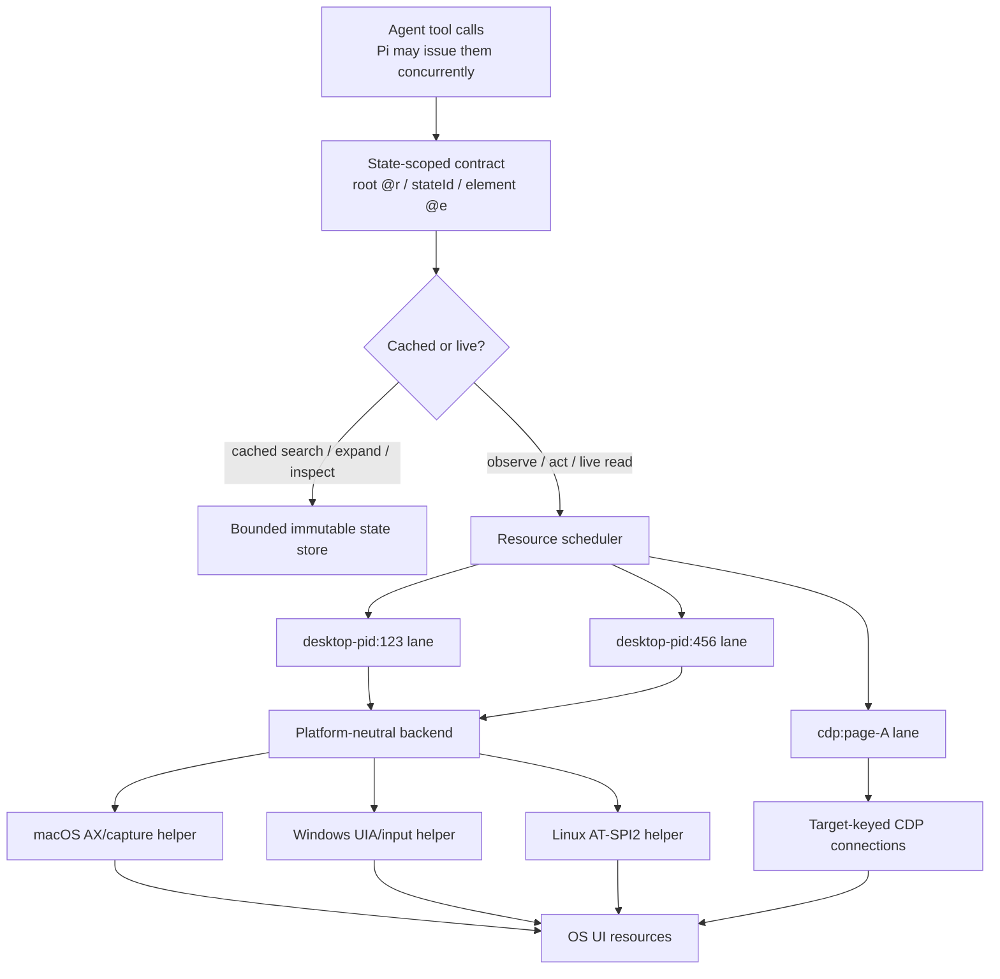

# pi-computer-use

`@nredd/pi-computer-use` lets Pi agents observe and control desktop apps and CDP browser pages.
This workspace is a fork of `injaneity/pi-computer-use`; see [Upstream](#upstream).
Managed browser shutdown shares concurrent cleanup of its temporary profile; failed removal stays
tracked for synchronous exit cleanup. This serializes removal attempts, not a proven fix for a
historical browser-profile leak.

## Install

```bash
pi install npm:@nredd/pi-computer-use
```

macOS 14+ ships per-architecture helpers. Setup installs at `~/Applications/pi-computer-use.app`
(or preserves an existing writable `/Applications/pi-computer-use.app`) and signs locally with the
existing stable keychain identity. Grant Accessibility and Screen Recording to that app. We do not
switch to upstream's CI self-signed bundle: changing signer would require a TCC re-grant.

Linux ships its locked Rust crate source, not a binary. Run inside the graphical user's AT-SPI2
session. Source builds are opt-in with `PI_COMPUTER_USE_ALLOW_BUILD=1`, use the user's cache rather
than the npm install directory, and need Cargo plus a C linker. See the
[Linux guide](#linux). Windows source remains in the repository;
Windows helpers and crate sources are not packed. If the Linux helper's input stream fails, in-flight
requests are rejected and the helper is stopped; a later request starts a fresh helper.
Windows helper commands reject with `Operation aborted.` when their signal aborts after sending,
without waiting for the command deadline. Cancellation clears the local pending request, timer and
listener; late replies are ignored. It does not stop native work already sent or kill the helper.
Deterministic client tests use scripted stdio helpers, not Windows UI or native coverage.

## Windows native helper safety

The native source is `native/windows/bridge-rs/`. This source change is a sibling of the
opt-in WSL transport (#981), not a second transport. It does not enable WSL interop,
install a helper, change accessibility settings or grant privileges. #673 remains release-gating.

- Protocol `4` and architecture `1` remain compatible. Diagnostics advertise
  `capabilities: ["fail-closed-live-target-v1"]`. The coordinated WSL client must require this
  capability before accepting a helper; an owner-pinned SHA alone does not make an older executable safe.
- Ref fallback resolves the observed RuntimeId again, reads current bounds and checks the selected
  window/session/desktop, token integrity and hit-tested ownership before input. Missing, disabled,
  offscreen, occluded, reused or inaccessible elements refuse. No error falls back to screenshot
  coordinates, and no uncertain mutating result is replayed. A reused AutomationId cannot revive a ref.
  A failed pattern-availability query is an error, not an absent pattern or permission to fall back.
  Read-only value patterns refuse before writing. Ref keyboard fallback verifies live keyboard focus;
  text fallback additionally requires an edit
  control. It does not click again after that verification or type into the previously focused field.
- Discovery registers a temporary UIA event listener on the selected subtree and walks raw-view
  children, at most 200 nodes/64 levels with a 1.5-second traversal budget and 500-ms UIA provider
  connection/transaction limits. The listener is removed on scope exit. UIA can exceed a traversal
  budget inside an outstanding provider call; the transport's terminal timeout remains necessary.
  Rich apps that ignore scoped assistive-client discovery still need owner-enabled accessibility.
  The helper NEVER sets the global `SPI_SETSCREENREADER` flag; scoped discovery does not guarantee rich-app labels.
- Startup requires per-monitor-v2 DPI awareness. Geometry stays in physical pixels, including negative
  origins. Restore uses `SW_RESTORE`, never a taskbar toggle. Explicit focus/capture may try one paired
  Alt hint and `BringWindowToTop` under the physical-input lease. Ref action preflight never sends
  that hint: stale or failed hit-testing cannot send even a focus keystroke.
  Window images use selected-window `PrintWindow` rendering, not an occluder's screen pixels. Capture
  requires two matching completed renders, plus changed frame or rectangle evidence after activation
  or restoration, within 1.5 seconds. Missing freshness, moving windows, blank/failed renders and captures
  over 16 million pixels refuse explicitly. A static/background window whose freshness cannot be proved
  may refuse rather than return an old frame.
- Participating native helper processes share a session-local kernel mutex for physical input,
  including restore/focus/capture and complete foreground batches. A foreground batch reserves input
  before live pattern probing, even if its observation advertised usable patterns. Kernel acquisition
  waits at most five seconds.
  Kernel abandonment refuses the waiting action; it never retries the crashed action. Windows releases
  thread ownership on death, but this is NOT a persistent uncertain-delivery fence. The WSL transport's
  retained host-volume lease remains authoritative after cancellation/timeout/helper failure; recovery
  requires the owner's documented review, never automatic lease stealing. No guarantee is made against
  a human, a nonparticipating program or hostile same-user code injecting input.
  Ordinary delivery failures attempt key/button release once. A possibly partial physical-input
  failure, an uncertain UIA mutating-call/read-back failure, or a failed post-delivery delta read terminates the helper without
  acknowledging the request, stops the batch and leaves the
  WSL transport's uncertainty fence intact. It never replays the failed operation. Lost stdout is
  terminal. Every terminal failure cancels admission and allows an active physical operation up to
  two seconds to release keys/buttons before forcing exit; a stuck provider can still leave input
  state uncertain, so the host lease stays fenced. A mismatched `SetValue` read-back is uncertain
  under every policy, never an invitation to retry in the foreground. Stdin EOF cancels queued mutations and stops the helper after at most a two-second
  shutdown grace instead of joining a stuck provider indefinitely. An already admitted action may
  have run, and a forced stop can leave key/button state uncertain. The owner must verify the stopped
  process and input/app state before clearing the retained WSL lease.

Coordinate acts with `preserveFocus` require the target to already be foreground; the option never authorizes input into a background window.

Native `openBrowserLocation` requires an explicit nonempty `appName` matching a discovered browser root; it never types a URL into the first unrelated window.

Build and execute on an authorized Windows checkout, not inside an interop-disabled CI guest:

```sh
rustup toolchain install 1.97.1 --profile minimal --component rustfmt,clippy
cargo +1.97.1 build --locked --release --bin windows-bridge --manifest-path native/windows/bridge-rs/Cargo.toml
cargo +1.97.1 test --locked --all-targets --manifest-path native/windows/bridge-rs/Cargo.toml -- --test-threads=1
cargo +1.97.1 run --locked --release --manifest-path native/windows/bridge-rs/Cargo.toml --example disposable_windows_fixture
```

Native crate tests exercise real kernel input serialization and process-abandonment refusal without
an interactive desktop. The example opens ONLY its own disposable Win32 windows. It exercises scoped
assistive-client-dependent labels, pattern probing, current bounds after layout shifts, one actual
non-invokable click through the actual sibling helper executable's NDJSON `look`/`act` route, removed-ref refusal through that same process, restore, selected-window PNG capture/read-back and refused invalid/PID identities.
It prints the actual observed DPI.
It does not exercise owner apps, credentials, browser debug servers, PowerShell runtime control or WSL
interop. Session 0 or denied `OpenInputDesktop` returns `NATIVE_FIXTURE_UNSUPPORTED` (exit `3`), not
an assertion pass. CI records that exact GUI case as `NOT_RUN_HEADLESS`, separately from native
link/unit proof. Unexpected API failures and fixture assertions still fail the job. Mixed-DPI
and negative-monitor execution remain explicit `NOT RUN` unless an authorized multi-monitor target
runs those cases; portable negative-coordinate tests do not substitute for that execution.

The `windows-helper` job in `.github/workflows/native-helper.yml` links an actual MSVC x64 executable and runs these native
checks on disposable Windows infrastructure. Its `windows-helper-native-<SHA>` artifact contains
`windows-bridge.exe`, `SHA256SUMS`, source/target metadata, compiler log and explicit fixture status/log after a successful build. Failed builds preserve available logs and record `NOT_BUILT`/`NOT_REACHED`, never a usable delivery claim. Download the exact
reviewed commit's artifact, verify `SHA256SUMS` independently and inspect the native log before manually
placing the executable at the owner-controlled path described by #981. This is build delivery, NOT
publication, release acceptance or activation. The unchanged macOS `build` job is separate; its passing result is not Windows link/run proof. Existing Windows LLVM coverage production is unchanged; absent native branch
and statement counters remain unmeasured.

Local Rust tests and Windows-target type checks are NOT Windows link/run proof. The full #673 matrix
still needs an authorized interactive Windows/WSL2 owner: rich-app labels, non-invokable control input,
image read-back, minimized/focus/layout changes, mixed DPI/negative origins, desktop/session/permission
refusals, two actual Pi sessions and retained-lease recovery. No owner target or CI interop is activated.

## Tools

State-consuming desktop tools require an observation; missing or blank `stateId` fails with
`No observation state is available. Call observe_ui first.` The obsolete internal missing-window
guard is removed without changing this boundary (#755).

All platforms retain `find_roots`, `observe_ui`, `search_ui`, `expand_ui`, `inspect_ui`, `act_ui`,
`read_text`, `wait_for`, `launch_browser`, `navigate_browser`, and `evaluate_browser`.
macOS additionally registers `desktop_screenshot` and `desktop_input` (including app activation and
plain-text clipboard access). Desktop tools require `desktop_control: true` and `headless: false`.
Password managers, Keychain Access, terminals and system authentication agents are blocked by default (`app_blocked`, config `blocked_apps`), and the macOS helper refuses UI commands while the session is locked (`screen_locked`); see the [configuration reference](#preserved-configuration).
They share a scoped physical-input lock with `act_ui`; background semantic work stays independent.

The normal loop is find a root, observe it, then query or act from the returned immutable `stateId`.
`observe_ui` now defaults to compact controls; `detail: "outline"` returns the structural view.
Upstream's opt-in `activity_glow` is retained and defaults to false.

On CDP browser states, `act_ui` `moveMouse` requires explicit `x`/`y` coordinates; a `ref`
target fails with `invalid_args` rather than sending absent coordinates. Browser `keypress` requires
a non-empty `keys` array (`invalid_args`). Both checks run before any batch step is delivered or
the observation epoch advances. Desktop ref movement is unchanged.

## Documentation

- [Preserved guides and reference](#preserved-documentation)
- [macOS targeting and carried behavior](#macos-root-targeting)

The upstream website is retired. Its prose is preserved below; source-bound website generators no longer run.
The entry is `src/index.ts`. `test/` stays until #871 converts and moves the tests together.
The integration `local` stack loads this entry from the worktree; `personal` retains
`extensions/computer-use.ts` from published `0.7.0`. Startup timing baselines retain their historical paths.
Build local native helpers with `make bridge`; `build` produces the macOS payload on macOS and is a no-op elsewhere.
The published tarball still includes macOS helpers, built rather than committed.
Upstream sync retirement belongs to #895, independently of this layout change. Historical upstream
prose below is retained verbatim, not a claim that the retired website or sync commands remain supported.

## Checks and release

`npm run check` runs the owned deterministic package checks. Vitest reports native and live suites off
their platform or opt-in as skipped; this package remains outside the coverage gate. Never run
`test/macos-helper-live.test.mjs` on an occupied desktop: it manipulates fixture windows, apps, and the clipboard. It
starts, restarts and stops its own helper instance on the test home's socket, never the shared daemon.
`test/macos-helper-live.test.mjs` and the TCC-granted smoke are owner-only and NOT RUN in CI.

`npm run coverage:rust` needs Rust `1.97.1` with `llvm-tools-preview` and `cargo-llvm-cov` `0.9.1`, with
that rustup toolchain first on `PATH` (never a Homebrew `rustc` sysroot):

```sh
rustup toolchain install 1.97.1 --profile minimal --component llvm-tools-preview
cargo +1.97.1 install cargo-llvm-cov --version 0.9.1 --locked
export PATH="$(dirname "$(rustup which --toolchain 1.97.1 cargo)"):$PATH"
```

`npm run coverage:swift` runs real-source headless motion and native assertions with one Swift
compiler worker. It covers analytic geometry, clock/lifecycle checks and the clamp mutation control.
This does not run the live overlay suite or prove physical pointer behavior.
`native/macos/headless_tests.swift` directly asserts complete `appBlockedMessage` literals for a
named bundle, nil (`unknown bundle id`), an empty bundle and a quoted Unicode application name.
These pure string checks do not discover applications or exercise live refusal callers, UI,
capture, input or permissions. All five production Swift sources stay unchanged. LLVM regions
are not branch outcomes or statements; the full-source producer retains unexecuted live code.

`npm run coverage:swift` links all shipped Swift sources with the headless assertions.
`native/macos/ref_look_tests.swift` checks real `AXRefStore` ownership and snapshots plus
`LookNode.payload()` keys, flags, rectangles and recursive child order. It only constructs
self-process/managed-child AX handles and synthetic nodes, never queries AX attributes.
The child is reaped before assertions; a source-level guard forbids AX queries/actions.
Ordinary regression suites cover window equality, destination ownership, optional flags and child order.
Unexecuted live code stays in the denominator; this slice does not claim whole-file coverage or change
runtime behavior. Upstream pulls are manual; the sync ledger and its mutation runner are retired.
The behavior suites they invoked remain under `test/`, including the async EPERM refusal regression.

`npm test -- test/platform-linux.test.mjs --coverage.enabled=false` uses disposable protocol children, not a native desktop helper. Its closed-stdin
fixture initializes stdout before closing fd `0` (lazy pipe initialization aborts Node 26.12 on Darwin),
acknowledges verified closure while alive, and requires real `EPIPE` rejection plus child cleanup.
The next request carries a 64 KiB payload so Bun also reaches an OS write failure instead of accepting
a small write into its buffer. A successful write callback is not proof of delivery; runtime command
deadlines and error propagation are unchanged. Build-script tests assert the active runtime's executable,
use numeric exit-code sentinels on Node/Bun, and require actual invalid CLI/symlink entries to exit `1`.

The harness root `publish.yml` owns releases; nested upstream workflows are dormant reference source.
Local helper builds and local signing remain unchanged. Source preparation is not activation.

Linux source-build cleanup gives its detached compiler group a bounded TERM/KILL budget. A successful
KILL syscall alone is not treated as success: setup fails if the group cannot be confirmed empty, and
keeps a fresh-probe-guarded exit-time KILL backstop while ownership remains signalable. Only ESRCH
proves quiescence; permission or unexpected syscall errors surface uncertainty and revoke signalling.

## Upstream

Fork of [`injaneity/pi-computer-use`](https://github.com/injaneity/pi-computer-use) (MIT). It is not kept in sync with upstream.

## Signing certificate setup

From this package directory, `make signing-cert OUTPUT_DIR=<output-dir>` still creates
`key.pem`, `cert.pem` and `id.p12` (default `./signing`) for the upstream self-signed release
workflow. Keep those files permanently; this does not guarantee persistent TCC grants.
The existing Node minimum, Bash and OpenSSL requirements are unchanged. The harness release
workflow does not invoke this command or import a signing identity.

`scripts/make-signing-cert.mjs` owns directory/config creation, OpenSSL arguments, failure
propagation and successful cleanup. Tests inject every external command and use disposable
files, never a real identity, Keychain, trust operation or credential prompt. Istanbul measures
only that Node code with L/F/B/S zero thresholds. The Makefile target replaces the shell compatibility launcher; the Bash `read -r -s` password fragment are explicitly **unmeasured shell**, not covered Node
logic. The latter preserves Bash's terminal editing, whitespace, EOF and interrupt semantics
without a new password-input dependency. Remaining shell work belongs to #695.

## macOS root targeting

Carried behavior notes for `@nredd/pi-computer-use`. Root targeting is now based on upstream PR #95.

### Target contract

- A root target is `{ pid, windowId?, rootRef?, windowRef? }`. `windowId` is present only when
  positive. An unpaired root (no matching CG window) has no `windowId`, never `0`.
- `rootRef` and `windowRef` are the same native ref. Every macOS helper call (`look`,
  `focusWindow`, `axWaitFor`) goes through `normalizeTarget()` in `src/platform/macos/backend.ts`,
  which sends only `windowRef`.
- The helper treats `windowId <= 0` as absent. A request with a `windowRef` and no usable `windowId` that no longer resolves fails; it
  never falls back to the app's first window. With a positive `windowId` it still pairs by id.
- Looks remember their `windowRef`, so `act` resolves the root by ref for unpaired roots.

### Capture

- Paired root: semantic and visual observation work.
- Unpaired root: semantic works. Visual `observe_ui` fails with `root_not_capturable`; use `mode: semantic`. The `act_ui` successor capture downgrades to semantic automatically.
  No other window is ever captured in its place.

### Modality

`isModal` is true for: a sheet child, role `AXSheet`, or `AXModal == true`. When the app does not
report `AXModal` at all, a dialog-like role/subrole still counts. An explicit `AXModal == false`
wins: Fusion's BROWSER sidebar (subrole `AXDialog`, `AXModal=0`) is nonmodal.

`act_ui` acts on, and captures the successor of, the root its state belongs to; it does not retarget to
a foreground modal. If a confirmed modal is in front afterwards, the result ends with a `Note:` line
naming it. Other tools (`observe_ui` without a root, `wait_for`, `read_text`) may still prefer a
confirmed foreground modal, so they can disagree with `act_ui` about which root is current.

### Post-action outcomes

Terminal `act_ui` results always say the action was delivered, and:

- `target_closed`, `cause: replaced`, `successors: [...]`: source root gone and new window, dialog or sheet
  roots of the same pid appeared and are still live (menus and popovers do not count). Observe a successor via `find_roots`.
- `target_closed`, `cause: closed`: source root gone, nothing replaced it.
- `post_action_observation_failed` with code `root_stale`: the root is still listed but the helper answers
  `root_not_found` for its ref (matched on the error code, not the message). A failed probe stays generic. Rediscover with `find_roots`.

### Ref lifecycle

Measured, not assumed:
- The helper stores native refs (`w<epoch>-<n>` roots, `e<epoch>-<n>` elements) without TTL or idle exit.
  Look records are capped at 8; element refs are evicted with their owning look, as described below.
  Window refs persist until their AX element dies or the helper restarts. The daemon does not exit when idle.
- Refs carry a per-process epoch, so a ref from before a helper restart never resolves; it used to be possible
  for `w3` from an old helper to name a different window in a new one.
- Helper restarts happen on reinstall, protocol/binary mismatch, permission relaunch. The extension's `@rN`
  records survive them, so `@rN` can outlive its native ref: expect `root_not_found` / "stale", then rediscover
  with `find_roots`. Refs from earlier sessions, pids and state ids are stale.
- Root deltas in `act_ui` results carry helper-native refs until `normalizeRootDeltaRefs()` maps them, once per
  transaction, to the extension's `@rN` for the same root (registered from `listRoots`, keyed by `windowId`, the
  same identity `find_roots` uses). An earlier mapper registered a placeholder record under a different identity, so
  a dialog got `@r2` in the action result and `@r3` from `find_roots`; `test/unpaired-act.test.mjs` guards this and fails
  on the old code. Verified live on Bambu's Open panel (delta `@r2` == `find_roots` `@r2`). A delta whose root is
  gone (`closed`) reuses the existing record, or shows no ref.
- Element refs live as long as their look: the helper keeps 8 look records and drops a look's element refs when it
  ages out (or when the look fails before being recorded). Unowned element refs (one-off element queries) sit in a
  FIFO capped at 1024. Window refs are deduped per window and not evicted (bounded by the number of windows).
  An incremental look (`expand_ui` graft, `baseLookId`) inherits its base look's refs, since the grafted outline
  still uses them. Acting with a current look on a ref whose look aged out fails with `stale_ref`; acting with an
  aged-out look id fails with `stale_look`. Both live-checked in `test/macos-helper-live.test.mjs`, which also fails
  when the base-look transfer is disabled (checked).

### Helper lifecycle

The helper daemon outlives pi, so a reinstall alone leaves old code running. Two guards:
- `scripts/setup-helper.mjs` stops the running helper (`pkill -f '<bridge> serve'`) whenever it replaces the bundle
- `ensureProtocol()` restarts a daemon whose process started before the installed binary was written (`helperPredatesBinary`)

### Whole-desktop control

Both tools exist on macOS only, serialize behind one lock, and refuse when `headless` is true or
`desktop_control` is false (`PI_COMPUTER_USE_DESKTOP_CONTROL=0`). They are on by default.

`desktop_screenshot` captures a full display (cursor included, `display` 0 is main) and states the
image-to-point mapping. `desktop_input` posts physical HID input in global points: `moveMouse`,
`click`, `scroll`, `drag`, `typeText`, `keypress`. It moves the real cursor and types into whatever has
focus, so verify with a screenshot. Input goes to the *frontmost app*: raising a window
inside a background app is not enough (`focusWindow` can report `focused` while another app is frontmost),
so call `activateApp` first.

Non-pointer actions on the same tool:
- `activateApp { app }`: bundle id, then display name, then executable name (`ambiguous_app` when two running apps
  share the winning name; paths are rejected). Launches the app when not running and fails with
  `activation_failed` unless it is frontmost within 5s; `app_not_found` when neither running nor installed. It runs
  `/usr/bin/open <bundle>` as a killable subprocess: AX `AXFrontmost` and `NSRunningApplication.activate` were
  refused from the background helper live (macOS 14+ cooperative activation), and an in-process
  `NSWorkspace.openApplication` hung in `_sandbox_extension_issue` and wedged the daemon. Unbundled executables
  get AX + `activate()` only.
- `readClipboard`: plain text only, capped at 100k characters (`truncated`); non-text gives `clipboard_empty`. The
  result is fenced in `<clipboard>` and labelled as data, since it can hold anything (including secrets) and is
  gated only by `desktop_control`.
- `writeClipboard { text }`: replaces the clipboard with plain text.

`scroll` follows macOS natural scrolling: `scrollY: -5` arrives as a positive delta. Prefer `act_ui` for controls reachable by ref. Helper commands:
`captureDisplay`, `desktopInput` (wire actions `type`/`key`). Needs Screen Recording and Accessibility.

### Tests

`npm test -- test/macos-observe-target.test.mjs --coverage.enabled=false`, `test/macos-native-pure.test.mjs` (links all five production Swift files into the headless assertion binary),
`test/act-outcomes.test.mjs`, `test/desktop-tools.test.mjs`, `test/unpaired-act.test.mjs` (stubbed backend: unpaired successor, delta refs, lock
scope). `PI_COMPUTER_USE_LIVE=1 npm test -- test/macos-helper-live.test.mjs --coverage.enabled=false` drives the real helper against an `NSAlert` fixture
(`windowElement`, `look`, `act`, `axWaitFor`, `desktopInput` parsing, `activateApp`, clipboard round trip with
restore, ref epoch across a restart, look-scoped ref eviction). It restarts only its own helper instance, launched
from the installed bundle on the isolated test home's socket.

### Real GUI validation

Run 2026-10-07 against existing Fusion (pid 32012) and Bambu Studio (pid 65354), fork `v0.5.1-nredd.1`
(`2c3dd8b`). Gotcha: the helper process started before the rebuilt binary was installed kept running
the old code; the sidebar still showed `modal` until the helper was killed and respawned.

Worked:
- Fusion BROWSER sidebar (`AXDialog`, `AXModal=0`, pairing low/10): `modal` on 0.5.1, nonmodal on the fork.
  Semantic observe of it works.
- `act_ui` press on the main window while the sidebar was up: delivered to the main window and the
  returned state was the main window (`@r2`), not the sidebar. Used the already selected Py radio, no
  design change.
- Bambu Cmd+O raised an "unsaved changes" prompt (`dialog`, modal, exact pairing). Escape cancelled it.
  `act_ui` reported the source root closed with no successor (`cause: closed`) and no fabricated state.
- Stale and bogus refs (`@r16` after the dialog closed, `@r99`) fail with a clear "stale" / "not available
  in this session, call find_roots" error.

Observed, not fixed:
- observe on a root ref can return a different `@r` (`@r16` -> `@r17`). Root cause found later: action results
  printed helper-native refs; fixed by `normalizeRootDeltaRefs()` (see Ref lifecycle).

Not validated:
- An unpaired dialog (no `windowId`): none was available, every dialog seen paired. The `windowRef`
  forwarding and `root_not_capturable` paths are covered by unit tests only.
- `root_stale` and `cause: replaced` on a live app; ref expiry after long gaps (no TTL measured).
- Fusion batch (Py via SPACE, click console, type, RETURN) was not re-run.
- Bambu Cmd+I/Cmd+N dialogs.

#### Whole-desktop tools (live, 2026-10-07, two displays, unreleased build)

Worked:
- `captureDisplay` on both displays (main 2560x1080 at 0,0; second 1920x1080 at 341,-1080, i.e. negative y); bad display index -> `display_not_found`
- `desktopInput` `moveMouse` lands exactly, including negative y on the second display; the returned `mouse` is read back in the same top-left global space
- In a scratch TextEdit document: click, unicode typing, `return`, `cmd+a`, `delete`, triple-click, drag-select (selected text confirmed via AX), scroll
- Invalid actions and arguments fail with `invalid_args`

Bugs found by the live run and fixed:
- Returned `mouse` came from `NSEvent.mouseLocation` (bottom-left origin) and was read before the move settled; now `CGEvent(source: nil).location` after a short settle
- Drags posted one event per waypoint; they now interpolate (<=12pt steps) with click state set


#### Later live results (2026-10-07, final helper)

- Second display (global origin 341,-1080), via a probe window that logs the events it receives (`scripts/fixtures/event-probe.swift`): left,
  right and middle clicks, double click, unicode typing, `cmd+k` (command flag set) and scroll all arrive at the exact global
  coordinates sent, including negative y.
- Multi-waypoint drag selects text in TextEdit; a rejected drag leaves no button held.
- Real modal `NSAlert` (`scripts/fixtures/alert-app.swift`): ref-only observe works, visual gives `root_not_capturable`,
  `act` press by ref dismisses it; the `act_ui` dismissal reports `target_closed`. Opt-in script: `PI_COMPUTER_USE_LIVE=1 npm test -- test/macos-helper-live.test.mjs --coverage.enabled=false`.
  It fails when `windowElement` is mutated to always fall back to the first window (checked).
- Fusion with the sidebar up: Py radio via SPACE, then click console field + `print(1)` + RETURN in one batch; the console shows `1`.
- Bambu Cmd+I: `act_ui` reports `New root: dialog "Open" (modal)` and a `Note:` that a foreground modal is in front. Background-delivered Escape
  returned outcome `unknown` and did not dismiss the panel; physical Escape via `desktop_input` did, once Bambu was frontmost.
- `activateApp` TextEdit, cmd+n, `writeClipboard`, cmd+v: the scratch doc's AX value is the clipboard text (incl. `é`);
  closed without saving, clipboard restored. Driven by the helper only, no AppleScript (`osascript` from a terminal
  triggers an Automation prompt per target app).
- `activateApp` launched Calculator (not running) and switched Finder <-> TextEdit; unknown names -> `app_not_found`.
- `desktop_input` moves running concurrently with a background `act_ui` click on Fusion: both completed, no errors.
- No natural unpaired dialog was found (the alert and Open panel pair with `low`/`exact`). The unpaired path is covered by the ref-only live
  runs above and by `test/unpaired-act.test.mjs` (stubbed backend).

Notes: desktop tools and `act_ui` share one lock. An `act_ui` transaction takes it lazily at its first foreground
(physical HID) step (the `needsForeground`/current-focus case, the side-effect-free foreground retry, the
`foreground_required` fallback) and keeps it until the transaction ends, so a later step relying on focus set by an
earlier one is never interleaved with `desktop_input`. Transactions that stay background/pid/AX never take it. Lock order is window write lock, then
desktop lock; the desktop tools take only the desktop lock. A queued call that is aborted never runs. A restart is triggered when the
helper process started before the installed binary's `ctime`, so anything that touches the binary's metadata
costs one helper restart (and invalidates native refs) at the next session start.

## License

MIT, retaining upstream's copyright in `LICENSE`.


## Preserved documentation

The following source documents are retained verbatim as historical reference. Website commands,
relative website links and generated source paths below describe the retired upstream site, not
supported harness commands. Use the current install/build instructions above.

<!-- Preserved from CONTRIBUTING.md -->

# Contributing

Thanks for helping improve `pi-computer-use`.

## Before you start

Open an issue before starting work. Use it to agree on scope, validation, and any user-facing behavior changes.

## Setup

```bash
npm install
npm test
```

Run this checkout in Pi:

```bash
pi --no-extensions -e .
```

If you change native code, rebuild the helper:

```bash
npm run build:native
```

macOS permissions should normally be granted to:

```text
~/Applications/pi-computer-use.app
```

Existing writable system-wide installs remain at `/Applications/pi-computer-use.app`.

## Validation

Use the smallest check that proves the change:

- Documentation changes: run `npm run docs:check`, proofread changed files, and check touched links or commands.
- TypeScript or schema changes: run `npm test`; if the public tool definition changed, run `npm run docs:generate` first.
- Native helper changes: run `npm run build:native` and `npm test`.
- Behavior changes: run `cubench` against the registered extension tools.

The in-repo legacy benchmark harness was removed because it targeted old direct action tools. Use `cubench` for behavioral validation.

## Commit messages

Use a capitalized imperative subject, at most 72 characters, with no trailing period and no conventional-commit prefix (`feat:`, `fix(scope):`). The root `make check-commits` target enforces this independently of package checks.

Examples:

```text
Add label association to scene output
Document strict AX env vars
Simplify the public tool surface
```

Check a range locally with:

```bash
make -C ../.. check-commits COMMIT_RANGE=<base>..<head>
```

## Pull requests

A PR should include:

- the linked issue
- a short description of the user-facing change
- permission, browser, or strict AX impact if relevant
- validation results

Keep unrelated formatting out of the PR. Commit generated reference changes when their source definition changed so CI can verify that the two remain synchronized.

## AI-assisted work

If AI tools helped produce the PR, include the thread or transcript so reviewers can see the context.

## Releases

Release notes use [`notes/release-template.md`](./notes/release-template.md). Maintainers handle releases.


<!-- Preserved from docs/README.md -->

# Documentation website

This directory contains the Next.js and Fumadocs application used to render the pi-computer-use documentation website. The content, navigation, generated references, and visual system are maintained specifically for pi-computer-use.

## Run locally

From the harness repository root, enter the imported package and install the website dependencies once:

```bash
cd packages/computer-use
npm install --prefix docs
```

Run all remaining commands from `packages/computer-use`, not the harness repository root.
Start the preview:

```bash
npm run docs:dev
```

Open http://localhost:8080/docs.

Build and validate it with:

```bash
npm run docs:build
npm run docs:site:check
```

## Content model

Public content lives in `content/docs/` and follows Diátaxis:

- `tutorials/` teaches through a guided first success.
- `how-to-guides/` gives steps for one operational goal.
- `explanation/` builds understanding of architecture and tradeoffs, organized by runtime concern.
- `reference/` provides exact interface, configuration, and platform lookup, organized by implementation boundary.

Navigation opens only the active branch. Platform reference should expose concrete subsystems rather than hiding them in one page; for example, macOS separates Accessibility and AX, capture and OCR, actions and input delivery, and the complete implementation inventory.

Every page below `reference/` is generated. Exact tool schemas come from `../extensions/computer-use.ts`; behavioral reference prose is extracted from marked documentation blocks in the source file that owns the behavior; navigation and the codebase inventory are derived from generator metadata and the repository tree. `../scripts/docs-generators/reference-evidence.json` independently lists required source symbols. Run `npm run docs:generate` after changing code-owned reference documentation, and `npm run docs:check` to detect output or evidence drift.

## Visual system

The website uses the quiet systems language: near-black olive surfaces, warm off-white text, sparse amber and green signals, square geometry, technical mono labels, condensed display typography, and a restrained 12-column editorial rhythm. Structure and reading order take priority over decoration.

Theme implementation lives in `src/app/global.css`. Keep new components responsive, maintain 44px interaction targets, and respect reduced-motion preferences.


<!-- Preserved from docs/content/docs/explanation/action-pipeline.mdx -->

---
title: 'Action execution and evidence'
description: 'How intent is validated, grounded, delivered, checked, and converted into one immutable successor state.'
---

An action is not considered successful merely because an input API accepted it. The runtime separates intent, delivery, and evidence so uncertain effects remain explicit.

## Ownership by layer

[`src/actions.ts`](https://github.com/injaneity/pi-computer-use/blob/main/src/actions.ts) validates action shapes, normalizes intent, resolves targets, tracks dependent focus, and decides whether retry is safe. [`src/bridge.ts`](https://github.com/injaneity/pi-computer-use/blob/main/src/bridge.ts) validates state ownership, acquires the resource lane, and coordinates the transaction. The selected platform backend grounds coordinates and refs, performs preflight, delivers input, and gathers evidence.

```text
intent → state validation → resource lock → grounding → preflight → delivery → evidence → successor observation
```

## Dependent transactions

One `act_ui` call can contain several ordered steps when no intermediate observation is required. The transaction validates one base state, stays inside one resource lane, and stops at the first failed or invalidated step. Partial results identify the checked boundary, after which the caller must observe again.

Focus established by an editable click can carry into a following unscoped typing step. This dependency is transaction-local rather than a mutable global focus assumption.

## Delivery versus success

Backends report `worked`, `didnt`, or `unknown`. Read-back values, selection changes, focused-window changes, sheets, and root deltas can provide evidence. A posted pointer or keyboard event alone may remain unknown.

Optional `expect` conditions add semantic evidence such as text or a role appearing or disappearing. A failed postcondition changes the outcome to `didnt`; event delivery is not upgraded to success.

## Retry safety

A retry is allowed only when checked evidence shows that the earlier attempt had no effect and the next strategy is policy-compliant. Ambiguous pointer outcomes are not replayed because duplicate delivery could produce a second side effect.

Platform mechanisms differ. The macOS backend can use AX operations, background `CGEvent` delivery, or controlled foreground fallback; [Actions and input delivery](../reference/platforms/macos/actions.mdx) documents that strategy. Windows uses UIA and native input while preserving the same outcome contract.

## Successor state

After execution settles, the backend observes one final root state. The runtime stores that complete immutable successor and renders a compact diff only when identity confidence and change size make the diff trustworthy. Otherwise it returns a folded full view.


<!-- Preserved from docs/content/docs/explanation/architecture.mdx -->

---
title: 'Architecture'
description: 'How immutable UI state, resource scheduling, observations, and checked actions fit together.'
---

`pi-computer-use` exposes one state-scoped interface for desktop and browser UI:

```text
find roots → observe one root → search/expand/inspect its state → act from that state
```

The agent still sees a multi-root forest. `find_roots` returns stable root refs (`@rN`) for desktop windows, transient surfaces, and CDP pages. Observing one root produces an immutable element tree whose refs (`@eN`) belong only to that returned `stateId`. Progressive disclosure is unchanged: the first view lists actionable controls, while `search_ui`, `expand_ui`, and `inspect_ui` query the full stored tree.

## Runtime model

Every live request follows one path:

```text
load saved state → prepare actions → run → observe → save → show changes
```

The implementation keeps that ownership explicit:

| Module | Owns |
|---|---|
| `state.ts` | Saved UI states, request-local state, restoration, and serialization |
| `actions.ts` | Validation, normalization, target resolution, dependent focus, and safe retry eligibility |
| `bridge.ts` | Tool coordination and resource scheduling |
| `view.ts` | Stable public refs and full-versus-changes rendering |
| `outline.ts` | Parsing and querying complete UI trees |
| `platform/*` | OS observation, input mechanics, and native protocol translation |



There is no session-wide current UI. Every call hydrates request-local state from `stateId`; unrelated calls cannot overwrite one another. Stored observations are immutable and bounded, so old refs either resolve to their exact observation or fail clearly after eviction.

The scheduler serializes live operations only when they address the same physical resource. Different desktop processes and different CDP targets can run concurrently. Cached outline queries bypass it entirely. Every resource has a monotonically increasing epoch. A mutating call must present the epoch captured by its state; if another write won the race, the stale call is rejected before dispatch.

Desktop scheduling is conservatively keyed by process rather than window because accessibility focus, menus, and physical input can cross window boundaries inside an app. CDP scheduling is keyed by page target. Global physical input remains mutex-protected in the native helper; semantic AX/UIA work can overlap where the platform permits it.

## Observation and progressive disclosure

`observe_ui` asks the selected backend for one look. A desktop look combines root identity, accessibility structure, optional image evidence, OCR boxes when required, and capture metadata. A browser look converts the CDP accessibility tree into the same serialized outline shape.

The bridge stores the complete observation and returns a compact control list; `detail: "outline"` and `expand_ui` render the folded tree. The state owns its refs:

```text
@r3 browser page
  state A (epoch 4)
    @e1 document
    @e7 button

@r8 desktop window
  state B (epoch 2)
    @e1 application
    @e12 text field
```

`search_ui` and ordinary inspection are pure cached queries. A live escalation such as OCR or a refreshed truncated region is epoch-checked and resource-scheduled. It cannot silently graft data across a concurrent mutation.

## Acting and batching

`act_ui` runs one dependent action list:

```ts
act_ui({
  stateId,
  actions: [
    { action: "setText", ref: "@e12", text: "hello" },
    { action: "press", ref: "@e18" },
  ],
})
```

Transactions may include a semantic postcondition:

```ts
act_ui({
  stateId,
  actions: [{ action: "press", ref: "@e9" }],
  expect: { text: "Saved", timeoutMs: 3000 }
})
```

With a postcondition, the backend waits for the requested text or role to
appear (or disappear with `gone: true`) before reporting success. It records
whether the condition was newly verified, already present before delivery, or
failed. A failed postcondition changes the execution outcome to `didnt`; event
delivery alone is never treated as semantic success.

One action is represented by an array of length one. A multi-action transaction is appropriate only when no intermediate observation is needed. The runtime validates one base state, acquires one resource lane, and sends the steps as one native helper transaction. The helper captures one pre-transaction root baseline, executes and verifies steps in order, and stops on the first failed or invalidated step. Partial results include `stoppedAt`, so callers know the exact checked boundary and must re-observe before continuing. The helper performs one final root-delta settle and the bridge produces one final observation. There is no alternate sequential protocol. This is not a mechanism for parallel actions within one UI resource.

The bridge resolves model intent; the backend/helper owns grounding, preflight, delivery, and evidence. Accessibility capabilities choose an initial strategy but are not treated as proof that the intended result occurred. Editable-region clicks establish foreground focus for following unscoped keyboard steps in the same transaction. Raw coordinates are tied to the image-bearing state that produced them. Web-backed editable controls use atomic keyboard events and web-backed buttons use pointer events so application state receives normal input events rather than only a changed AX value. A helper result reports `worked`, `didnt`, or `unknown`, including evidence and shallow root changes where available. The [macOS implementation reference](../reference/platforms/macos/actions.mdx) documents that backend's exact Accessibility, web-control, and synthesized-event paths.

With `headless: true`, the background boundary is strict: Pi must never activate or raise an application, change the user's focused window, move the global cursor, post synthesized input, or display the agent cursor or activity glow. On macOS, the helper rejects any action that would need synthesized pointer or keyboard input with `foreground_required`, and the bridge returns that error instead of retrying in the foreground ([macOS actions reference](../reference/platforms/macos/actions.mdx#headless-policy)). With `headless: false` (the default), credible semantic activation may begin in the background, editable clicks preserve the focus they establish for following unscoped keyboard input, and keyboard input with a checked `didnt` result may retry in the foreground because the first attempt proved side-effect-free. Focus-preserving native keyboard requests do not raise or re-focus the outer window between semantic activation and event delivery; canvas editors such as PowerPoint otherwise collapse an inner text editor back to placeholder selection. Ambiguous pointer outcomes are never replayed. On macOS, `cursor_overlay` schedules a visual, noninteractive overlay separately from action delivery for non-headless background pointer actions; foreground HID actions use only the physical cursor, and the overlay is currently main-display-only ([macOS implementation reference](../reference/platforms/macos/actions.mdx#agent-cursor-overlay)). With `activity_glow: true` (default `false`), non-headless macOS sessions hold a persistent helper connection that owns a click-through border on each screen until the agent run ends. The helper combines active connections and removes their state on disconnect.

The `headless` configuration option determines whether foreground execution is prohibited. Fallback-capable multi-action calls execute one checked action at a time, retain click-established focus, and stop on a checked `didnt`; strict-headless calls retain native transactional batching.

## Successor diffs

Complete observations remain immutable and bounded internally. The initial observation renders the compact control list. After a mutation, `view.ts` stabilizes public refs using confident native identities, saves the complete resulting state, and compares it with the base state. Small trustworthy results render `added`, `updated`, and `removed` nodes plus the next `stateId`. Root appearance, closure, and focus changes remain part of the run result.

Diff rendering falls back to the compact control list when the root identity changes, too few successor nodes can be matched confidently, or the change budget would make a patch less useful than the full view. Cached queries always operate on the complete stored state, never on a partially applied model-side tree.

## Browser support

Browser pages are roots, not a second agent-facing context hierarchy. `launch_browser` returns browser-page `@r` refs; `observe_ui` returns their normal outline and `stateId`. `read_text`, `wait_for`, `act_ui`, `navigate_browser`, and `evaluate_browser` derive the CDP target from that state. Internal CDP target identifiers never need to be copied between public tools.

## Native transports

The macOS socket server and Windows line protocol accept multiple in-flight requests and correlate responses by request id. macOS protects shared AX ref/look stores and the root-event sequence; Windows uses a fixed worker pool and initializes UIA per worker thread. Both platforms keep eight immutable native look records and serialize global synthesized input. Target focus, bounded occlusion preflight, and event delivery share that same critical section; another worker cannot change the foreground between validation and delivery. UIA-only Windows batches do not acquire the global input lock, while any batch that may fall back to pointer or keyboard delivery holds it for the complete transaction. Further event-delivery and occlusion details live in the [macOS implementation reference](../reference/platforms/macos/implementation.mdx) and [Windows bridge reference](../reference/platforms/windows.mdx).

The Linux helper is a local JSON-lines child process with correlated concurrent requests. It snapshots roots over AT-SPI2 and attempts semantic `Action`/`EditableText` delivery first. On X11, EWMH enriches root identity/focus, XComposite (with `GetImage` fallback) supplies PNG capture, and non-headless policies may use serialized XTEST physical input. Strict headless/background policy blocks XTEST and focus. Wayland diagnostics only reads portal version and capability properties; no portal session, capture, or input path is implemented. The [Linux support guide](../how-to-guides/linux.mdx) lists the exact capability matrix.

Windows UIA extraction is bounded. When the native limit omits descendants, the nearest retained ancestors are marked `truncated`; `expand_ui` performs a scoped look and the helper carries forward the untouched refs into the new immutable look record. Windows root deltas combine an event journal with authoritative before/after snapshots. `SetWinEventHook` accelerates settling and retains short-lived root transitions, while snapshots remain the source of truth for persistent state.

## Preventing platform drift

Platform parity is defined by invariants, not matching source structure. Every helper reports an `architectureVersion` and the invariant set it implements. Startup fails closed if either helper omits a required invariant. The TypeScript backend interface and conformance check additionally require both platforms to expose the same observation, text ownership, batching, and lifecycle operations.

Changes to a native backend should therefore include three layers of evidence:

1. shared contract tests for request and response semantics;
2. target-native compilation and deterministic native unit tests;
3. the same black-box Cubench properties on an interactive host for that platform.

OS-specific mechanisms can differ—Accessibility, Core Graphics, ScreenCaptureKit, Vision, and AppKit on macOS; UIA and Windows capture/input APIs on Windows; AT-SPI2 plus optional X11 EWMH/XComposite/XTEST on Linux—but state ownership, bounds, progressive disclosure, transaction boundaries, and honest outcomes may not. The [macOS implementation reference](../reference/platforms/macos/implementation.mdx) records the current API choices, delivery policies, evidence boundaries, and known limits so this explanation does not duplicate platform claims. The agent-cursor overlay lives inside the existing helper because native action grounding owns the final screen point; keeping it there avoids a second coordinate transform or public cursor tool surface. The helper's socket server runs off the main thread while AppKit owns the main run loop, and the helper excludes its click-through overlay from root discovery. Cursor animation is observational: newer actions may supersede an in-flight path, but rendering never blocks action delivery or verification.

## Design constraints

- Preserve the multi-root forest and progressive disclosure.
- Make state ownership explicit; never depend on a mutable session-wide current UI.
- Reject stale writes before dispatch using resource epochs.
- Serialize by physical resource, not by tool name or whole session.
- Prefer platform semantics as the cheapest credible attempt, then trust verified outcomes over advertised capabilities.
- Preserve focus established by one transaction step for dependent keyboard steps.
- Store full immutable states and render the smallest trustworthy resulting view.
- Keep observation compact and expand locally.
- Let the backend/helper own action grounding and verification.
- Keep platform mechanisms behind the platform-neutral seam.
- Treat batching as one-resource transaction amortization, not a separate execution architecture.
- Fail closed when an action outcome is uncertain; a later call must observe again.


<!-- Preserved from docs/content/docs/explanation/index.mdx -->

---
title: 'Overview'
description: 'Understand why pi-computer-use uses immutable state, resource scheduling, progressive disclosure, and checked execution.'
---

Explanation pages build a mental model of the system. They answer why the runtime is structured this way; use [reference](/reference) when you need exact APIs, options, platform mechanisms, or limits.

## Start with the system view

- [Architecture](./architecture.mdx) — how the complete runtime fits together.

## Follow a runtime concern

- [State ownership and scheduling](./state-and-scheduling.mdx) — `state.ts`, resource epochs, concurrency, and stale-write rejection.
- [Observation and progressive disclosure](./observation-pipeline.mdx) — platform observations, `outline.ts`, immutable storage, folded views, and scoped expansion.
- [Action execution and evidence](./action-pipeline.mdx) — `actions.ts`, bridge coordination, native delivery, checked outcomes, and successor states.
- [Platform boundary](./platform-boundary.mdx) — how the shared runtime delegates to macOS, Windows, Linux, and browser backends without pretending their APIs are identical.

If your question names a concrete operating-system API—such as macOS AX, ScreenCaptureKit, or Windows UIA—go directly to [platform reference](/reference/platforms).


<!-- Preserved from docs/content/docs/explanation/observation-pipeline.mdx -->

---
title: 'Observation and progressive disclosure'
description: 'How platform observations become complete immutable trees, compact outlines, local queries, and image evidence.'
---

Observation separates what the runtime stores from what it initially shows the agent. The backend collects a complete bounded state, while the first response folds that state into a compact outline.

## Pipeline

```text
platform root → semantic tree + optional image → normalized outline → immutable state → folded response
```

The main ownership boundaries are:

- [`src/platform/`](https://github.com/injaneity/pi-computer-use/tree/main/src/platform) retrieves platform-specific roots, semantic structure, text, images, and native metadata;
- [`src/outline.ts`](https://github.com/injaneity/pi-computer-use/blob/main/src/outline.ts) parses and queries complete outline trees;
- [`src/state.ts`](https://github.com/injaneity/pi-computer-use/blob/main/src/state.ts) stores the immutable result;
- [`src/view.ts`](https://github.com/injaneity/pi-computer-use/blob/main/src/view.ts) produces stable public refs and compact renderings.

## Progressive disclosure

`observe_ui` returns enough ancestry and local detail to orient the agent without dumping every descendant. `search_ui`, `expand_ui`, and `inspect_ui` query the complete saved tree, so folding affects presentation rather than data ownership.

Most of those queries are pure and cached. A request that needs fresh OCR or recovery of a truncated region becomes a live, epoch-checked observation and produces a new state instead of mutating the old one.

## Semantic and visual evidence

Desktop observations can combine an accessibility tree with an optional image. Visual OCR boxes supplement sparse semantic trees but do not acquire native action capabilities. Browser observations normalize the CDP accessibility tree into the same agent-facing outline model.

On macOS, AX extraction and image capture are separate subsystems; use [Accessibility and AX](../reference/platforms/macos/accessibility.mdx) or [Capture and OCR](../reference/platforms/macos/capture.mdx) for exact behavior. Windows uses UI Automation extraction and its native capture path.

## Bounded completeness

A platform walk can stop at implementation limits. Rather than implying completeness, the nearest retained ancestor is marked `truncated`. Scoped expansion can then retrieve the missing region into a successor state while preserving unaffected identities where confidence allows.

Continue to [State ownership and scheduling](./state-and-scheduling.mdx) for concurrency rules or [Action execution and evidence](./action-pipeline.mdx) for mutation.


<!-- Preserved from docs/content/docs/explanation/platform-boundary.mdx -->

---
title: 'Platform boundary'
description: 'How the shared runtime delegates observation and input to macOS, Windows, Linux, and browser backends without hiding platform differences.'
---

The agent contract is shared, but operating-system mechanics are not forced into identical source structures. A platform-neutral seam keeps state ownership and outcomes consistent while allowing each backend to use credible native APIs.

## Shared contract

[`src/platform/types.ts`](https://github.com/injaneity/pi-computer-use/blob/main/src/platform/types.ts) defines the backend operations consumed by the runtime. Shared TypeScript code owns public refs, state IDs, resource epochs, action intent, and result rendering. Backends own native root enumeration, observation, coordinate grounding, delivery, and platform evidence.

## macOS path

[`src/platform/macos/`](https://github.com/injaneity/pi-computer-use/tree/main/src/platform/macos) manages helper lifecycle, permissions, and protocol translation. [`native/macos/bridge.swift`](https://github.com/injaneity/pi-computer-use/blob/main/native/macos/bridge.swift) integrates Accessibility, Core Graphics, ScreenCaptureKit, Vision, AppKit, and synthesized events.

The macOS reference is organized by those implementation subsystems:

- [Accessibility and AX](../reference/platforms/macos/accessibility.mdx)
- [Capture and OCR](../reference/platforms/macos/capture.mdx)
- [Actions and input delivery](../reference/platforms/macos/actions.mdx)
- [Complete implementation reference](../reference/platforms/macos/implementation.mdx)

## Windows path

[`src/platform/windows/`](https://github.com/injaneity/pi-computer-use/tree/main/src/platform/windows) translates the shared contract to the Windows native bridge. UI Automation provides semantic extraction and actions, while the helper owns Windows capture, input, event journals, and authoritative snapshots. Exact protocol behavior is in the [Windows bridge reference](../reference/platforms/windows.mdx).

## Linux path

[`src/platform/linux/`](https://github.com/injaneity/pi-computer-use/tree/main/src/platform/linux) translates the shared contract to the Rust helper in [`native/linux/bridge-rs/`](https://github.com/injaneity/pi-computer-use/tree/main/native/linux/bridge-rs). AT-SPI2 provides semantic extraction and actions on every session; X11 adds EWMH window metadata and focus, XComposite capture, and policy-gated XTEST input, while native Wayland stays semantic-only. The capability matrix is in the [Linux support guide](../how-to-guides/linux.mdx).

## Browser path

Browser pages are roots in the same multi-root forest. CDP accessibility trees become normal outlines, and page-target identity supplies the resource key. Browser tools derive the internal CDP target from public root or state ownership rather than asking the agent to manage protocol identifiers.

## Parity without pretending equivalence

Platform parity means preserving shared invariants: immutable states, bounded observations, honest truncation, checked transactions, resource ordering, and explicit uncertainty. It does not mean claiming that AX, UIA, and AT-SPI2 expose identical roles, actions, window identity, or capture behavior.


<!-- Preserved from docs/content/docs/explanation/state-and-scheduling.mdx -->

---
title: 'State ownership and scheduling'
description: 'Why observations are immutable, refs are state-owned, and live work is serialized by physical resource.'
---

The runtime has no session-wide “current UI.” That choice prevents one concurrent tool call from silently changing the meaning of refs used by another call.

## State ownership

[`src/state.ts`](https://github.com/injaneity/pi-computer-use/blob/main/src/state.ts) owns saved observations, request-local hydration, restoration, and bounded storage. An `@e` ref belongs to exactly one `stateId`; it is meaningful only inside that immutable observation. [`src/view.ts`](https://github.com/injaneity/pi-computer-use/blob/main/src/view.ts) assigns public refs and renders either a full view or a trustworthy successor diff.

Tool results in the Pi session file carry only `stateId` and `lookId`, never the outline. [`src/outline-store.ts`](https://github.com/injaneity/pi-computer-use/blob/main/src/outline-store.ts) writes each `observe_ui`/`act_ui` outline to `<agent dir>/cache/pi-computer-use/outlines/` (owner-only, newest 512 states across sessions), and session restore reads it back by `stateId`. A state whose entry was evicted is not restored, so using its `stateId` fails with the usual unavailable-or-evicted error and the root must be observed again. Sessions written before the store embedded the outline in `details.outline` and still restore from it.

This produces a simple rule: cached reading can reuse a state, but mutation must prove that the state still represents the resource epoch from which it was observed.

## Resource scheduling

[`src/bridge.ts`](https://github.com/injaneity/pi-computer-use/blob/main/src/bridge.ts) coordinates live work by physical resource rather than by tool name or whole session.

- desktop work is conservatively keyed by process because focus, menus, and input can cross windows inside one app;
- browser work is keyed by CDP page target;
- cached search, expansion, and ordinary inspection do not enter a live resource lane;
- global synthesized input remains serialized by the native helper.

Independent apps and browser pages can therefore progress concurrently, while operations that could interfere with one another remain ordered.

## Epoch checks

Each resource has a monotonically increasing epoch. A mutating call presents the epoch captured by its base state. If another mutation has already advanced the resource, the stale call is rejected before delivery and the caller must observe again.

This is stricter than checking whether a window still exists: the root may remain present while its actionable state has changed.

## Why immutable states matter

Immutability enables deterministic cached queries, explicit stale-state errors, safe parallelism across unrelated roots, and successor diffs that compare two complete observations. It also keeps recovery honest: the runtime never patches a partially trusted model-side tree and calls it current.

Continue to [Observation and progressive disclosure](./observation-pipeline.mdx) for how a complete state is built, or [Action execution and evidence](./action-pipeline.mdx) for how a state becomes a checked successor.


<!-- Preserved from docs/content/docs/how-to-guides/develop-and-validate.mdx -->

---
title: 'Develop and validate changes'
description: 'Repository layout, validation, native helper development, and release signing.'
---

Run package-relative commands below from `packages/computer-use`, not the harness root.
Use `npm run check` for the complete owned package gate (`npm test` below is its upstream test portion).

## Repository layout

```text
extensions/computer-use.ts       Public Pi tool registration
src/bridge.ts                    TypeScript runtime and tool implementation
src/actions.ts                   Action preparation and result reconciliation
src/runtime.ts                   Immutable state store and resource scheduler
src/state.ts                     Saved UI state ownership and restoration
src/view.ts                      Stable refs and resulting-state change views
src/outline.ts                   Outline parsing, folding, control lists, search, and ref mapping
src/outline-store.ts             Disk store of observation outlines, kept out of the session file
src/note.ts                      Disposable running-note generation
native/macos/bridge.swift        macOS helper for AX, capture, permissions, and input
native/macos/activity_glow.swift macOS activity indicator windows and client ownership
native/windows/                 Windows backend/helper code when developing on Windows
native/linux/bridge-rs/         Linux AT-SPI2 helper (Rust)
scripts/build-native.mjs         macOS helper build script
scripts/setup-helper.mjs         macOS helper install script
test/*.test.mjs                  Vitest suites, e.g. invariants and runtime concurrency
scripts/check-*.mjs              Repository gates (docs, package assets, commits, sync ledger)
scripts/pi-cubench-agent.mjs     Cubench gateway adapter using registered Pi tools
```

The public tool surface lives in `extensions/computer-use.ts`. Keep it small. Internal complexity belongs in `src/bridge.ts`, `src/outline.ts`, `src/note.ts`, and the native helper.

## Checks

Run all static checks (typecheck, docs, every Vitest suite under `test/`, then the repository gates):

```bash
npm run check
```

This runs TypeScript, generated documentation checks, tool-schema compatibility checks, architecture invariants, and native helper checks available on the current platform. After changing a tool definition or a source-owned `PI_DOCS_REFERENCE` block, run `npm run docs:generate` and commit the regenerated pages.

On macOS, the Swift invariants first prepare SDK imports in a private per-run module cache.
This is an explicit failing gate phase, not a skipped or cached source verdict: SDK compilation
has a 240s child deadline, identity probes have 10s each, and the setup hook has a 300s cap
including bounded process-group cleanup. Logs name the compiler, SDK, target, identity key,
cache path and preparation outcome. A failed preparation publishes no ready receipt and fails
the suite. The cache and receipt are removed after the file run, including on failure.

`INV-8` still has its 90s source-validation deadline; its compiler child has 65s plus bounded
cleanup. `INV-17` retains 50s, with 20s compilation and 5s binary execution budgets. Both reuse
only their own prepared SDK cache and recheck compiler-file/SDK-settings identity. Real invalid
Swift must fail even with a warm cache; concurrent valid/invalid compilations and a corrected
source at the same path guard against caching source verdicts. Each run still squats the retired
shared cache names as unwritable. There is no cross-run cache or shared gate lock. These checks
establish run separation and ordinary account ownership, not protection against malicious same-UID
filesystem changes. Compiler/SDK identity is a diagnostic consistency check, not artifact authentication.
The SDK orchestration fixtures run on macOS and Linux only: their executable POSIX shebangs,
UID ownership and process-group assertions are NOT RUN on native Windows (reported as skipped).
Real Swift invariants remain macOS-only; Linux fixtures do not establish native Swift behavior.

On macOS, rebuild the native helper after Swift changes:

```bash
npm run build:native
```

## Architecture rules

The runtime is state-scoped and outline-first:

- `observe_ui` returns a compact control list and running note; `detail: "outline"` returns the folded outline.
- `search_ui`, `expand_ui`, and `inspect_ui` provide progressive disclosure.
- `act_ui` is the state-scoped desktop action entrypoint. The carried macOS `desktop_input` tool is a separately gated physical fallback with a shared transaction lock.
- UI observations are immutable records; request-local hydration replaces global current state.
- Cached queries bypass scheduling; live work is ordered per physical resource.
- Browser pages and desktop surfaces share the `@r` root forest and `@e` outline contract.
- The helper owns grounding, preflight, execution, and verification.
- Removed direct tools such as `screenshot`, `click`, `set_text`, and `computer_actions` should not reappear as public extension tools.

Run invariants after architecture changes:

```bash
npm test -- test/invariants.test.mjs --coverage.enabled=false
```

Set `PI_CU_LIVE=1` only when you want live helper checks in addition to static checks.

## Cubench

`scripts/pi-cubench-agent.mjs` drives a headed Cubench Chromium window through the same registered Pi tools used by the extension. Cubench must launch its web driver headed (the current development tree accepts `CUBENCH_HEADLESS=0`):

```bash
CUBENCH_HEADLESS=0 node ../cubench/bin/cubench.mjs suite run \
  --suite ../cubench/suites/core.json \
  --agent "node --experimental-transform-types $PWD/scripts/pi-cubench-agent.mjs" \
  --driver web \
  --trials 3 \
  --label picu
```

The adapter uses Cubench only for the instruction and final oracle; UI observation and action go through `pi-computer-use`. Gateway action/observation counters therefore do not trigger Cubench interference hooks, so stale/reorder cases need a native-driver integration before their interference timing can be treated as benchmark evidence.

## Native platform helpers

On macOS, the helper installed for permissions is normally:

```text
~/Applications/pi-computer-use.app
```

Existing writable system-wide installs remain at `/Applications/pi-computer-use.app`. The macOS helper targets macOS 14 and links ApplicationServices, AppKit, ScreenCaptureKit, Foundation, SwiftUI, Vision, and ImageIO through the Swift sources and build scripts. The [macOS implementation reference](../reference/platforms/macos/implementation.mdx) records the exact platform behavior and Apple API citations; update it whenever the helper changes.

Local setup chooses a Developer ID identity when one is available, otherwise its managed local signing identity, and finally ad-hoc signing. The installer refuses to replace an existing helper with an ad-hoc rebuild unless `PI_COMPUTER_USE_ALLOW_ADHOC_UPDATE=1` is set. This is project safety policy, not a guarantee about permission retention ([setup-helper.mjs](https://github.com/injaneity/pi-computer-use/blob/main/scripts/setup-helper.mjs#L427)).

On Windows, development uses the Windows platform backend/helper and the active desktop session rather than the macOS app bundle.

On Linux, install Rust/Cargo and run `npm run build:linux`, `npm test -- test/platform-linux.test.mjs --coverage.enabled=false`, and `npm test -- test/async.test.mjs test/cleanup.test.mjs test/linux-build-scripts.test.mjs --coverage.enabled=false`. Live checks must run inside the target user's graphical D-Bus session. The helper installs to `~/.pi/agent/helpers/pi-computer-use/linux-bridge`.

For an isolated X11 acceptance run, install Xvfb, xfwm4, the AT-SPI2 runtime, xfce4-appfinder, and xfce4-terminal, then build and install the helper before running the explicitly gated live suite:

```bash
npm run build:linux
node scripts/setup-helper.mjs --platform linux
npm run test:linux-live
```

The harness creates its own D-Bus and Xvfb session. It fails rather than silently passing when the live flag, helper, accessibility bridge, or required X11 applications are unavailable.

## macOS release signing

The harness root `.github/workflows/publish.yml` owns releases of `@nredd/pi-computer-use`.
Committed per-architecture macOS helpers are built locally; setup retains local signing with the
existing keychain identity. This sync does not switch to an upstream-signed universal bundle,
release, promote or activate anything. See the package [README](https://github.com/nredd/pi-harness/blob/main/packages/computer-use/README.md#upstream)
and the harness [release procedure](https://github.com/nredd/pi-harness/blob/main/docs/releases.md).

The nested `.github/workflows/publish-npm.yml` is dormant upstream reference source, not the
harness release path. Upstream's standalone workflow builds and signs a universal helper on
`macos-14` with a `14.0` minimum system version; its optional `NOTARIZE` path submits and staples
the app. Those upstream certificate/notarization secrets and artifact claims do not describe our
retained local-signing path ([upstream workflow](https://github.com/injaneity/pi-computer-use/blob/main/.github/workflows/publish-npm.yml#L39)).


<!-- Preserved from docs/content/docs/how-to-guides/index.mdx -->

---
title: 'Overview'
description: 'Task-focused procedures for operating and repairing pi-computer-use.'
---

How-to guides solve a specific operational problem without teaching the whole system.

- [Troubleshoot setup and runtime failures](./troubleshooting.mdx) — repair helper installation, permissions, capture, stale state, coordinates, and browser fallback.
- [Run on Linux](./linux.mdx) — set up the AT-SPI2 helper and check the X11, Wayland, headless, and security boundaries.
- [Develop and validate changes](./develop-and-validate.mdx) — run checks, preserve invariants, work on native helpers, and prepare signed macOS releases.

Use the [macOS implementation reference](/reference/platforms/macos) when a procedure depends on platform API behavior.


<a id="linux"></a>

<!-- Preserved from docs/content/docs/how-to-guides/linux.mdx -->

---
title: 'Run on Linux'
description: 'Set up the Linux AT-SPI2 helper and understand its X11, Wayland, headless, and security boundaries.'
---

Linux uses the same root/state/ref navigation architecture as macOS and Windows. Its per-user Rust helper uses AT-SPI2 semantics first. In an X11 session it can enrich those semantics with EWMH window state, X11 capture, and guarded XTEST physical input.

## Setup

Run Pi as the same user and inside the same graphical session as the target applications. The session needs a working D-Bus and AT-SPI2 accessibility bus, and applications must export useful accessibility interfaces. A normal install places the helper at:

```text
~/.pi/agent/helpers/pi-computer-use/linux-bridge
```

The npm package ships no Linux binary. It ships the locked Rust crate source (`native/linux/bridge-rs`: `Cargo.toml`, `Cargo.lock`, `src/*.rs`), and building it is opt-in. On every Pi load an existing helper at that path is probed (`diagnostics`: protocol version 4 and the shared architecture invariants) and used as-is when it passes, with no setup and no compiler. A missing, non-executable, wrong-architecture or stale helper is replaced by setup (a `prebuilt/linux/<arch>/linux-bridge`, if the install has one, else the source build) and probed again.

The source build needs `cargo` (Rust toolchain via [rustup](https://rustup.rs)) and a C linker (e.g. `build-essential`), and runs only when you opt in:

```bash
PI_COMPUTER_USE_ALLOW_BUILD=1 node <package>/scripts/setup-helper.mjs --platform linux
```

`<package>` is the installed `@nredd/pi-computer-use` directory. It runs `cargo build --locked --release` with its target directory in `${XDG_CACHE_HOME:-~/.cache}/pi-computer-use/linux-bridge-target` (the npm install may be read-only), then copies the binary to the helper path. Without the opt-in, a missing helper fails with an error naming that variable.

In-session setup keeps its existing 60s deadline, and a cold build can exceed it. Run the command above once outside Pi first; later Pi loads accept the installed helper. If the deadline is hit the error says so, and the next Pi load retries (cargo's incremental cache is kept). `PI_COMPUTER_USE_LINUX_HELPER_PATH` overrides the helper location with the same semantics.

The upstream [AT-SPI development guide](https://gnome.pages.gitlab.gnome.org/at-spi2-core/devel-docs/index.html) describes the accessibility stack. Containers, system services, `sudo`, and unrelated SSH sessions do not automatically inherit the graphical user's bus.

## WSL2 limits

Under WSL2, Pi runs in the Linux guest and the Linux backend only sees the guest's AT-SPI bus. Windows host windows (a WebView2 or Electron client, for example) never appear there. Linux apps inside the guest, e.g. through WSLg, work as usual.

WSL is detected from `WSL_DISTRO_NAME`, `WSL_INTEROP`, the `/proc/sys/fs/binfmt_misc/WSLInterop` entry or a `microsoft`/`wsl` string in `/proc/version`. When the guest has no windows to report, `find_roots` appends the explanation to its empty or filter-miss result and `observe_ui`, `act_ui` and `search_ui` fail with `No frontmost window was available. Running under WSL2: Windows host windows are not reachable from the WSL2 guest ...` instead of the bare message. Reaching host windows needs a Windows-host bridge, tracked in [nredd/pi-harness#668](https://github.com/nredd/pi-harness/issues/668); it is not implemented. Native Linux behavior and messages are unchanged.

## Cancellation checks

`npm test -- test/async.test.mjs test/cleanup.test.mjs test/linux-build-scripts.test.mjs --coverage.enabled=false` runs real POSIX process groups on macOS and Linux. Each fixture process publishes readiness only after installing its TERM handler. A test-only Node preload also observes the wrapper adding all three cancellation listeners and an exit listener before publishing a separate wrapper PID marker. Cancellation and exit-first release wait for leader, descendant and wrapper readiness; production handlers are never replaced or instrumented. The checks record injected group signals and require TERM followed by KILL after the grace period, plus dead descendants and an empty group. A TERM-responsive negative control must fail that same escalation assertion. The reaped-group guard requires TERM without a later exit-hook KILL. An injected `EPERM` probe has no real process to synchronize and must reject without any group signal.

Readiness and wrapper completion have bounded waits with explicit failures, rather than startup sleeps or elapsed-wrapper-time lower bounds. Signal timestamps are recorded immediately after successful syscalls in memory; the trace is flushed once on wrapper exit, after its cleanup exit hook. Failed signal attempts are retained separately so the reaped-group guard still detects forbidden exit-hook attempts. `npm test -- test/linux-native.test.mjs --coverage.enabled=false` uses the same observer for the actual packed-source setup process, waiting for its wrapper marker as well as the compiler and leader markers before TERM. Initial setup, missing-tool rejection, cancellation and native setup completion all use contextual bounded waits. Native setup gets 30 seconds for fixture cases and 15 minutes for the real cold source build, with a bounded cancellation fallback. Cargo tests and ARM64 checks each get 15 minutes, npm packing two minutes, extraction one minute and permission changes 30 seconds. These native build/packaging operations use the same contextual command runner, with capped TERM then KILL close waits of five seconds each; the setup CLI shares that bounded cleanup helper. Failed cleanup releases its pipes/handle and surfaces an error instead of hanging the check. Child signal registration gets 10 seconds and parent readiness gets 15 seconds, preserving captured output if preload startup or registration fails. The main fixture lifetime is 60 seconds so sequential 15-second readiness waits cannot cause its deliberate self-exit before cancellation; this does not relax the TERM/KILL grace or reap backstop. Final native cleanup attempts permission restoration and scratch removal independently and aggregates cleanup failures with any original check error, rather than masking it or skipping removal. Readiness, poll cadence, fixture lifetime and backstop budgets are named constants. Its cargo/build checks require Linux; Vitest reports them skipped elsewhere. The `test/linux-build-scripts.test.mjs` gate also runs unit checks for deferred readiness, contextual timeout/rejection behavior, the observer's post-registration marker, its explicit missing-handler deadline diagnostic, bounded external-command output/failure/timeout behavior and both failed and never-arriving close events.

The cold source build, cargo tests and alternate-target check each get 15 minutes because they compile dependencies in cold scratch caches and may share a loaded CI runner. Packing needs only two minutes: `npm pack --ignore-scripts` archives local files without compiler or network work. The complete live D-Bus session gets a five-minute overall budget covering desktop startup, assertions and inner teardown, then capped group TERM/KILL cleanup. Stream closure is not group quiescence: the shared cleanup helper independently probes the owned group until `ESRCH`, with separate five-second stream-close and group-probe caps after TERM and KILL. Once a leader has already exited, its former numeric PGID no longer proves ownership: cleanup is probe-only, never TERM/KILL, even if a probe sees a potentially recycled group. This applies to successful live sessions, completed failed commands and completed integration fixtures; regressions assert that success sends only signal `0` and that inherited pipes/handles are released when probe-only cleanup times out. Polling every 20ms avoids busy-spinning while promptly observing exit within the caps. One-second recurring fixture intervals only keep the leader and descendant alive until explicit cleanup; they are neither readiness delays nor finite lifetime backstops. Helper test cases use named, JSDoc-documented callbacks so formatting cannot attach their return/error contracts to the preceding test-name argument. The redirected-descendant failure fallback also refuses group signals after its leader exits. Native and build-script fixture cleanup retains only its direct setup/wrapper child: while it is live, that wrapper reaps its owned group; after either a failed or completed wrapper exits, cleanup releases handles without signalling its historical PID or PGID. Regressions assert both completed and failed fixtures send no later signal. Its redirected-descendant regression starts a TERM-responsive leader and a TERM-ignoring descendant with redirected stdio; leader closure must not skip group KILL. Readiness failures at *any* leader, compiler, descendant or wrapper marker retain captured output, as do native setup completion timeouts.

The synchronization audit covers `scripts/*.mjs`, `test/*.test.mjs` and `tests/integration/probes/`:
- Keep the named `DISPOSE_NO_RESTART_WINDOW_MS` and `FOREGROUND_BLOCKED_WINDOW_MS` negative-observation windows: they watch start/setup counters and completion/delivery markers after observable probe/fallback readiness, not elapsed time as a proxy for readiness.
- Use cooperative microtask yields for mock concurrent workloads and await their completion; do not inject fixed signing/installation latency. Register the CDP close listener before triggering shutdown, then await shutdown and close together so a close-deadline rejection is handled even while shutdown is pending. Live Linux checks poll accessible roots instead of sleeping before discovery or Terminal launch.
- Trigger integration lifecycle TERM escalation from the fixture's post-handler `ready` line, not a startup timer. Normal-exit leaders retain an IPC channel until their descendant acknowledges an installed lifetime timer; only then do they disconnect, unreference the child and exit. Remaining timers bound observable file/process/socket polls, fixture lifetime, requests or teardown. The slow diagnostics reply is deliberate fault injection, not a readiness guarantee.
- Keep the latency probe's injected stall and Python overhead probe's metric-sampling windows: they define the measured workload rather than synchronize startup or infer completion.

Production cleanup treats only `ESRCH` as proof of quiescence, and stops probing that ID immediately. Darwin answers `EPERM` to a probe or signal at a group whose every member is a zombie awaiting its parent's `wait` (measured: a lone zombie leader, no live member), so `EPERM` alone cannot tell a draining group from a credential boundary. On `EPERM` cleanup lists the group with `/bin/ps`: a non-empty all-zombie listing (every STAT starts with `Z`, so a niced `ZN` zombie counts), or a group whose listing at the start of cleanup showed members and is now empty (reaped between the syscall and `ps`), counts as still present and keeps probing to `ESRCH` without signalling. `EPERM` with a live member or a never-seen empty listing surfaces at once and revokes further signalling, because a spawned group can remain alive after credential changes. A `ps` that fails or exceeds its `PS_TIMEOUT_MS` bound decides nothing: no signal is sent while that `EPERM` is unexplained, and every probe re-lists until a listing explains it (draining, or a live member that surfaces the first `EPERM` at once). If none has by the end of the TERM/KILL budget, the first `EPERM` surfaces, so a real permission failure is never read as reaped. The 1.3s budget is capped from the start of cleanup; slow listings can overrun it by at most three `PS_TIMEOUT_MS` bounds. Unexpected syscall errors surface at once. A positive final probe after the bounded TERM/KILL budget rejects, so a zombie-only group that never drains is reported unreaped, never reaped. Until an empty or inconclusive probe, cleanup retains a fresh-probe-guarded exit-time KILL backstop; an exit-time `EPERM` no listing explains gets no KILL. The POSIX probe/signal race remains: these numeric IDs are not kernel ownership handles. A command failure stays first in an `AggregateError` when cleanup also fails. PID-less spawn failures release listeners without probing or signalling.

`test/cleanup.test.mjs` covers probe and signal `EPERM`/`EIO`, terminal `ESRCH`, zombie-only `EPERM` draining to `ESRCH`, `EPERM` with a live member, a never-seen empty listing, or listings that time out first and then explain it or never do, a real Darwin zombie-only group (drained, never drained, and reaped between `EPERM` and `ps`), invalid group IDs (including pgid 1, which would be the `kill(-1)` broadcast, rejected before any syscall, in `reapProcessGroup` and in `runCancellable` at close and at exit), slow listings held to the overall budget, PID-less spawn, cancellation rejection, persistent positive probes, primary-error preservation and the exit backstop. Injected syscalls never signal a real group. The real Darwin fixture is a `perl` holder whose zombie child leads its own group; the holder blocks until the test releases it or stdin closes. Readiness uses the production zombie rule within a 2s wall-clock budget, and real signals start only once `ps` shows the zombie leading its own group as the holder's child. A missed premise reports the last non-empty listing, the leader's `pid ppid pgid stat` row and any `ps` failures. The real tests also wrap the listing seam so that, if no listing succeeds within the budget, the test failure names the `ps` failures instead of a bare `EPERM`; production itself only surfaces the `EPERM`. The real descendant fixture deliberately suppresses one KILL and requires failed cleanup plus an exit-time retry; this is fault injection, not a claim that the kernel ignored SIGKILL. No privileged UID transition was run.

## Reproducing cancellation checks

These are recorded local macOS results, not guarantees that a future baseline run reproduces the same failure count:

| Revision | Loaded script failures |
| --- | --- |
| `f2255c1b86a89192a55d77b9f26b12c131fd0464` (original main) | 4/200 |
| `1e144407b8f6928c7d674d9fdf49cb3779afc9ba` | 0/200 |
| `25945870fc6709c07cb17ac3eafa9f918da95527` | 0/200 |
| `36e2001f8552a7882f40802f8703957a90f45912` | 0/200 |
| Current polish HEAD | Run the command below; final SHA/count is recorded in the PR body |

Run this Bash script with `REPO OUTPUT_DIR EXPECTED_SHA` on a clean checkout of either the baseline or the current HEAD. The same Node executable must be used for both (recorded runs used `v26.12.0`). No npm lifecycle script, live desktop test or production helper install is invoked by the loop:

```bash
#!/bin/bash
set -euo pipefail
repo=$1
out=$2
expected=$3
[[ "$(git -C "$repo" rev-parse HEAD)" == "$expected" ]]
[[ -z "$(git -C "$repo" status --porcelain)" ]]
mkdir -p "$out"
[[ ! -e "$out/progress" ]]
printf 'HEAD=%s\nnode=%s\n' "$expected" "$(node --version)" >"$out/metadata"
loads=()
trap 'kill "${loads[@]}" 2>/dev/null || true; wait "${loads[@]}" 2>/dev/null || true' EXIT
trap 'exit 130' INT TERM
for i in 1 2 3 4; do yes >/dev/null & loads+=("$!"); done
failed=0
for ((i=1;i<=200;i++)); do
  if (cd "$repo/packages/computer-use" && node ../../scripts/run-vitest.ts node test/linux-build-scripts.test.mjs --coverage.enabled=false) >"$out/$i.log" 2>&1; then result=pass; else result=FAIL; failed=$((failed+1)); fi
  printf '%s %s failures=%s\n' "$i" "$result" "$failed" >>"$out/progress"
done
[[ "$(git -C "$repo" rev-parse HEAD)" == "$expected" ]]
[[ -z "$(git -C "$repo" status --porcelain)" ]]
printf 'failures=%s/200\n' "$failed" | tee "$out/result"
[[ "$failed" == 0 ]]
```

For example, after saving the script as `/tmp/stress-cancellation.sh`:

```bash
bash /tmp/stress-cancellation.sh /path/to/baseline /tmp/pr165-before f2255c1b86a89192a55d77b9f26b12c131fd0464
bash /tmp/stress-cancellation.sh "$PWD" /tmp/pr165-after "$(git rev-parse HEAD)"
```

The original baseline failed at iterations 6, 52, 115 and 174 with these raw assertion messages:

```text
AssertionError [ERR_ASSERTION]: leader-exits-first: wrapper returned after 13ms, before the 800ms TERM grace (no SIGKILL escalation?)
AssertionError [ERR_ASSERTION]: leader-exits-first: wrapper returned after 0ms, before the 800ms TERM grace (no SIGKILL escalation?)
AssertionError [ERR_ASSERTION]: leader-exits-first: wrapper returned after 15ms, before the 800ms TERM grace (no SIGKILL escalation?)
AssertionError [ERR_ASSERTION]: leader-exits-first: wrapper returned after 22ms, before the 800ms TERM grace (no SIGKILL escalation?)
```

Mutation controls change **only a disposable copy** of `scripts/setup-helper.mjs`; restore that copy between cases:

| Copied-production mutation | Required failing oracle |
| --- | --- |
| `quiesce(GROUP_TERM_GRACE_MS)` -> `quiesce(0)` | `SIGKILL preceded the TERM grace` |
| Replace `if (!signalGroup("SIGKILL")) return` with `return` | `expected TERM then KILL escalation` (TERM-only trace) |
| Replace `onExit` with an unconditional `kill(-child.pid, "SIGKILL")` | `expected TERM then KILL escalation` (extra exit-hook KILL attempt) |
| Built-in TERM-responsive descendant | The same escalation assertion must throw inside its negative-control test |

Prepare a runnable disposable copy, apply one mutation from the table, then run its check directly:

```bash
root="$PWD"
repo="$root/packages/computer-use"
# Mirror the monorepo so the copied Vitest config finds its shared home guard and `coverage/policy.json`.
top=$(mktemp -d /tmp/pr165-mutant.XXXXXX)
work="$top/packages/computer-use"
mkdir -p "$work/scripts" "$work/test"
cp "$repo/scripts/"{check-async,setup-helper,build-native}.mjs "$work/scripts/"
cp "$repo/test/linux-build-scripts.test.mjs" "$work/test/"
cp "$repo/vitest.config.ts" "$work/"
for name in src native docs package.json; do ln -s "$repo/$name" "$work/$name"; done
for name in node_modules integration coverage; do ln -s "$root/$name" "$top/$name"; done
# Apply ONE table mutation to "$work/scripts/setup-helper.mjs", never the real module.
(cd "$work" && node "$root/scripts/run-vitest.ts" node test/linux-build-scripts.test.mjs --coverage.enabled=false)  # Must fail with the table's assertion.
```

The shared cleanup contract above addresses [#167](https://github.com/nredd/pi-harness/issues/167), [#168](https://github.com/nredd/pi-harness/issues/168) and [#180](https://github.com/nredd/pi-harness/issues/180). Production setup owns its continuously observed compiler group; check fixtures own only their live direct wrapper, not historical IDs read from marker files. Effective-UID-only setuid is not sufficient to reproduce POSIX permission loss: the receiving real/saved UID must also stop matching the sender.

## Capability matrix

| Capability | X11 | Wayland | Delivery |
| --- | --- | --- | --- |
| Discover accessible roots | Yes; EWMH enriches geometry, stacking, focus, and minimized state | Yes, when exported | AT-SPI2, plus EWMH on X11 |
| Press/click an actionable ref | Capability-gated | Capability-gated | AT-SPI `Action` |
| Replace editable text | Capability-gated | Capability-gated | AT-SPI `EditableText` |
| Read/wait on accessible text | Capability-gated | Capability-gated | AT-SPI `Text`/snapshots |
| Screenshot/visual observation | Yes | No | XComposite PNG; `GetImage` fallback may be stale or obscured |
| Coordinate pointer, keyboard, scroll, and drag | Non-headless only | No | XTEST after semantic delivery is unavailable/insufficient |
| Force focus | Non-headless only | No | EWMH `_NET_ACTIVE_WINDOW` |
| Managed Chromium pages | Yes | Yes | Loopback CDP |
| Open a URL | Yes | Yes | `xdg-open` |

“Capability-gated” means the target must export the corresponding AT-SPI interface. X11 physical fallback reports an `unknown` outcome unless later observation or a postcondition verifies the result. Capture prefers XComposite so covered windows can still be read; the `GetImage` fallback explicitly warns that pixels may be stale or obscured.

## Background and headless guarantees

Linux always attempts AT-SPI semantics first. Semantic delivery does not request compositor focus or inject global input; background delivery is not invisible execution, because an application may still update its visible window.

With `headless: true` or the `ax_only`/`background` delivery policy, the helper never invokes XTEST or EWMH focus. Unsupported semantic input fails closed. With non-headless `default` or `foreground` policy on X11, actions may fall back to global XTEST input and focus may use EWMH. Those operations can move the real pointer, type into the focused application, and interfere with the user's session. Native Wayland has no such physical fallback.

Managed CDP actions also avoid desktop focus, but `launch_browser` normally starts a visible browser; this project's `headless` option is an input-delivery policy, not Chromium's `--headless` switch. When no `DISPLAY` or `WAYLAND_DISPLAY` is present (headless servers, containers, CI), `launch_browser` instead starts Chromium with `--headless=new --disable-gpu`, plus `--no-sandbox` when running as root, since there is no graphical session to attach a visible window to. Set `PI_COMPUTER_USE_MANAGED_BROWSER_HEADLESS=0` or `=1` to override this auto-detection in either direction.

## Wayland portal boundary

The standardized [ScreenCast portal](https://flatpak.github.io/xdg-desktop-portal/docs/doc-org.freedesktop.portal.ScreenCast.html) can expose user-selected streams through PipeWire. The [RemoteDesktop portal](https://flatpak.github.io/xdg-desktop-portal/docs/doc-org.freedesktop.portal.RemoteDesktop.html) can negotiate input devices and may return restore tokens when the desktop grants persistence. Starting a session normally invokes compositor-owned selection/consent, and backend support varies.

On Wayland, diagnostics performs only a read-only property probe and reports the RemoteDesktop and ScreenCast interface versions plus advertised device, source, and cursor-mode bitmasks. It does not create a portal request or session and cannot display a chooser.

There is no portal session, PipeWire frame, input dispatch, or restore-token implementation. Installing a portal backend therefore does not enable Wayland capture or input.

## Security boundaries

- The helper is a local stdin/stdout child process and opens no helper network listener.
- It can inspect applications exposed on the current user's AT-SPI bus; run only trusted agents and extensions in that session.
- Password-role values are omitted and explicit reads are rejected, though application mislabeling remains possible.
- On X11, capture can read window pixels and non-headless physical fallback can control the global pointer/keyboard and request focus. These are broad desktop capabilities; strict headless/background policy blocks XTEST and focus, but does not make AT-SPI or requested X11 observation private.
- On Wayland, portal diagnostics are read-only; capture and input are not implemented.
- CDP is separate and gives local processes that can reach its loopback port powerful page access. `launch_browser` uses a fresh non-default temporary profile, matching modern Chrome's [remote-debugging security policy](https://developer.chrome.com/blog/remote-debugging-port), rather than the user's normal profile.

## Browser discovery

`launch_browser` searches common Chrome/Chromium or Helium locations and `PATH`. For an AppImage or custom install, set an authoritative executable override:

```bash
PI_COMPUTER_USE_CHROME_EXECUTABLE=/absolute/path/to/chrome
PI_COMPUTER_USE_HELIUM_EXECUTABLE=/absolute/path/to/helium.AppImage
```

Manual CDP launches must use a non-default `--user-data-dir` together with `--remote-debugging-port`; set `PI_COMPUTER_USE_CDP_PORT` to that loopback port.


<!-- Preserved from docs/content/docs/how-to-guides/troubleshooting.mdx -->

---
title: 'Troubleshoot setup and runtime failures'
description: 'Repair helper installation, permissions, capture, stale state, and action delivery problems.'
---

Start with `/computer-use` in Pi to confirm the active configuration and its source. For macOS implementation details and Apple API citations, use the [macOS reference](../reference/platforms/macos/implementation.mdx).

macOS uses an installed helper app and TCC permissions. Windows uses the active desktop session. Linux uses a per-user helper and the graphical session's AT-SPI2 bus.

## Repair Linux accessibility

Run Pi as the same user and inside the same graphical session as the target apps. Check the bus with:

```bash
busctl --user get-property org.a11y.Bus /org/a11y/bus org.a11y.Bus Address
```

If it is missing, install or enable your distribution's AT-SPI2 services and restart the graphical login session.
This owned package ships locked Linux source, not a Linux binary. Install Cargo and a C linker
(e.g. `build-essential`), enter the installed `@nredd/pi-computer-use` package directory, and explicitly
opt in to its cache-targeted source build:

```bash
PI_COMPUTER_USE_ALLOW_BUILD=1 node scripts/setup-helper.mjs --platform linux --runtime
```

For source development use `npm run build:linux` followed by the same opt-in installer command.
The installer replaces the helper whenever the build output differs from the installed copy.
See the [Linux source-build guide](./linux.mdx) for prerequisites and the writable cache path.

AT-SPI semantic presses/clicks and editable-text replacement are attempted first on Linux. X11 also supports window capture plus non-headless EWMH focus and XTEST pointer/keyboard/scroll/drag fallback. Strict headless, `ax_only`, and `background` policies block XTEST/focus. Native Wayland remains semantic-only. Diagnostics may read portal version and capability properties, but never creates or starts a portal session. Interactive portal capture and input dispatch are disabled, so installing a portal backend alone does not enable them. The [Linux support guide](./linux.mdx) lists the full capability matrix.

## Windows windows are missing under WSL2

`find_roots` returns no roots, or `observe_ui` reports `No frontmost window was available. Running under WSL2: ...`, when the target is a Windows host app. The WSL2 guest cannot reach host windows; only Linux apps in the guest are visible. See [Run on Linux](./linux.mdx) and nredd/pi-harness#668.

## Repair a missing macOS helper

The normal runtime requires this executable inside the resolved helper app:

```text
~/Applications/pi-computer-use.app/Contents/MacOS/bridge
```

Existing writable system-wide installs remain at `/Applications/pi-computer-use.app`. Set `PI_COMPUTER_USE_HELPER_APP_PATH` only when an explicit location is needed for development or testing.

Install the packaged, downloaded, or locally buildable helper with:

```bash
node scripts/setup-helper.mjs --runtime
```

For source development, rebuild first and then run the same installer:

```bash
npm run build:native
node scripts/setup-helper.mjs --runtime
```

There is no `--force` installer option. If replacement is refused because only an ad-hoc signing identity is available, prefer a signed helper or managed local signing identity. Set `PI_COMPUTER_USE_ALLOW_ADHOC_UPDATE=1` only when intentionally replacing a development helper.

## Recover from a helper that disconnected mid-command

If the macOS helper crashes or drops its socket, or the Windows or Linux helper process exits, while a command is waiting for its reply, the command fails at once instead of after the command timeout. On macOS the error is a `HelperTransportError` and on Windows an `Error`, both with `code` `helper_disconnected`; on Linux the message reads `Linux helper exited ...`. A reply the helper already wrote before exiting is still delivered. The next command probes and relaunches or respawns the helper. Repeated disconnects point at a helper crash; check Console for `pi-computer-use` crash reports.

## Grant macOS permissions

Grant Accessibility and Screen Recording to the resolved `pi-computer-use.app`, normally `~/Applications/pi-computer-use.app`, then choose Recheck. Recheck restarts the helper before checking again.

The helper checks Accessibility with `AXIsProcessTrusted` and Screen Recording with Core Graphics preflight plus a ScreenCaptureKit content query ([macOS permissions reference](../reference/platforms/macos/accessibility.mdx#trust-and-permission)). System Settings labels can vary by macOS version, so identify the app by its name and path rather than relying on one pane label.

If setup reports `source.attribution: caller`, the bridge is not running as the installed helper app. Restart Pi and rerun setup so the client launches the installed bundle.

If permission checks still disagree after recheck, reset only this bundle's entries and grant them again:

```bash
tccutil reset Accessibility com.injaneity.pi-computer-use
tccutil reset ScreenCapture com.injaneity.pi-computer-use
```

A successful reset command only removes the stored decision; it does not grant permission.

## Fix an empty Accessibility outline

Confirm Accessibility is enabled for `pi-computer-use.app`, choose Recheck, and observe again. If one app alone remains sparse, inspect it in fused or visual mode because the target may expose little Accessibility data:

```ts
observe_ui({ root: "@r1", mode: "fused" })
```

The helper can only report attributes and actions exposed through the target's Accessibility tree. OCR can add visual text evidence, but OCR-only `pictureOnly` nodes are not semantic action targets.

## Fix a failed or black window capture

Confirm that:

- Screen Recording is enabled for `pi-computer-use.app`;
- the target still has an open window;
- the root has a Core Graphics window ID;
- the window wasn't closed between discovery and observation.

The helper captures with ScreenCaptureKit first and then tries `/usr/sbin/screencapture` for the same window ID. A successful permission readiness check does not guarantee that either method can capture every later window ([capture reference](../reference/platforms/macos/capture.mdx)).

If the target is ambiguous, find the exact root by app and window title, then observe it:

```ts
find_roots({ app: "TextEdit", text: "Untitled" })
observe_ui({ root: "@r1" })
```

## Handle strict headless rejection

`headless: true` permits only Accessibility actions on macOS. Coordinate targeting, Accessibility fallbacks that would need synthesized pointer input, every `typeText` and `keypress`, and web text replacement fail with `foreground_required` before the helper activates an app or posts events. The bridge does not retry them in the foreground.

Use a current semantic ref when the target exposes the required action. If the workflow genuinely needs synthesized events, run that action without strict headless mode and let the checked fallback policy decide whether foreground delivery is allowed.

## Recover from stale state or refs

A mutation must use the `stateId` that owns its refs and must still match the resource epoch. Use the successor state returned by `act_ui`. If another actor changed the app, the state was evicted, or the target identity is uncertain, call `observe_ui` and resolve the target again.

The native helper may reacquire an element from stored role, identifier, label, and geometry, but this is best effort and does not override epoch checks.

## Recover from rejected coordinates

Coordinates are image pixels owned by one image-bearing state. Observe again if the window moved, resized, changed, or was replaced. Outline-only roots, including unmatched macOS menus, cannot accept coordinate actions.

## Enable browser JavaScript fallback on macOS

The macOS browser fallback uses `osascript` for supported browser-window operations. If the returned error specifically says that JavaScript through Apple Events is disabled, enable “Allow JavaScript from Apple Events” in that browser's developer settings and retry. This setting is only relevant when that fallback path reports the error.

## Enable browser windows

If browser roots are refused, run `/computer-use`. When `browser_use` is disabled, enable it in the project or global configuration:

```json
{
  "browser_use": true
}
```

If `launch_browser` cannot find the selected browser, set `PI_COMPUTER_USE_CHROME_EXECUTABLE` or `PI_COMPUTER_USE_HELIUM_EXECUTABLE` to an executable absolute path. A manual Chromium CDP launch needs both `--remote-debugging-port` and a non-default `--user-data-dir`.

## Use an interactive desktop

When macOS grants are missing, start Pi with its UI available so the setup selector can open System Settings and recheck. After permissions are granted, Pi can run noninteractively, but macOS automation still requires a logged-in graphical user session. On Windows, use an unlocked interactive desktop session. On Linux, run Pi inside the target user's graphical session.


<!-- Preserved from docs/content/docs/index.mdx -->

---
title: 'pi-computer-use documentation'
description: 'Learn the state-scoped model for observing and controlling macOS, Windows, and Linux interfaces from Pi.'
full: true
---

<section className="quiet-docs-intro">
  <div className="quiet-intro-copy">
    <span className="quiet-eyebrow"><span className="signal signal-live" /> technical documentation / pi extension</span>
    <h1>pi-computer-use</h1>
    <p>Learn how an agent discovers, reads, and operates real desktop software through immutable observations and checked actions.</p>
  </div>
  <aside className="quiet-learning-index" aria-label="What this documentation covers">
    <span>in this documentation</span>
    <ol>
      <li><b>01</b><p><strong>set up the runtime</strong>install the extension and grant platform access.</p></li>
      <li><b>02</b><p><strong>understand the model</strong>move from roots to observations to state-scoped actions.</p></li>
      <li><b>03</b><p><strong>operate reliably</strong>inspect exact contracts, limits, and recovery paths.</p></li>
    </ol>
  </aside>
</section>

<section className="quiet-start-panel">
  <div>
    <span>recommended first lesson</span>
    <h2>get one checked desktop action working</h2>
    <p>Install the extension, inspect a controllable root, create an immutable observation, and perform an action against that state.</p>
  </div>
  <a className="quiet-button quiet-button-primary" href="/docs/tutorials/getting-started">open the tutorial <span aria-hidden="true">→</span></a>
</section>

<section className="quiet-model-section">
  <div className="quiet-model-copy">
    <span>core concept / 01</span>
    <h2>the operating model</h2>
    <p>Every action refers to a saved observation. Acting produces a new state, so the agent never has to treat a stale screenshot as current truth.</p>
    <a href="/docs/explanation/architecture">read the architecture explanation →</a>
  </div>
  <div className="system-figure" aria-label="Find, observe, and act workflow">
    <div className="system-figure-label">state-scoped control loop</div>
    <div className="system-node system-node-source"><span>01</span><strong>find roots</strong><small>desktop / browser</small></div>
    <div className="system-connector"><i /></div>
    <div className="system-node system-node-active"><span>02</span><strong>observe</strong><small>immutable state s1</small></div>
    <div className="system-connector"><i /></div>
    <div className="system-node"><span>03</span><strong>act</strong><small>checked transition</small></div>
    <div className="system-return"><span>new state s2</span></div>
  </div>
</section>

<div className="quiet-section-heading">
  <span>browse the manual</span>
  <h2>choose by intent</h2>
</div>

<div className="quiet-route-grid">
  <a href="/docs/tutorials"><span>01 / learn</span><strong>tutorials</strong><p>follow a guided path from installation to a working action.</p></a>
  <a href="/docs/how-to-guides"><span>02 / do</span><strong>how-to guides</strong><p>solve setup, capture, permission, and runtime problems.</p></a>
  <a href="/docs/explanation"><span>03 / understand</span><strong>explanation</strong><p>understand immutable state, scheduling, and checked execution.</p></a>
  <a href="/docs/reference"><span>04 / look up</span><strong>reference</strong><p>inspect exact tools, configuration, platform APIs, and limits.</p></a>
</div>

<div className="quiet-status-line">
  <span><i className="signal signal-live" /> macos 14+</span>
  <span><i className="signal signal-live" /> windows interactive desktop</span>
  <span><i className="signal signal-live" /> linux at-spi2 session</span>
  <span><i className="signal signal-active" /> generated tool schemas</span>
</div>


<!-- Preserved from docs/content/docs/reference/agent/contract.mdx -->

---
title: 'Agent state and action contract'
description: 'Operating contract for refs, immutable state, progressive disclosure, actions, batching, browser roots, and parallel calls.'
---

{/* This file is generated by scripts/docs-generators/generate-source-references.mjs. Do not edit it directly. */}

The normal loop is:

1. Find a desktop or browser root.
2. Observe that root and retain its `stateId`.
3. Search, expand, or inspect that immutable state.
4. Act using the same `stateId` and its `@e` refs.

## Tool surface

| Tool | Purpose |
| --- | --- |
| `find_roots` | Return a bounded, ranked set of desktop and CDP browser-page roots. |
| `observe_ui` | Capture the current/frontmost root or one exact `@r` root and return a compact list of actionable `@e` controls plus `stateId`. |
| `search_ui` | Run a bounded, ranked query over the full cached outline. |
| `expand_ui` | Show local outline context for one ref. |
| `inspect_ui` | Show fields, rects, actions, and evidence for one ref. |
| `act_ui` | Perform checked actions and return the resulting saved state, showing its changes or a full view when needed. |
| `read_text` | Read fixed pages from state-owned `@e` text or immutable `@o` output. |
| `wait_for` | Wait for a precise, optionally scoped condition. |
| `launch_browser` | Start a managed CDP browser and return its observed page state. |
| `navigate_browser` | Navigate the browser page owned by a state. |
| `evaluate_browser` | Evaluate JavaScript in the browser page owned by a state. |

The exact registered descriptions, prompt guidance, parameters, enums, and constraints are generated from source in [the tool reference](./tools.mdx). This page owns the cross-tool operating contract and examples instead of duplicating those schemas.

## Refs and state

`find_roots` returns roots such as `@r1`. Every desktop window, transient surface, and CDP page participates in that same forest. `observe_ui` returns element refs such as `@e12` and a `stateId`.

Every tool that consumes an `@e` ref also requires its owning `stateId`. A state remains queryable while it is in the bounded store, but a mutation from an old resource epoch is rejected as stale. `act_ui` returns the next usable `stateId`; consume it directly instead of observing again. Observe again only after an uncertain external mutation or state eviction.

Truncated textual output receives an immutable session-local ref such as `@o1`. Continue it with `read_text({ ref: "@o1", offset })`; output refs don't use a UI state id. Tool-provided `@o` offsets are UTF-8 byte offsets, while `@e` text offsets count Unicode characters.

Nodes marked `pictureOnly` have visual evidence but no platform accessibility element. Semantic actions cannot target them. Coordinate actions are available only from a current image-bearing desktop state.

## Progressive disclosure

Use `observe_ui({ root: "@r1" })` for the compact first view. It lists actionable controls only; containers, static text, tooltips, geometry, and unlabeled non-text controls are omitted and counted:

```text
Controls (3 of 212 nodes, stateId S7, root @e1):
@e12 textarea "Message" = "draft" [focused]
@e18 button "Search the web"
@e27 link "New chat"
… 209 other nodes hidden, including 4 unlabeled controls. Use search_ui to find more; expand_ui({ stateId: "S7", ref: "@e1", depth: 2 }) or observe_ui detail "outline" for structure.
```

The focused control is always listed first, followed by controls inside an open sheet or dialog. If a root exposes no actionable controls, the response falls back to the folded outline and says so. Use `observe_ui({ root: "@r1", detail: "outline" })` to get the folded outline directly. Then query without another capture:

```ts
search_ui({ stateId, text: "Save" })
expand_ui({ stateId, ref: "@e7", depth: 3 })
inspect_ui({ stateId, ref: "@e12" })
```

`semantic` observation is cheapest, `fused` is the default, and `visual` forces visual text evidence. Search requires at least one of `text`, `role`, or `capability`. It ranks exact, prefix, and substring text before conservative fuzzy matches, returns a fixed top set with the total match count, and asks the caller to refine broad queries. Search can escalate OCR once when the original desktop look omitted it; that refresh is checked against the state's resource epoch.

## Acting and batching

The public action shape is always transactional:

```ts
act_ui({ stateId, actions: [{ action: "press", ref: "@e12" }] })
```

When an action has an observable completion signal, attach it to the same
transaction. Pi waits through the platform change-notification path and marks
the execution `didnt` with `postcondition_failed` if the application swallowed
the delivered event:

```js
act_ui({
  stateId,
  actions: [{ action: "press", ref: "@e12" }],
  expect: { text: "Archive completed", until: "present", timeoutMs: 3000 }
})
```

Verification reports `verified`, `preexisting`, or `failed`. A preexisting
condition means the requested end state holds, but is not evidence that the
action caused it. Use `ref` for one exact element or `scopeRef` for a subtree;
role-only conditions must be scoped, and value checks require an exact `ref`.

Batch steps only when the second step does not need to inspect the result of the first:

```ts
act_ui({
  stateId,
  actions: [
    { action: "setText", ref: "@e18", text: "hello" },
    { action: "press", ref: "@e22" },
  ],
})
```

Steps run sequentially against one resource and retain helper checks. The native helper uses one root baseline and final settle for the transaction, and the bridge returns one final observation. If a transition can change the meaning of later refs or requires a decision, send one action, inspect the returned state, then continue.

Clicks into editable regions establish foreground focus for later keyboard steps in the same transaction. Omit `ref` from `typeText`, `paste` or `keypress` after such a click so input is sent to the editor established by that click:

```ts
act_ui({
  stateId,
  actions: [
    { action: "click", x: 420, y: 300 },
    { action: "typeText", text: "hello" },
  ],
  expect: { text: "hello" },
})
```

`secondaryAction` (`ref`, `name`) runs an accessibility action the element advertises, e.g. `AXShowMenu` to open a context menu; `inspect_ui` lists them. `selectText` (`ref`, `start`, `length`) sets the selection of a text element in UTF-16 units (`length` 0 places the caret). `paste` (`text`, optional `ref`) inserts through the pasteboard and cmd+v, then restores the previous clipboard, which suits input methods where per-key typing composes; like `typeText` it is refused in strict headless mode. These three are macOS-only and fail with `unsupported_command` elsewhere; browser (CDP) states do not support them.

The runtime prefers background semantics when they are credible, verifies the result, and escalates side-effect-free failed keyboard input to foreground delivery automatically. Ambiguous pointer actions are never replayed blindly.

### Successor views

The initial `observe_ui` response is the compact control list; expand for structure. A normal `act_ui` response saves the complete resulting state but renders only its trustworthy changes:

```text
Successor diff (1 change, S1 → S2):
~ @e9 (@e1 > @e9) value="hello"
Use stateId S2 for subsequent actions and queries.
```

Confidently matched elements retain their model-facing refs across resulting states. New nodes receive new refs and removed nodes are named explicitly. The runtime returns the compact control list instead when the root was replaced, identity confidence is low, or the change budget is too large. `search_ui`, `expand_ui`, and `inspect_ui` always query the complete saved state regardless of how it was rendered.

Coordinate fallback uses image pixels from the observed state:

```ts
act_ui({ stateId, actions: [{ action: "click", x: 420, y: 300 }] })
```

## Bounded output

Every model-visible textual result is limited to 48 KiB or 2,000 lines. Oversized results return a 16 KiB preview, focused-query guidance, and an immutable `@o` continuation. Discovery tools don't page through irrelevant matches: refine `find_roots` and `search_ui` instead. Continuation is intended for concrete long text, evaluation values, and diagnostics.

## Browser use

Browser-specific commands operate only on CDP browser-page states. `launch_browser` chooses the configured browser and debugging port internally and immediately returns an observed state:

```ts
const launched = launch_browser({ url: "https://example.com" })
act_ui({ stateId: launched.stateId, actions: [{ action: "press", ref: "@e7" }] })
navigate_browser({ stateId: returnedStateId, url: "https://openai.com" })
evaluate_browser({ stateId: returnedStateId, expression: "document.title" })
```

Browser states use the same outline, action, text, and condition contracts as desktop states. Native browser windows remain ordinary desktop UI; use `observe_ui` and `act_ui` rather than `navigate_browser` or `evaluate_browser` on them.

## Parallel calls

Pi may issue tool calls concurrently. Cached queries can overlap freely. Live work for different desktop processes or CDP pages can overlap; work for the same physical resource is ordered. Do not intentionally race two mutations derived from the same state: one wins and the other receives a stale-state error by design.

<details className="reference-provenance">
  <summary>source provenance</summary>
  <p>Generated from <a href="https://github.com/injaneity/pi-computer-use/blob/main/src/bridge.ts"><code>src/bridge.ts</code></a>. The evidence check requires <code>find_roots</code>, <code>observe_ui</code>, <code>act_ui</code>, <code>stateId</code>; external API citations remain independently maintained.</p>
</details>


<!-- Preserved from docs/content/docs/reference/agent/index.mdx -->

---
title: 'Agent reference'
description: 'Entry point for the public state/action contract and exact tool schemas.'
---

{/* This file is generated by scripts/docs-generators/generate-source-references.mjs. Do not edit it directly. */}

Use the [state and action contract](./contract.mdx) for refs, immutable observations, progressive disclosure, batching, browser roots, and concurrency. Use the [tool schema reference](./tools.mdx) for exact descriptions, parameters, enums, and constraints extracted from `extensions/computer-use.ts`.


<!-- Preserved from docs/content/docs/reference/agent/tools.mdx -->

---
title: 'Tool schema reference'
description: 'Exact Pi tool descriptions, guidance, parameters, enums, and constraints extracted from source.'
---

{/* This file is generated by scripts/docs-generators/generate-tool-reference.mjs. Do not edit it directly. */}

This reference is generated from the declared Pi tool definitions in [`extensions/computer-use.ts`](https://github.com/injaneity/pi-computer-use/blob/main/extensions/computer-use.ts). Tool descriptions, agent guidance, parameter descriptions, enum values, and array bounds therefore stay aligned with the interface shipped to agents. The desktop tools are registered on macOS only; documentation includes them on every build host.

## `find_roots`

Find a bounded, ranked set of controllable UI roots with refs, geometry, and focus state.

### agent guidance

Find a target root before observe_ui when needed.

### parameters

| parameter | type | required | description and constraints |
| --- | --- | --- | --- |
| `text` | `string` | no | Ranked app or title text |
| `app` | `string` | no | Exact normalized app name |
| `bundleId` | `string` | no | Exact bundle id |
| `pid` | `integer` | no | Exact positive process id minimum: `1`. |
| `kind` | `window` \| `menu` \| `sheet` \| `popover` \| `dialog` \| `browser_page` | no | Exact root kind |

## `observe_ui`

Capture the current/frontmost root or one exact @r root and return a compact list of actionable @e controls plus stateId.

### agent guidance

Primary UI observation tool. Follow with search_ui, expand_ui, inspect_ui, or act_ui.

- Use mode=semantic to skip OCR and images, visual to force them, and fused for automatic selection.
- Use @e outline refs from observe_ui/search_ui for act_ui; pictureOnly refs are coordinate-only and blocked by UI-tree-only policy.
- Use search_ui for unlisted controls; expand_ui on the root ref or detail=outline for structure.

### parameters

| parameter | type | required | description and constraints |
| --- | --- | --- | --- |
| `root` | `string` | no | Exact @r ref issued by find_roots |
| `mode` | `semantic` \| `visual` \| `fused` | no | Observation mode, default fused |
| `detail` | `compact` \| `outline` | no | compact (default) lists actionable refs; outline returns the folded tree |

## `search_ui`

Return a bounded, deterministically ranked search of the cached outline. At least one predicate is required.

### agent guidance

Find targets not shown in the compact observe_ui output; refine broad searches instead of paging matches.

### parameters

| parameter | type | required | description and constraints |
| --- | --- | --- | --- |
| `text` | `string` | no | Human-readable text or label |
| `role` | `string` | no | Exact normalized role, e.g. button |
| `capability` | `string` | no | Exact capability, e.g. press |
| `stateId` | `string` | yes | Required state id owning every @e ref used by this operation |

## `expand_ui`

Unfold bounded local outline context for one @e ref; use the root ref for full structure.

### agent guidance

Expand a specific ref instead of dumping unrelated UI.

### parameters

| parameter | type | required | description and constraints |
| --- | --- | --- | --- |
| `ref` | `string` | yes | — |
| `depth` | `number` | no | Subtree depth, default 3 minimum: `1`, maximum: `8`. |
| `stateId` | `string` | yes | Required state id owning every @e ref used by this operation |

## `inspect_ui`

Inspect one exact outline ref with fields, geometry, capabilities, and annotations.

### agent guidance

Use when a target's evidence or provenance matters.

### parameters

| parameter | type | required | description and constraints |
| --- | --- | --- | --- |
| `ref` | `string` | yes | — |
| `stateId` | `string` | yes | Required state id owning every @e ref used by this operation |

## `act_ui`

Perform one or more precisely targeted checked actions and return the successor state.

### agent guidance

Pass dependent click/type steps together and use expect for observable completion.

- After clicking an editable region, omit ref from typeText/keypress so input follows the established focus.

### parameters

| parameter | type | required | description and constraints |
| --- | --- | --- | --- |
| `stateId` | `string` | yes | Required state id owning every @e ref used by this operation |
| `expect` | object (ref: `string`, scopeRef: `string`, text: `string`, role: `string`, value: `string`, until: `present` \| `absent`, timeoutMs: `number`) | no | — |
| `expect.ref` | `string` | no | Specific @e ref to test |
| `expect.scopeRef` | `string` | no | Restrict matching to this @e subtree |
| `expect.text` | `string` | no | Text that must match |
| `expect.role` | `string` | no | Exact normalized role |
| `expect.value` | `string` | no | Exact normalized value; normally pair with ref |
| `expect.until` | `present` \| `absent` | no | Desired condition, default present |
| `expect.timeoutMs` | `number` | no | Maximum wait, default 10000ms minimum: `100`, maximum: `60000`. |
| `actions` | array of union | yes | — minItems: `1`, maxItems: `20`. |

#### action variants

| action | fields |
| --- | --- |
| `press` | `ref`: `string` (required) |
| `click` | `ref`: `string` (required); `button`: `left` \| `right` \| `middle` (optional); `clickCount`: `number` (optional) minimum: `1`, maximum: `3`. |
| `click` | `x`: `number` (required); `y`: `number` (required); `button`: `left` \| `right` \| `middle` (optional); `clickCount`: `number` (optional) minimum: `1`, maximum: `3`. |
| `setText` | `ref`: `string` (required); `text`: `string` (required) |
| `typeText` | `ref`: `string` (optional); `text`: `string` (required) |
| `paste` | `ref`: `string` (optional); `text`: `string` (required) |
| `keypress` | `ref`: `string` (optional); `keys`: array of `string` (required) minItems: `1`. |
| `secondaryAction` | `ref`: `string` (required); `name`: `string` (required) |
| `selectText` | `ref`: `string` (required); `start`: `integer` (required) minimum: `0`.; `length`: `integer` (optional) minimum: `0`. |
| `scroll` | `ref`: `string` (optional); `scrollX`: `number` (optional); `scrollY`: `number` (optional) |
| `drag` | `path`: array of object (x: `number`, y: `number`) (required) minItems: `2`. |
| `moveMouse` | `x`: `number` (required); `y`: `number` (required) |

## `read_text`

Read a fixed-size page from an @e UI ref or immutable @o truncated-output ref.

### agent guidance

Use @e with its stateId; @o continuation refs don't need stateId.

### parameters

| parameter | type | required | description and constraints |
| --- | --- | --- | --- |
| `ref` | `string` | yes | — |
| `offset` | `number` | no | — minimum: `0`. |
| `stateId` | `string` | no | Required state id owning every @e ref used by this operation |

## `wait_for`

Wait for one scoped UI condition and return the successor state.

### agent guidance

Use after asynchronous UI changes instead of polling observe_ui.

### parameters

| parameter | type | required | description and constraints |
| --- | --- | --- | --- |
| `ref` | `string` | no | Specific @e ref to test |
| `scopeRef` | `string` | no | Restrict matching to this @e subtree |
| `text` | `string` | no | Text that must match |
| `role` | `string` | no | Exact normalized role |
| `value` | `string` | no | Exact normalized value; normally pair with ref |
| `until` | `present` \| `absent` | no | Desired condition, default present |
| `timeoutMs` | `number` | no | Maximum wait, default 10000ms minimum: `100`, maximum: `60000`. |
| `stateId` | `string` | yes | Required state id owning every @e ref used by this operation |

## `launch_browser`

Launch the configured Pi-managed CDP browser and return an observed browser-page state.

### agent guidance

Use for browser work that needs a managed CDP context.

- Prefer curl through bash when the page is directly fetchable.

### parameters

| parameter | type | required | description and constraints |
| --- | --- | --- | --- |
| `url` | `string` | no | — |

## `navigate_browser`

Navigate an observed CDP browser-page state to an HTTP(S) URL.

### agent guidance

Native browser windows use act_ui; this tool is CDP-only.

### parameters

| parameter | type | required | description and constraints |
| --- | --- | --- | --- |
| `url` | `string` | yes | — |
| `stateId` | `string` | yes | Required state id owning every @e ref used by this operation |

## `evaluate_browser`

Evaluate targeted JavaScript in a CDP browser-page state; returned output is strictly bounded.

### agent guidance

Prefer observe/search/read; return selected fields, aggregates, or bounded slices.

### parameters

| parameter | type | required | description and constraints |
| --- | --- | --- | --- |
| `stateId` | `string` | yes | Required state id owning every @e ref used by this operation |
| `expression` | `string` | yes | — |

## `desktop_screenshot`

Capture a whole display (all apps, menu bar, cursor). Coordinates for desktop_input are global points; the result states the image-to-point mapping.

### agent guidance

Use for anything outside one app window; screenshot, act with desktop_input, screenshot again to verify.

### parameters

| parameter | type | required | description and constraints |
| --- | --- | --- | --- |
| `display` | `integer` | no | Display index, 0 is the main display minimum: `0`. |
| `maxDimension` | `integer` | no | — minimum: `200`, maximum: `4000`. |

## `desktop_input`

Physical mouse and keyboard input in global screen points, like a person at the keys. Moves the real cursor; keys and text go to the FRONTMOST app, so call activateApp first. Also reads/writes clipboard text.

### agent guidance

activateApp before typing or keys (input goes to the frontmost app); verify with desktop_screenshot; prefer act_ui for ref-targetable app controls.

### parameters

| parameter | type | required | description and constraints |
| --- | --- | --- | --- |
| `action` | `moveMouse` \| `click` \| `scroll` \| `drag` \| `typeText` \| `keypress` \| `activateApp` \| `readClipboard` \| `writeClipboard` | yes | moveMouse/click/scroll need x,y; drag needs path; typeText/writeClipboard need text; keypress needs keys; activateApp needs app (launches it if not running); readClipboard returns clipboard text |
| `x` | `number` | no | Global point x |
| `y` | `number` | no | Global point y (negative above the main display is valid) |
| `button` | `left` \| `right` \| `middle` | no | — |
| `clickCount` | `integer` | no | — minimum: `1`, maximum: `3`. |
| `scrollX` | `integer` | no | — |
| `scrollY` | `integer` | no | — |
| `path` | array of object (x: `number`, y: `number`) | no | — minItems: `2`. |
| `text` | `string` | no | — |
| `keys` | array of `string` | no | — minItems: `1`. |
| `app` | `string` | no | App name or bundle id for activateApp |

<details className="reference-provenance">
  <summary>source provenance</summary>
  <p>Generated from all tool definitions in <a href="https://github.com/injaneity/pi-computer-use/blob/main/extensions/computer-use.ts"><code>extensions/computer-use.ts</code></a>, independent of the build host. Schema drift fails <code>npm run docs:check</code>.</p>
</details>


<!-- Preserved from docs/content/docs/reference/codebase.mdx -->

---
title: 'Codebase map'
description: 'Source-tree and repository command index.'
---

{/* This file is generated by scripts/docs-generators/generate-source-references.mjs. Do not edit it directly. */}

This inventory is generated directly from the repository tree and `package.json`.

## Runtime and native modules

### `extensions/`

- [`extensions/computer-use.ts`](https://github.com/injaneity/pi-computer-use/blob/main/extensions/computer-use.ts)

### `src/`

- [`src/actions.ts`](https://github.com/injaneity/pi-computer-use/blob/main/src/actions.ts)
- [`src/bridge.ts`](https://github.com/injaneity/pi-computer-use/blob/main/src/bridge.ts)
- [`src/cdp.ts`](https://github.com/injaneity/pi-computer-use/blob/main/src/cdp.ts)
- [`src/config.ts`](https://github.com/injaneity/pi-computer-use/blob/main/src/config.ts)
- [`src/contract.ts`](https://github.com/injaneity/pi-computer-use/blob/main/src/contract.ts)
- [`src/desktop.ts`](https://github.com/injaneity/pi-computer-use/blob/main/src/desktop.ts)
- [`src/find-params.ts`](https://github.com/injaneity/pi-computer-use/blob/main/src/find-params.ts)
- [`src/note.ts`](https://github.com/injaneity/pi-computer-use/blob/main/src/note.ts)
- [`src/outline-store.ts`](https://github.com/injaneity/pi-computer-use/blob/main/src/outline-store.ts)
- [`src/outline.ts`](https://github.com/injaneity/pi-computer-use/blob/main/src/outline.ts)
- [`src/output.ts`](https://github.com/injaneity/pi-computer-use/blob/main/src/output.ts)
- [`src/permissions.ts`](https://github.com/injaneity/pi-computer-use/blob/main/src/permissions.ts)
- [`src/root-selection.ts`](https://github.com/injaneity/pi-computer-use/blob/main/src/root-selection.ts)
- [`src/runtime.ts`](https://github.com/injaneity/pi-computer-use/blob/main/src/runtime.ts)
- [`src/state.ts`](https://github.com/injaneity/pi-computer-use/blob/main/src/state.ts)
- [`src/view.ts`](https://github.com/injaneity/pi-computer-use/blob/main/src/view.ts)

### `src/platform/macos/`

- [`src/platform/macos/backend.ts`](https://github.com/injaneity/pi-computer-use/blob/main/src/platform/macos/backend.ts)
- [`src/platform/macos/browser.ts`](https://github.com/injaneity/pi-computer-use/blob/main/src/platform/macos/browser.ts)
- [`src/platform/macos/helper-path.d.mts`](https://github.com/injaneity/pi-computer-use/blob/main/src/platform/macos/helper-path.d.mts)
- [`src/platform/macos/helper-path.mjs`](https://github.com/injaneity/pi-computer-use/blob/main/src/platform/macos/helper-path.mjs)
- [`src/platform/macos/helper.ts`](https://github.com/injaneity/pi-computer-use/blob/main/src/platform/macos/helper.ts)
- [`src/platform/macos/permissions.ts`](https://github.com/injaneity/pi-computer-use/blob/main/src/platform/macos/permissions.ts)

### `src/platform/windows/`

- [`src/platform/windows/backend.ts`](https://github.com/injaneity/pi-computer-use/blob/main/src/platform/windows/backend.ts)
- [`src/platform/windows/helper.ts`](https://github.com/injaneity/pi-computer-use/blob/main/src/platform/windows/helper.ts)

### `src/platform/linux/`

- [`src/platform/linux/backend.ts`](https://github.com/injaneity/pi-computer-use/blob/main/src/platform/linux/backend.ts)
- [`src/platform/linux/helper.ts`](https://github.com/injaneity/pi-computer-use/blob/main/src/platform/linux/helper.ts)
- [`src/platform/linux/wsl.ts`](https://github.com/injaneity/pi-computer-use/blob/main/src/platform/linux/wsl.ts)

### `native/macos/`

- [`native/macos/activity_glow.swift`](https://github.com/injaneity/pi-computer-use/blob/main/native/macos/activity_glow.swift)
- [`native/macos/agent_cursor.swift`](https://github.com/injaneity/pi-computer-use/blob/main/native/macos/agent_cursor.swift)
- [`native/macos/agent_cursor_motion.swift`](https://github.com/injaneity/pi-computer-use/blob/main/native/macos/agent_cursor_motion.swift)
- [`native/macos/agent_cursor_tests.swift`](https://github.com/injaneity/pi-computer-use/blob/main/native/macos/agent_cursor_tests.swift)
- [`native/macos/bridge.swift`](https://github.com/injaneity/pi-computer-use/blob/main/native/macos/bridge.swift)
- [`native/macos/cursor_motion_tests.swift`](https://github.com/injaneity/pi-computer-use/blob/main/native/macos/cursor_motion_tests.swift)
- [`native/macos/headless_tests.swift`](https://github.com/injaneity/pi-computer-use/blob/main/native/macos/headless_tests.swift)
- [`native/macos/helper_entry.swift`](https://github.com/injaneity/pi-computer-use/blob/main/native/macos/helper_entry.swift)
- [`native/macos/ref_look_tests.swift`](https://github.com/injaneity/pi-computer-use/blob/main/native/macos/ref_look_tests.swift)
- [`native/macos/request_framing_tests.swift`](https://github.com/injaneity/pi-computer-use/blob/main/native/macos/request_framing_tests.swift)

### `native/windows/bridge-rs/src/`

- [`native/windows/bridge-rs/src/capture.rs`](https://github.com/injaneity/pi-computer-use/blob/main/native/windows/bridge-rs/src/capture.rs)
- [`native/windows/bridge-rs/src/error.rs`](https://github.com/injaneity/pi-computer-use/blob/main/native/windows/bridge-rs/src/error.rs)
- [`native/windows/bridge-rs/src/input.rs`](https://github.com/injaneity/pi-computer-use/blob/main/native/windows/bridge-rs/src/input.rs)
- [`native/windows/bridge-rs/src/lib.rs`](https://github.com/injaneity/pi-computer-use/blob/main/native/windows/bridge-rs/src/lib.rs)
- [`native/windows/bridge-rs/src/main.rs`](https://github.com/injaneity/pi-computer-use/blob/main/native/windows/bridge-rs/src/main.rs)
- [`native/windows/bridge-rs/src/protocol.rs`](https://github.com/injaneity/pi-computer-use/blob/main/native/windows/bridge-rs/src/protocol.rs)
- [`native/windows/bridge-rs/src/refs.rs`](https://github.com/injaneity/pi-computer-use/blob/main/native/windows/bridge-rs/src/refs.rs)
- [`native/windows/bridge-rs/src/state.rs`](https://github.com/injaneity/pi-computer-use/blob/main/native/windows/bridge-rs/src/state.rs)
- [`native/windows/bridge-rs/src/uia.rs`](https://github.com/injaneity/pi-computer-use/blob/main/native/windows/bridge-rs/src/uia.rs)
- [`native/windows/bridge-rs/src/window.rs`](https://github.com/injaneity/pi-computer-use/blob/main/native/windows/bridge-rs/src/window.rs)

### `native/linux/bridge-rs/src/`

- [`native/linux/bridge-rs/src/atspi.rs`](https://github.com/injaneity/pi-computer-use/blob/main/native/linux/bridge-rs/src/atspi.rs)
- [`native/linux/bridge-rs/src/error.rs`](https://github.com/injaneity/pi-computer-use/blob/main/native/linux/bridge-rs/src/error.rs)
- [`native/linux/bridge-rs/src/lib.rs`](https://github.com/injaneity/pi-computer-use/blob/main/native/linux/bridge-rs/src/lib.rs)
- [`native/linux/bridge-rs/src/main.rs`](https://github.com/injaneity/pi-computer-use/blob/main/native/linux/bridge-rs/src/main.rs)
- [`native/linux/bridge-rs/src/protocol.rs`](https://github.com/injaneity/pi-computer-use/blob/main/native/linux/bridge-rs/src/protocol.rs)
- [`native/linux/bridge-rs/src/state.rs`](https://github.com/injaneity/pi-computer-use/blob/main/native/linux/bridge-rs/src/state.rs)
- [`native/linux/bridge-rs/src/wayland.rs`](https://github.com/injaneity/pi-computer-use/blob/main/native/linux/bridge-rs/src/wayland.rs)
- [`native/linux/bridge-rs/src/x11.rs`](https://github.com/injaneity/pi-computer-use/blob/main/native/linux/bridge-rs/src/x11.rs)

### `scripts/docs-generators/`

- [`scripts/docs-generators/README.md`](https://github.com/injaneity/pi-computer-use/blob/main/scripts/docs-generators/README.md)
- [`scripts/docs-generators/config.json`](https://github.com/injaneity/pi-computer-use/blob/main/scripts/docs-generators/config.json)
- [`scripts/docs-generators/config.schema.json`](https://github.com/injaneity/pi-computer-use/blob/main/scripts/docs-generators/config.schema.json)
- [`scripts/docs-generators/generate-source-references.mjs`](https://github.com/injaneity/pi-computer-use/blob/main/scripts/docs-generators/generate-source-references.mjs)
- [`scripts/docs-generators/generate-tool-reference.mjs`](https://github.com/injaneity/pi-computer-use/blob/main/scripts/docs-generators/generate-tool-reference.mjs)
- [`scripts/docs-generators/reference-evidence.json`](https://github.com/injaneity/pi-computer-use/blob/main/scripts/docs-generators/reference-evidence.json)
- [`scripts/docs-generators/reference-evidence.schema.json`](https://github.com/injaneity/pi-computer-use/blob/main/scripts/docs-generators/reference-evidence.schema.json)

## Repository commands

- `npm run build:linux`
- `npm run build:native`
- `npm run build:windows`
- `npm run check`
- `npm run coverage:rust`
- `npm run coverage:swift`
- `npm run docs:build`
- `npm run docs:check`
- `npm run docs:dev`
- `npm run docs:generate`
- `npm run docs:site:check`
- `npm run postinstall`
- `npm run test`
- `npm run test:async`
- `npm run test:linux-live`
- `npm run typecheck`


<a id="preserved-configuration"></a>

<!-- Preserved from docs/content/docs/reference/configuration.mdx -->

---
title: 'Configuration'
description: 'Configuration files, options, environment variables, and browser support reference.'
---

{/* This file is generated by scripts/docs-generators/generate-source-references.mjs. Do not edit it directly. */}

Configuration controls browser access, blocked apps, strict accessibility execution, the macOS agent cursor, and the macOS activity glow.

## Files

Global config:

```text
~/.pi/agent/extensions/pi-computer-use.json
```

Project config:

```text
.pi/computer-use.json
```

Project config overrides global config, except `blocked_apps`, which a project file can only add to. Environment variables override both.

Example:

```json
{
  "browser_use": true,
  "managed_browser": "chrome",
  "headless": false,
  "cursor_overlay": true,
  "activity_glow": true,
  "blocked_apps": ["com.apple.Terminal", "com.1password.1password"]
}
```

Run `/computer-use` in Pi to show the active config and its source.

## Options

### `browser_use`

Default: `true`

When `false`, the extension refuses known browser windows. This is useful for projects that should not control browsers.

Known browser families include Safari, Chrome and Chromium-family browsers, Firefox, Arc, Brave, Edge, Vivaldi, and Helium.

### `managed_browser`

Default: `"chrome"`

Selects `"helium"` or `"chrome"` for `launch_browser`. The debugging port is always allocated internally and isn't part of the model-facing contract.

### `headless`

Default: `false`

When `true`, actions must remain in the background. Raw pointer events, raw keyboard events, foreground focus fallback, cursor takeover, the agent cursor overlay, and the activity glow are blocked. On macOS, actions that would need synthesized pointer or keyboard input, including every `typeText`, `paste` and `keypress`, fail with `foreground_required` ([macOS reference](./platforms/macos/actions.mdx#headless-policy)). When `false` (the default), Pi prefers verified semantic activation when it is credible, preserves the focus established by editable clicks for dependent keyboard input, and may retry keyboard input in the foreground when a background attempt conclusively produced no value change. Ambiguous pointer actions are never replayed blindly.

### `cursor_overlay`

Default: `true`

When `true`, macOS pointer actions enqueue a click-through agent cursor animation to the native grounded point during non-headless background delivery. Foreground actions that control the physical cursor don't display the overlay. The overlay doesn't move the system pointer, accept input, or delay the action. Set it to `false` for invisible automation. `headless: true` always suppresses it regardless of this setting ([macOS reference](./platforms/macos/actions.mdx#agent-cursor-overlay)).

### `activity_glow`

Default: `false`

When `true`, macOS displays a click-through pulsing border on every screen while a Pi agent is using one of the extension's tools. The border stays visible until the agent run ends. Each Pi session owns its indicator state, so one session cannot hide another session's active indicator. The helper removes a session's state if its connection closes unexpectedly.

The activity glow appears in user screen recordings. Single-window `observe_ui` captures exclude screen-edge overlays, but whole-display `desktop_screenshot` captures exclude only blocked apps and can include an already-active glow. Desktop tools do not activate the glow themselves; another tool or session may already have activated it. The glow is excluded from accessibility discovery. Other platforms ignore this setting, and `headless: true` always suppresses it ([macOS reference](./platforms/macos/implementation.mdx#activity-glow)).

### `blocked_apps`

Default: the list below. System authentication agents are blocked in addition, always.

A list of macOS bundle ids that Pi refuses to observe or control. The default list covers password managers (`com.apple.Passwords`, `com.1password.1password`, `com.1password.1password7`, `com.agilebits.onepassword7`, `com.agilebits.onepassword-osx-helper`, `com.bitwarden.desktop`, `com.lastpass.LastPass`, `com.dashlane.dashlanephonefinal`, `org.keepassxc.keepassxc`), Keychain Access (`com.apple.keychainaccess`) and terminals (`com.apple.Terminal`, `com.googlecode.iterm2`, `net.kovidgoyal.kitty`, `com.mitchellh.ghostty`, `dev.warp.Warp-Stable`, `co.zeit.hyper`, `org.alacritty`, `com.github.wez.wezterm`).

The system authentication agents `com.apple.SecurityAgent`, `com.apple.loginwindow`, `com.apple.coreservices.uiagent` and `com.apple.ScreenSaver.Engine` are always blocked and cannot be removed by this option.

A blocked target fails with the coded error `app_blocked`. `act_ui` coordinate input and HID typing are checked more narrowly than `desktop_input`:

- `observe_ui`, `act_ui` and every tool that resolves a root (e.g. `read_text`, `wait_for`) refuse a root owned by a blocked app. `act_ui` re-checks on every call, so adding an app to the list stops a state observed earlier.
- `desktop_input` refuses `activateApp` of a blocked app, refuses `typeText` and `keypress` while a blocked app is frontmost or holds key focus, and refuses `moveMouse`, `click`, `scroll` and `drag` whose pointer (or any drag path vertex) lands on a blocked app's window. The helper checks immediately before it delivers the input, but a key sequence that itself switches apps (e.g. `cmd+tab`) or a focus change in the middle of delivery is not re-checked, so this is a guard against mistakes, not a sandbox. Clipboard actions are not input delivery and are not blocked.
- `act_ui` re-resolves and checks the target app for every action, so `secondaryAction` and `selectText` (AX-only) cannot reach a blocked app either. `act_ui` with HID delivery refuses a coordinate `click`, `moveMouse`, `scroll` or `drag` whose point (or any drag vertex) lands on a blocked app's window, after it has focused the target and run its occlusion preflight and right before it posts the event, so a blocked window that the target's own focus change uncovers is not a false refusal. Pid (background) delivery skips this pointer check: it targets one app and that app's root is already checked. HID `typeText`, `paste`, `keypress` and the web-content `setText` fallback (which types through `cmd+a` and keystrokes) wait up to 200 ms of wall time for the target to become frontmost and focused, then refuse a blocked focused app; if the target never takes focus the call fails with `focus_not_acquired`. With `preserveFocus` the focus is not moved or awaited and the current focus is checked at once.
- `find_roots` still lists blocked roots, marked `blocked`, so the model learns why they cannot be used.

Only the user-global file can replace the list. A project `.pi/computer-use.json` is writable by the repository and by the agent itself, so its `blocked_apps` is only unioned into the effective list: it can add ids, never remove one, and `[]` there changes nothing. The environment is treated the same way, because a repository can set it too (`.envrc`, direnv, a launch script). The user-global list replaces the default, it does not extend it, so the explicit opt-out is a literal `"blocked_apps": []` in `~/.pi/agent/extensions/pi-computer-use.json`; copy the defaults and append to extend them.

A `blocked_apps` value that is not an array of non-blank strings (e.g. `[{"id": "..."}]`, `[123]`, `[" "]`) is a configuration error, not an opt-out: the previous list stays in force and `/computer-use` prints the error. Bundle ids compare case-insensitively. A root without a bundle id (e.g. an unbundled process) cannot be matched. The environment variable `PI_COMPUTER_USE_BLOCKED_APPS` takes a comma-separated list of ids that are added to the effective list; it never removes one, a blank value (empty, whitespace, only commas) is treated as unset, and there is no environment opt-out (`none` is just an id that matches nothing). Trust model: the environment and project config are additive only; the user-global file is the only place that can opt out, and `PI_CODING_AGENT_DIR` selects which file that is, so it must be controlled by the operator, not by a repository.

Known limits. This is a guard against mistakes, not a sandbox:

- Terminals embedded in an IDE (e.g. VS Code, JetBrains) belong to the IDE's bundle id, so they are not blocked unless you add the IDE.
- Password managers that run inside a browser (extensions, web vaults) belong to the browser's bundle id and are not blocked. Add the browser, or set `browser_use` to `false`.
- The clipboard is not guarded: `desktop_input` `readClipboard` and `writeClipboard` work regardless of the list, and secrets copied from a blocked app stay readable.
- Outlines cached by an earlier `observe_ui` (`search_ui`, `expand_ui`, `inspect_ui` read the stored state) are not re-checked against a list that grew afterwards; `act_ui` and `read_text` are.
- Pointer input is checked against the window list and an accessibility hit test immediately before delivery; a window that appears or moves in the middle of delivery is not re-checked.

### Locked sessions

While the macOS session is locked (`CGSSessionScreenIsLocked`, or a session that is no longer on the console after a fast user switch) the helper refuses every command that reads or drives the UI (`look`, `act`, `actBatch`, `hitTest`, `axWaitFor`, `axReadText`, `focusedElement`, `focusWindow`, `setWindowFrame`, `captureDisplay`, `desktopInput`) with the coded error `screen_locked`. Discovery (`find_roots`) keeps working. This is not configurable.

## Environment variables

```bash
PI_COMPUTER_USE_BROWSER_USE=0
PI_COMPUTER_USE_BROWSER_USE=1
PI_COMPUTER_USE_MANAGED_BROWSER=helium
PI_COMPUTER_USE_MANAGED_BROWSER=chrome
PI_COMPUTER_USE_CHROME_EXECUTABLE=/absolute/path/to/chrome
PI_COMPUTER_USE_HELIUM_EXECUTABLE=/absolute/path/to/helium
PI_COMPUTER_USE_HEADLESS=0
PI_COMPUTER_USE_HEADLESS=1
PI_COMPUTER_USE_CURSOR_OVERLAY=0
PI_COMPUTER_USE_CURSOR_OVERLAY=1
PI_COMPUTER_USE_ACTIVITY_GLOW=0
PI_COMPUTER_USE_ACTIVITY_GLOW=1
PI_COMPUTER_USE_BLOCKED_APPS=com.apple.Terminal,com.example.Vault
PI_COMPUTER_USE_CDP_PORT=9222
PI_COMPUTER_USE_MANAGED_BROWSER_HEADLESS=0
PI_COMPUTER_USE_MANAGED_BROWSER_HEADLESS=1
```

`PI_COMPUTER_USE_HEADLESS=1` prohibits foreground fallback.

`launch_browser` searches common platform install locations and `PATH`. Use `PI_COMPUTER_USE_CHROME_EXECUTABLE` or `PI_COMPUTER_USE_HELIUM_EXECUTABLE` for an AppImage, portable install, or any non-standard location. An explicit override is authoritative and must name an executable file.

On Linux, `launch_browser` launches the managed browser headless (`--headless=new --disable-gpu`, plus `--no-sandbox` when running as root) when neither `DISPLAY` nor `WAYLAND_DISPLAY` is set, since there is no graphical session for a visible window. Set `PI_COMPUTER_USE_MANAGED_BROWSER_HEADLESS` to `0` or `1` to force the decision explicitly on any platform; without it macOS and Windows always run windowed, since they always have a desktop session.

## CDP browser support

`PI_COMPUTER_USE_CDP_PORT` enables Chrome DevTools Protocol support for Chromium-family browsers. Launch the browser with `--remote-debugging-port=<port>` and set this variable to the same port.

Use a dedicated, non-default profile with `--user-data-dir=<directory>`. Chrome 136 and later ignore remote-debugging switches for the default data directory as a security measure. `launch_browser` already creates a private temporary CDP profile for each launch (a fresh owner-only directory under the system temp dir, removed when the browser exits or Pi quits) and binds discovery to a randomly allocated loopback port. An aborted launch waiting behind another managed-browser lifecycle step does not start a browser. Session shutdown waits for admitted launches to enter that lifecycle and stops their managed browser.

When CDP is active, discovered pages participate in the same root and state system as desktop UI. `launch_browser` configures CDP automatically and returns an observed page state. `navigate_browser` and `evaluate_browser` accept only CDP browser-page states; native browser windows continue to use the normal desktop observe/act tools.

With the variable unset, CDP is inactive.

<details className="reference-provenance">
  <summary>source provenance</summary>
  <p>Generated from <a href="https://github.com/injaneity/pi-computer-use/blob/main/src/config.ts"><code>src/config.ts</code></a>. The evidence check requires <code>DEFAULT_CONFIG</code>, <code>browser_use</code>, <code>headless</code>, <code>cursor_overlay</code>, <code>activity_glow</code>; external API citations remain independently maintained.</p>
</details>


<!-- Preserved from docs/content/docs/reference/index.mdx -->

---
title: 'Overview'
description: 'Lookup map for agent APIs, configuration, platform implementations, and source ownership.'
---

{/* This file is generated by scripts/docs-generators/generate-source-references.mjs. Do not edit it directly. */}

Reference is generated from source-owned documentation blocks and checked evidence symbols. Choose the boundary you need to inspect.

## Agent interface

- [Agent overview](./agent/index.mdx)
- [State and action contract](./agent/contract.mdx)
- [Tool schemas](./agent/tools.mdx)

## Configuration

- [Configuration files, options, and environment](./configuration.mdx)

## Platform implementations

- [macOS subsystem index](./platforms/macos/index.mdx)
- [Windows bridge](./platforms/windows.mdx)
- [Linux support](../how-to-guides/linux.mdx)

## Source ownership

- [Codebase map](./codebase.mdx)


<!-- Preserved from docs/content/docs/reference/platforms/index.mdx -->

---
title: 'Platform reference'
description: 'Index of native macOS, Windows, and Linux implementation boundaries.'
---

{/* This file is generated by scripts/docs-generators/generate-source-references.mjs. Do not edit it directly. */}

## macOS

The macOS helper is indexed by native subsystem: [Accessibility and AX](./macos/accessibility.mdx), [Capture and OCR](./macos/capture.mdx), [Actions and input delivery](./macos/actions.mdx), [Root targeting](./macos/root-targeting.mdx), and the [complete implementation inventory](./macos/implementation.mdx).

## Windows

The [Windows bridge reference](./windows.mdx) covers UI Automation, capture, input, refs, state, protocol behavior, and constraints.

## Linux

The [Linux support guide](../../how-to-guides/linux.mdx) covers AT-SPI2 setup, the X11 and Wayland capability matrix, background and headless guarantees, and the portal boundary.


<!-- Preserved from docs/content/docs/reference/platforms/macos/accessibility.mdx -->

---
title: 'Accessibility and AX'
description: 'macOS Accessibility trust, root discovery, AX extraction, semantic operations, and limits reference.'
---

{/* This file is generated by scripts/docs-generators/generate-source-references.mjs. Do not edit it directly. */}

This page is the direct reference for macOS Accessibility, usually abbreviated AX. The implementation lives primarily in [`native/macos/bridge.swift`](https://github.com/injaneity/pi-computer-use/blob/main/native/macos/bridge.swift); the TypeScript platform adapter lives in [`src/platform/macos/`](https://github.com/injaneity/pi-computer-use/tree/main/src/platform/macos).

## Trust and permission

The helper checks trust with [`AXIsProcessTrusted()`](https://developer.apple.com/documentation/applicationservices/1460720-axisprocesstrusted) and requests it with [`AXIsProcessTrustedWithOptions(_:)`](https://developer.apple.com/documentation/applicationservices/1459186-axisprocesstrustedwithoptions). Accessibility permission enables semantic UI observation and AX actions; it does not grant window image capture.

The grant must apply to the resolved helper app during normal operation. The helper is installed per user at `~/Applications/pi-computer-use.app` by default; existing writable system-wide installs remain at `/Applications/pi-computer-use.app`, and `PI_COMPUTER_USE_HELPER_APP_PATH` selects an explicit location for development or testing. Setup requests trust before opening System Settings and restarts the helper after recheck. Pane names and listing behavior vary by macOS release, so they are not part of the runtime contract.

## AX root discovery

Root discovery combines several APIs rather than treating AX as a window registry:

1. [`NSWorkspace.runningApplications`](https://developer.apple.com/documentation/appkit/nsworkspace/runningapplications) supplies process identity and frontmost state.
2. [`AXUIElementCreateApplication`](https://developer.apple.com/documentation/applicationservices/axuielement) creates an application-level AX element for each candidate process.
3. AX window attributes provide controllable windows, roles, frames, state, and child trees. When an app reports an empty `AXWindows` list, the helper falls back to its `AXMainWindow` and `AXFocusedWindow`.
4. Core Graphics window data is paired separately to provide capture IDs and visual ordering.

Windows, sheets, dialogs, popovers, and open menus can become roots. Menus use the `AXMenu` role when an AX element is available. A visually discovered menu without a matching AX element is returned as `pictureOnly`, so it cannot receive ref-targeted AX actions. An AX root without a matching Core Graphics window is unpaired; the [root targeting reference](./root-targeting.mdx) defines how such roots are addressed and observed.

## Tree extraction

An observation walks the selected AX subtree breadth-first. It reads available roles, subroles, identifiers, titles, descriptions, values, frames, focus state, supported actions, and settable attributes. The native walk stops at 2,000 nodes or 20 seconds; incomplete ancestors are marked `truncated` rather than presented as complete.

The resulting outline preserves native semantics where they are available. It does not infer that every visible control has an AX node. Web views, custom drawing, games, and apps with incomplete accessibility implementations can expose sparse trees.

## Semantic operations

The helper prefers AX operations before synthesized input:

- press and eligible click actions call [`AXUIElementPerformAction`](https://developer.apple.com/documentation/applicationservices/1462091-axuielementperformaction) with `AXPress`;
- `setText` writes `AXValue` through [`AXUIElementSetAttributeValue`](https://developer.apple.com/documentation/applicationservices/1460434-axuielementsetattributevalue) and reads the value back;
- semantic scrolling walks the target and its ancestors for supported AX scroll actions;
- foreground coordinate delivery uses `AXUIElementCopyElementAtPosition` as an occlusion preflight.

An advertised AX action is a delivery capability, not proof of an application-level result. Action outcomes remain `worked`, `didnt`, or `unknown` based on read-back or observable state evidence.

## Strict headless behavior

`headless: true` maps native actions to the `ax_only` policy. AX press, `AXValue` writes outside web content, and semantic scrolling still run. Actions that would fall back to synthesized pointer input, every `typeText` and `keypress`, and web text replacement fail with `foreground_required` before the helper posts events or activates the target. The agent cursor overlay and activity glow are not shown.

## Common interpretation rules

- An empty outline usually indicates missing Accessibility trust, an inaccessible target, or an app that exposes no useful AX hierarchy.
- `truncated` means the bounded walk did not retrieve the complete descendant tree.
- `pictureOnly` means the element came from visual evidence and cannot be targeted by AX ref.
- A supported action describes what the element reports, not whether the app will honor it.
- AX frames and Core Graphics windows are paired heuristically; low-confidence pairing must not be treated as exact identity.

For the image side of an observation, continue to [Capture and OCR](./capture.mdx). For fallback delivery and checked outcomes, continue to [Actions and input delivery](./actions.mdx). The [complete implementation reference](./implementation.mdx) contains line-level source citations and current limits.

<details className="reference-provenance">
  <summary>source provenance</summary>
  <p>Generated from <a href="https://github.com/injaneity/pi-computer-use/blob/main/native/macos/bridge.swift"><code>native/macos/bridge.swift</code></a>. The evidence check requires <code>AXIsProcessTrustedWithOptions</code>, <code>AXUIElementCreateApplication</code>, <code>AXUIElementPerformAction</code>; external API citations remain independently maintained.</p>
</details>


<!-- Preserved from docs/content/docs/reference/platforms/macos/actions.mdx -->

---
title: 'Actions and input delivery'
description: 'AX delivery, synthesized event, foreground fallback, strict headless, and outcome evidence reference.'
---

{/* This file is generated by scripts/docs-generators/generate-source-references.mjs. Do not edit it directly. */}

Action delivery is divided between model-level coordination in [`src/bridge.ts`](https://github.com/injaneity/pi-computer-use/blob/main/src/bridge.ts) and native grounding, delivery, and verification in [`native/macos/bridge.swift`](https://github.com/injaneity/pi-computer-use/blob/main/native/macos/bridge.swift).

## Delivery order

Ref-based actions prefer the least disruptive credible strategy:

1. use a supported semantic AX operation;
2. use background event delivery when semantic delivery is unavailable and policy permits it;
3. request foreground delivery only when the action requires focus or a checked background attempt proves it had no effect.

Coordinate clicks and focus-dependent steps can begin in the foreground. Ambiguous pointer outcomes are not replayed because repeating an uncertain click can duplicate a side effect.

Actions and the successor capture stay on the root the state belongs to; `act_ui` does not redirect to a foreground modal. A modal that appears afterwards is reported in `rootDelta` as `appeared`.

## AX delivery

Eligible presses use `AXPress`, text replacement writes `AXValue`, and semantic scrolling searches the target and ancestor chain for AX scroll actions. These paths are described in [Accessibility and AX](./accessibility.mdx).

`secondaryAction` runs one named AX action (e.g. `AXShowMenu`) that the element currently advertises; the bridge validates the name against the `inspect_ui` actions, and the helper re-checks it live. `selectText` writes `AXSelectedTextRange` (UTF-16 units) and reads it back. Both are AX-only: they never fall back to coordinates and stay allowed in strict headless mode. `secondaryAction` reports `worked` only when a value, selection or window change is observed, otherwise `unknown` (an AX `cannotComplete` failure is also `unknown`, and only a dead element is retried); an opened menu appears in `rootDelta`. Both are implemented on macOS only; Linux and Windows fail them with `unsupported_command`.

## Synthesized delivery

Web-backed editable controls and controls without usable AX actions can require synthesized keyboard or pointer events. Background events use [`CGEvent.postToPid(_:)`](https://developer.apple.com/documentation/coregraphics/cgevent/posttopid%28_%3A%29). Foreground delivery activates and raises the target before posting at the [CG event tap](https://developer.apple.com/documentation/coregraphics/cgevent/post%28tap%3A%29).

`paste` writes the text to the general pasteboard, posts `cmd+v`, then restores every item of the previous clipboard, unless something else wrote to the clipboard in the meantime (`performed.clipboardRestored` says which). It is the robust path for input methods that compose per-key typing. It posts a keyboard event, so under HID delivery it waits for the target to take focus and refuses a blocked focused app before the clipboard is touched, exactly like `typeText`. `cmd+v` presses the key whose Command-modified output on the active keyboard layout is `v` (macOS resolves Command shortcuts through the layout's Command key map: key 9 on QWERTY, Russian, Greek and "Dvorak - QWERTY Command", another key on plain Dvorak), falling back to key 9, and `paste` fails with `layout_unsupported` only when the layout is unreadable; the lookup runs after the focus checks, inside the temporary clipboard, so that failure restores the clipboard. The temporary item carries the `org.nspasteboard.TransientType`, `AutoGeneratedType` and `ConcealedType` markers so clipboard history managers skip it, and is written current-host-only so Universal Clipboard and Handoff never sync it to other devices. The restore is host-only too, because the original may itself be a host-only secret; an item that had synced is not re-synced. If the helper is killed mid-paste the restore never runs and the pasted text stays on the clipboard. The clipboard is restored once the target's value changed or after a short deadline; a target slower than that can still read the restored clipboard and paste it, so a `paste` that observes no change reports `unknown` (with `performed.pasteDeadlineExpired`) and is never retried automatically.

These are synthesized events, not physical hardware input. Before foreground coordinate delivery, the helper hit-tests the intended point with AX. An unrelated resolved element produces `occluded_target`; an unavailable or coarse result remains unknown rather than proving visibility.

## Headless policy

`headless: true` is a strict prohibition, not a preference. It maps the transaction to the native `ax_only` policy. The helper fails these actions with `foreground_required` before it posts events or activates the target:

- coordinate delivery: raw `x`/`y` targets, `moveMouse`, `drag`, and press, click, `setText`, or scroll requests whose Accessibility operation is unavailable or fails;
- `typeText`, `paste` and `keypress`, including ref-targeted requests;
- `setText` inside web content, which needs synthesized keyboard input.

The bridge returns that error instead of retrying in the foreground. `ax_only` actions never display the agent cursor overlay.

Without strict headless mode, ref-based work normally starts in the background and can escalate only through checked fallback rules.

## Outcome evidence

Native results distinguish:

- `worked`: observable evidence supports the intended effect;
- `didnt`: checked evidence supports that the intended effect did not occur;
- `unknown`: delivery happened, but available evidence cannot prove the application-level result.

Text writes and text entry can use read-back evidence. Pointer actions often need value, selection, focused-window, sheet, or root-delta changes; a successfully posted event alone is not universal proof. When the source root disappears after delivery, the result reports `target_closed` with its cause, as described in the [root targeting reference](./root-targeting.mdx#post-action-outcomes).

## Agent cursor overlay

When `cursor_overlay` is enabled, non-headless pointer actions delivered in the background with `postToPid` schedule the noninteractive AppKit/SwiftUI agent cursor at the grounded point. Foreground actions that control the physical cursor don't display the overlay. The overlay ignores mouse events, cannot become key or main, and hides automatically. It is visual only and currently limited to the main display.

For state ownership, batching, and successor observations, use the generated [agent state and action contract](../../agent/contract.mdx). For line-level implementation citations and every current limit, use the [complete macOS implementation reference](./implementation.mdx).

<details className="reference-provenance">
  <summary>source provenance</summary>
  <p>Generated from <a href="https://github.com/injaneity/pi-computer-use/blob/main/native/macos/bridge.swift"><code>native/macos/bridge.swift</code></a>. The evidence check requires <code>postToPid</code>, <code>cghidEventTap</code>, <code>ax_only</code>, <code>AgentCursor</code>; external API citations remain independently maintained.</p>
</details>


<!-- Preserved from docs/content/docs/reference/platforms/macos/capture.mdx -->

---
title: 'Capture and OCR'
description: 'Screen Recording, Core Graphics pairing, ScreenCaptureKit, fallback capture, and Vision OCR reference.'
---

{/* This file is generated by scripts/docs-generators/generate-source-references.mjs. Do not edit it directly. */}

macOS image evidence is separate from Accessibility. A target can have a complete AX outline while capture fails, or a valid image while its AX tree is sparse.

## Screen Recording permission

The helper preflights Screen Recording with [`CGPreflightScreenCaptureAccess()`](https://developer.apple.com/documentation/coregraphics/cgpreflightscreencaptureaccess%28%29) and requests it with [`CGRequestScreenCaptureAccess()`](https://developer.apple.com/documentation/coregraphics/cgrequestscreencaptureaccess%28%29). It additionally requires a nonempty [`SCShareableContent`](https://developer.apple.com/documentation/screencapturekit/scshareablecontent) query before reporting capture readiness.

That content query is a project readiness check, not an Apple-defined permission-status API. Passing it does not guarantee that every later window capture will succeed.

## Window identity and pairing

[`CGWindowListCopyWindowInfo`](https://developer.apple.com/documentation/coregraphics/cgwindowlistcopywindowinfo%28_%3A_%3A%29) supplies window IDs, owner PIDs, bounds, layers, titles, onscreen state, and ordering candidates. AX windows do not expose the same project-owned identifier, so the helper pairs AX and Core Graphics windows using title, geometry, onscreen state, and one-to-one assignment.

Pairing metadata reports `exact`, `high`, or `low` confidence. A low-confidence match is useful evidence but is not guaranteed identity. A root with no matching Core Graphics window is unpaired and has no `windowId`.

## ScreenCaptureKit path

For a requested image, the helper:

1. retrieves the matching `SCWindow` from `SCShareableContent`;
2. creates an `SCContentFilter` for that desktop-independent window;
3. disables cursor rendering and ignores single-window shadows;
4. captures one frame with [`SCScreenshotManager.captureImage`](https://developer.apple.com/documentation/screencapturekit/scscreenshotmanager/captureimage%28contentfilter%3Aconfiguration%3Acompletionhandler%3A%29).

`SCScreenshotManager` requires macOS 14, which is why the helper's deployment target is macOS 14 or newer.

Visual observation of an unpaired root fails with `root_not_capturable`; use semantic observation (`image: never`). No other window is captured in its place.

## Fallback capture

If ScreenCaptureKit times out or fails, the helper invokes `/usr/sbin/screencapture -x -l <window-id>` and reads an owner-only temporary PNG. This is a fallback implementation detail, not a guarantee that capture will work after a ScreenCaptureKit failure.

## OCR and picture-only nodes

Forced visual observation runs Vision's accurate [`VNRecognizeTextRequest`](https://developer.apple.com/documentation/vision/vnrecognizetextrequest), with language correction disabled. Nonduplicate recognized text boxes are attached to the outline.

OCR-derived nodes are marked `pictureOnly`. They can provide text and geometry evidence, but ref-targeted Accessibility actions are blocked because no corresponding AX element exists. A coordinate action can use visual evidence only when the saved observation includes the required image geometry.

## Failure boundaries

- A successful permission readiness check does not guarantee capture of every window.
- Protected, remote, transient, or rapidly closing surfaces may not produce an image.
- AX-to-Core-Graphics pairing can be uncertain, and unpaired roots are never capturable.
- OCR recognizes pixels, not control semantics.
- Outline-only menu roots cannot be coordinate targets without image geometry.

For semantic UI structure, use [Accessibility and AX](./accessibility.mdx). For coordinate delivery and outcome evidence, use [Actions and input delivery](./actions.mdx).

<details className="reference-provenance">
  <summary>source provenance</summary>
  <p>Generated from <a href="https://github.com/injaneity/pi-computer-use/blob/main/native/macos/bridge.swift"><code>native/macos/bridge.swift</code></a>. The evidence check requires <code>CGPreflightScreenCaptureAccess</code>, <code>SCScreenshotManager.captureImage</code>, <code>VNRecognizeTextRequest</code>; external API citations remain independently maintained.</p>
</details>


<!-- Preserved from docs/content/docs/reference/platforms/macos/implementation.mdx -->

---
title: 'macOS implementation reference'
description: 'Source-backed macOS requirements, APIs, permissions, capture, actions, and current limits.'
---

{/* This file is generated by scripts/docs-generators/generate-source-references.mjs. Do not edit it directly. */}

This page describes the current macOS implementation, not an intended design. Apple links establish the platform API semantics; source links establish what this project actually does.

For focused lookup, use [Accessibility and AX](./accessibility.mdx), [Capture and OCR](./capture.mdx), [Actions and input delivery](./actions.mdx), or [Root targeting](./root-targeting.mdx). This complete page remains the source-backed inventory of requirements, helper behavior, and current limits.

## Support boundary

The helper requires macOS 14 or newer because it is compiled with a `14.0` deployment target and uses `SCScreenshotManager`, which Apple introduced in macOS 14 ([Apple: `SCScreenshotManager`](https://developer.apple.com/documentation/screencapturekit/scscreenshotmanager), [setup-helper.mjs](https://github.com/injaneity/pi-computer-use/blob/main/scripts/setup-helper.mjs#L46), [bridge.swift](https://github.com/injaneity/pi-computer-use/blob/main/native/macos/bridge.swift#L3177)). Builds target Apple silicon and Intel (`arm64` and `x86_64`) ([setup-helper.mjs](https://github.com/injaneity/pi-computer-use/blob/main/scripts/setup-helper.mjs#L42)).

The normal runtime uses the per-user `~/Applications/pi-computer-use.app`; existing writable system-wide installs remain at `/Applications/pi-computer-use.app`, and `PI_COMPUTER_USE_HELPER_APP_PATH` selects an explicit location ([helper-path.mjs](https://github.com/injaneity/pi-computer-use/blob/main/src/platform/macos/helper-path.mjs#L15)). The bundle identifier is `com.injaneity.pi-computer-use`, and the daemon listens on a Unix-domain socket below `~/Library/Caches/pi-computer-use/`. The TypeScript client launches the resolved app with `open -n -g <app> --args serve …` and communicates with its daemon over that socket ([helper.ts](https://github.com/injaneity/pi-computer-use/blob/main/src/platform/macos/helper.ts#L19), [helper.ts](https://github.com/injaneity/pi-computer-use/blob/main/src/platform/macos/helper.ts#L169)). The app is an `LSUIElement`, so it is packaged as an agent-style app rather than a normal Dock app ([setup-helper.mjs](https://github.com/injaneity/pi-computer-use/blob/main/scripts/setup-helper.mjs#L405)).

## Permissions

Two grants are required for the complete feature set:

- Accessibility is checked with `AXIsProcessTrusted()` and requested with `AXIsProcessTrustedWithOptions(_:)` ([Apple: `AXIsProcessTrusted`](https://developer.apple.com/documentation/applicationservices/1460720-axisprocesstrusted), [Apple: `AXIsProcessTrustedWithOptions`](https://developer.apple.com/documentation/applicationservices/1459186-axisprocesstrustedwithoptions), [bridge.swift](https://github.com/injaneity/pi-computer-use/blob/main/native/macos/bridge.swift#L872)). It enables Accessibility API observation and actions.
- Screen Recording is preflighted and requested with `CGPreflightScreenCaptureAccess()` and `CGRequestScreenCaptureAccess()` ([Apple: preflight](https://developer.apple.com/documentation/coregraphics/cgpreflightscreencaptureaccess%28%29), [Apple: request](https://developer.apple.com/documentation/coregraphics/cgrequestscreencaptureaccess%28%29), [bridge.swift](https://github.com/injaneity/pi-computer-use/blob/main/native/macos/bridge.swift#L872)). It enables window image capture.

The extension reports Screen Recording as ready only when the helper can also retrieve nonempty display content through `SCShareableContent`. Apple documents that API as retrieving matching displays, apps, and windows; the project uses it as an additional readiness check, not as an Apple-defined permission-status API ([Apple: `getExcludingDesktopWindows`](https://developer.apple.com/documentation/screencapturekit/scshareablecontent/getexcludingdesktopwindows%28_%3Aonscreenwindowsonly%3Acompletionhandler%3A%29), [bridge.swift](https://github.com/injaneity/pi-computer-use/blob/main/native/macos/bridge.swift#L812)).

Setup invokes the request APIs before opening the relevant System Settings pane, then restarts the helper after the user chooses recheck ([permissions.ts](https://github.com/injaneity/pi-computer-use/blob/main/src/platform/macos/permissions.ts#L82), [permissions.ts](https://github.com/injaneity/pi-computer-use/blob/main/src/platform/macos/permissions.ts#L136)). The helper reports `source.attribution: helper-app` only when its executable path is inside the installed bundle and its parent PID is 1; every other launch reports `caller` ([bridge.swift](https://github.com/injaneity/pi-computer-use/blob/main/native/macos/bridge.swift#L836)). This is a project launch diagnostic, not an Apple API statement about grant ownership.

The documentation does not promise a particular pane label, automatic listing behavior, or grant persistence across re-signing because those details are not stable API contracts.

## Root discovery

Discovery combines three sources:

1. `NSWorkspace.runningApplications` supplies running-process identity and frontmost state ([Apple: `runningApplications`](https://developer.apple.com/documentation/appkit/nsworkspace/runningapplications), [bridge.swift](https://github.com/injaneity/pi-computer-use/blob/main/native/macos/bridge.swift#L951)).
2. `AXUIElementCreateApplication` plus Accessibility window attributes supplies controllable windows, roles, state, and element trees. An empty `AXWindows` list falls back to `AXMainWindow` and `AXFocusedWindow` ([Apple: `AXUIElement`](https://developer.apple.com/documentation/applicationservices/axuielement), [bridge.swift](https://github.com/injaneity/pi-computer-use/blob/main/native/macos/bridge.swift#L1260)).
3. `CGWindowListCopyWindowInfo` supplies session window IDs, bounds, layers, owner PIDs, titles, onscreen state, and ordering candidates ([Apple: `CGWindowListCopyWindowInfo`](https://developer.apple.com/documentation/coregraphics/cgwindowlistcopywindowinfo%28_%3A_%3A%29), [bridge.swift](https://github.com/injaneity/pi-computer-use/blob/main/native/macos/bridge.swift#L2936)).

Single-window lookups call `CGWindowListCreateDescriptionFromArray(_:)` for the requested window ID first and fall back to an all-window `CGWindowListCopyWindowInfo` query when that returns no match ([Apple: `CGWindowListCreateDescriptionFromArray`](https://developer.apple.com/documentation/coregraphics/cgwindowlistcreatedescriptionfromarray%28_%3A%29), [bridge.swift](https://github.com/injaneity/pi-computer-use/blob/main/native/macos/bridge.swift#L3317)).

Accessibility windows and Core Graphics windows do not share one project-owned identifier, so the helper pairs them heuristically using title, frame geometry, onscreen state, and one-to-one assignment. The returned metadata exposes `exact`, `high`, or `low` pairing confidence instead of presenting every match as certain ([bridge.swift](https://github.com/injaneity/pi-computer-use/blob/main/native/macos/bridge.swift#L3080)). Roots without a match are unpaired and omit `windowId`; the [root targeting reference](./root-targeting.mdx) defines how they are addressed.

Windows, sheets, dialogs, popovers, and open menus can become roots. Menus are identified by the Accessibility `AXMenu` role and Core Graphics popup-menu window level; a menu with no matching Accessibility element remains an outline-only, `pictureOnly` root ([bridge.swift](https://github.com/injaneity/pi-computer-use/blob/main/native/macos/bridge.swift#L1232), [bridge.swift](https://github.com/injaneity/pi-computer-use/blob/main/native/macos/bridge.swift#L3004)).

## Observation and capture

A look walks the target Accessibility subtree breadth-first and reads roles, subroles, identifiers, titles, descriptions, values, frames, focus, actions, and settable attributes. The walk stops at 2,000 nodes or 20 seconds and marks incomplete ancestors as `truncated` ([bridge.swift](https://github.com/injaneity/pi-computer-use/blob/main/native/macos/bridge.swift#L1533)).

When an image is requested, the helper:

1. retrieves the matching `SCWindow` from `SCShareableContent`;
2. builds an `SCContentFilter` for that desktop-independent window;
3. sets `showsCursor = false` and `ignoreShadowsSingleWindow = true`;
4. captures one frame with `SCScreenshotManager.captureImage` ([Apple: capture one image](https://developer.apple.com/documentation/screencapturekit/scscreenshotmanager/captureimage%28contentfilter%3Aconfiguration%3Acompletionhandler%3A%29), [bridge.swift](https://github.com/injaneity/pi-computer-use/blob/main/native/macos/bridge.swift#L3202)).

If ScreenCaptureKit times out or fails, the helper tries `/usr/sbin/screencapture -x -l <window-id>` and reads the temporary PNG with owner-only file permissions ([bridge.swift](https://github.com/injaneity/pi-computer-use/blob/main/native/macos/bridge.swift#L3277)). The fallback is an implementation detail, not a guarantee that capture succeeds when ScreenCaptureKit fails. Unpaired roots fail visual observation with `root_not_capturable` instead of capturing another window ([bridge.swift](https://github.com/injaneity/pi-computer-use/blob/main/native/macos/bridge.swift#L1367)).

Forced visual text recognition uses Vision's accurate `VNRecognizeTextRequest`, disables language correction, and attaches nonduplicate text boxes to the Accessibility outline. Apple defines that request as finding and recognizing text in an image ([Apple: `VNRecognizeTextRequest`](https://developer.apple.com/documentation/vision/vnrecognizetextrequest), [bridge.swift](https://github.com/injaneity/pi-computer-use/blob/main/native/macos/bridge.swift#L1637)). OCR-only nodes are marked `pictureOnly` and cannot receive ref-targeted Accessibility actions.

## Actions and delivery

The helper prefers Accessibility operations where the target exposes them:

- press and eligible click actions use `AXUIElementPerformAction` with `AXPress` ([Apple: `AXUIElementPerformAction`](https://developer.apple.com/documentation/applicationservices/1462091-axuielementperformaction), [bridge.swift](https://github.com/injaneity/pi-computer-use/blob/main/native/macos/bridge.swift#L2079));
- `setText` writes `AXValue` and reads it back ([Apple: `AXUIElementSetAttributeValue`](https://developer.apple.com/documentation/applicationservices/1460434-axuielementsetattributevalue), [bridge.swift](https://github.com/injaneity/pi-computer-use/blob/main/native/macos/bridge.swift#L2093));
- semantic scrolling walks the target and its ancestors looking for supported Accessibility scroll actions ([bridge.swift](https://github.com/injaneity/pi-computer-use/blob/main/native/macos/bridge.swift#L2467)).

Web-backed editable controls and controls without a usable Accessibility action can require synthesized keyboard or pointer events. Background event delivery uses `CGEvent.postToPid(_:)`; foreground delivery activates and raises the target, then posts the synthesized event at `.cghidEventTap` ([Apple: `postToPid`](https://developer.apple.com/documentation/coregraphics/cgevent/posttopid%28_%3A%29), [Apple: `post(tap:)`](https://developer.apple.com/documentation/coregraphics/cgevent/post%28tap%3A%29), [bridge.swift](https://github.com/injaneity/pi-computer-use/blob/main/native/macos/bridge.swift#L3362)). These are synthesized events; this documentation does not describe them as physical hardware input.

`headless: true` maps every native action to the `ax_only` policy. The helper rejects coordinate delivery, `typeText`, `keypress`, and web text replacement with `foreground_required` before posting synthesized events, and the bridge does not escalate that error ([bridge.swift](https://github.com/injaneity/pi-computer-use/blob/main/native/macos/bridge.swift#L1922)). Without strict headless mode, ref-based actions normally start with background delivery; coordinate clicks and focus-dependent steps can start in foreground, while checked keyboard failures and explicit `foreground_required` errors can escalate there ([bridge.ts](https://github.com/injaneity/pi-computer-use/blob/main/src/bridge.ts#L1185), [bridge.ts](https://github.com/injaneity/pi-computer-use/blob/main/src/bridge.ts#L1208)).

Before foreground coordinate delivery, the helper uses `AXUIElementCopyElementAtPosition` to check whether the point resolves to the intended element or a related ancestor or descendant. An unrelated resolved element produces `occluded_target`; an unavailable or coarse hit test produces an unknown preflight rather than proof of visibility ([bridge.swift](https://github.com/injaneity/pi-computer-use/blob/main/native/macos/bridge.swift#L2021), [bridge.swift](https://github.com/injaneity/pi-computer-use/blob/main/native/macos/bridge.swift#L2440)).

Action results distinguish `worked`, `didnt`, and `unknown`. A successful API call or posted event is not universally treated as proof of application-level effect: value writes and text entry get read-back evidence, while pointer actions can remain unknown unless value, selection, focused-window, or sheet state changes ([bridge.swift](https://github.com/injaneity/pi-computer-use/blob/main/native/macos/bridge.swift#L2079), [bridge.swift](https://github.com/injaneity/pi-computer-use/blob/main/native/macos/bridge.swift#L2197)).

## Agent cursor overlay

When `cursor_overlay` is enabled, non-headless pointer-oriented actions delivered in the background with `postToPid` schedule the AppKit/SwiftUI `AgentCursor` overlay at the grounded point; foreground actions that control the physical cursor and `ax_only` actions don't display it ([bridge.swift](https://github.com/injaneity/pi-computer-use/blob/main/native/macos/bridge.swift#L1982)). The overlay ignores mouse events, cannot become key or main, and hides after eight seconds ([Apple: `ignoresMouseEvents`](https://developer.apple.com/documentation/appkit/nswindow/ignoresmouseevents), [agent_cursor.swift](https://github.com/injaneity/pi-computer-use/blob/main/native/macos/agent_cursor.swift#L6)). It is visual only; action delivery remains in `bridge.swift`.

The current overlay is main-display-only because its frame is created from `NSScreen.main`. The helper excludes its own process from app discovery, but the overlay is not a supported target ([agent_cursor.swift](https://github.com/injaneity/pi-computer-use/blob/main/native/macos/agent_cursor.swift#L61), [bridge.swift](https://github.com/injaneity/pi-computer-use/blob/main/native/macos/bridge.swift#L951)).

## Activity glow

`activity_glow` defaults to `false`. When it is enabled and `headless` is `false`, the extension sends `setActivityGlow` over a persistent helper connection when a computer-use tool starts and clears it when the agent run ends ([computer-use.ts](https://github.com/injaneity/pi-computer-use/blob/main/extensions/computer-use.ts#L207)). The helper's `ActivityGlowController` tracks active connections and shows the glow while any is active; a closed connection removes its state ([bridge.swift](https://github.com/injaneity/pi-computer-use/blob/main/native/macos/bridge.swift#L485), [bridge.swift](https://github.com/injaneity/pi-computer-use/blob/main/native/macos/bridge.swift#L634), [activity_glow.swift](https://github.com/injaneity/pi-computer-use/blob/main/native/macos/activity_glow.swift#L74)). It creates one borderless window per `NSScreen`, rebuilt when screen parameters change. Each window ignores mouse events, is excluded from Accessibility, and sits at the screen-saver level ([activity_glow.swift](https://github.com/injaneity/pi-computer-use/blob/main/native/macos/activity_glow.swift#L130)).

## Current limits

- Accessibility completeness and supported actions depend on what the target app exposes; sparse or web-backed trees can require image evidence or foreground event delivery.
- Accessibility-to-Core-Graphics window pairing is heuristic, and callers must treat low-confidence pairing accordingly. Unpaired roots support semantic observation only.
- Raw coordinate targets require an image-bearing look; outline-only menu roots cannot be coordinate targets.
- ScreenCaptureKit readiness, capture, and the command-line screenshot fallback are separate checks, so one successful check does not guarantee every later window capture.
- The visual agent cursor only covers the main display.
- Strict headless mode rejects actions that need synthesized pointer or keyboard input, including every `typeText` and `keypress`.

<details className="reference-provenance">
  <summary>source provenance</summary>
  <p>Generated from <a href="https://github.com/injaneity/pi-computer-use/blob/main/native/macos/bridge.swift"><code>native/macos/bridge.swift</code></a>. The evidence check requires <code>CGWindowListCopyWindowInfo</code>, <code>SCScreenshotManager.captureImage</code>, <code>AXUIElementSetAttributeValue</code>, <code>/usr/sbin/screencapture</code>; external API citations remain independently maintained.</p>
</details>


<!-- Preserved from docs/content/docs/reference/platforms/macos/index.mdx -->

---
title: 'macOS reference'
description: 'Routing map for macOS Accessibility, capture, input delivery, and complete implementation details.'
---

{/* This file is generated by scripts/docs-generators/generate-source-references.mjs. Do not edit it directly. */}

The macOS backend is split between [`src/platform/macos/`](https://github.com/injaneity/pi-computer-use/tree/main/src/platform/macos) and [`native/macos/`](https://github.com/injaneity/pi-computer-use/tree/main/native/macos).

| Question | Reference | Primary source |
|---|---|---|
| AX trust, roles, trees, attributes, actions, or sparse outlines | [Accessibility and AX](./accessibility.mdx) | `native/macos/bridge.swift` |
| Screen Recording, window images, pairing, or OCR | [Capture and OCR](./capture.mdx) | `native/macos/bridge.swift` |
| clicks, typing, scrolling, headless policy, or evidence | [Actions and input delivery](./actions.mdx) | `src/bridge.ts`, `native/macos/bridge.swift` |
| root targets, unpaired roots, modality, or post-action outcomes | [Root targeting](./root-targeting.mdx) | `src/platform/macos/backend.ts`, `native/macos/bridge.swift` |
| support boundary, helper behavior, and all limits | [Complete implementation reference](./implementation.mdx) | macOS adapter, helper, and setup sources |


<!-- Preserved from docs/content/docs/reference/platforms/macos/root-targeting.mdx -->

---
title: 'Root targeting'
description: 'macOS root target shape, unpaired roots, capture, modality, post-action outcomes, and ref lifecycle.'
---

{/* This file is generated by scripts/docs-generators/generate-source-references.mjs. Do not edit it directly. */}

These are the target, capture, modality, and post-action contracts the macOS path guarantees.

## Target contract

- A root target is `{ pid, windowId?, rootRef?, windowRef? }`. `windowId` is present only when positive. An unpaired root (no matching CG window) has no `windowId`, never `0`.
- `rootRef` and `windowRef` are the same native ref. Every macOS helper call (`look`, `focusWindow`, `axWaitFor`) goes through `normalizeTarget()` in [`src/platform/macos/backend.ts`](https://github.com/injaneity/pi-computer-use/blob/main/src/platform/macos/backend.ts), which sends only `windowRef`.
- The helper treats `windowId <= 0` as absent. A `windowRef` that no longer resolves fails; it never falls back to the app's first window.
- Looks remember their `windowRef`, so `act` resolves the root by ref for unpaired roots.

## Capture

- Paired root: semantic and visual observation work.
- Unpaired root: semantic works. Visual fails with `root_not_capturable`; use `image: never`. No other window is ever captured in its place.

## Modality

`isModal` is true for: a sheet child, role `AXSheet`, or `AXModal == true`. When the app does not report `AXModal` at all, a dialog-like role/subrole still counts. An explicit `AXModal == false` wins: Fusion's BROWSER sidebar (subrole `AXDialog`, `AXModal=0`) is nonmodal.

`act_ui` no longer redirects to a foreground modal. Actions and the successor capture stay on the root the state belongs to; a modal that appears afterwards shows up in `rootDelta` as `appeared`. `observe_ui` without a root may still prefer a confirmed foreground modal.

## Post-action outcomes

Terminal `act_ui` results always say the action was delivered, and:

- `target_closed`, `cause: replaced`, `successors: [...]`: source root gone and new roots of the same pid appeared. Observe a successor via `find_roots`.
- `target_closed`, `cause: closed`: source root gone, nothing replaced it.
- `post_action_observation_failed` with code `root_stale`: root still listed or unknown but the ref no longer resolves. Rediscover with `find_roots`.

## Ref lifecycle

Native refs live in the helper's `refStore` and are only valid while the helper process and the AX element live. Refs from earlier sessions, pids and state ids are stale: rediscover with `find_roots`.

## Tests

`npm run test:macos-target`, `test:macos-native` (links the real production Swift sources with a headless test entry), `test:act-outcomes`.

<details className="reference-provenance">
  <summary>source provenance</summary>
  <p>Generated from <a href="https://github.com/injaneity/pi-computer-use/blob/main/native/macos/bridge.swift"><code>native/macos/bridge.swift</code></a>. The evidence check requires <code>root_not_capturable</code>, <code>classifyModal</code>, <code>AXModal</code>, <code>refStore</code>; external API citations remain independently maintained.</p>
</details>


<!-- Preserved from docs/content/docs/reference/platforms/windows.mdx -->

---
title: 'Windows bridge reference'
description: 'Windows backend contract, UIA behavior, refs, actions, deltas, protocol, and constraints.'
---

{/* This file is generated by scripts/docs-generators/generate-source-references.mjs. Do not edit it directly. */}

`windows-bridge.exe` is the native helper for the root-forest Windows backend. It is spawned by the TypeScript helper client and speaks stdin/stdout JSON-lines protocol version **4**.

## Backend contract

The TypeScript Windows backend is intentionally stateless. It forwards root-forest seam calls to the Rust helper:

- `listRoots({ pid? })`: cheap HWND metadata only. Roots do not fabricate pairing or sheet counts; HWND/class/style diagnostics live under `metadata` when useful.
- `look`: atomic observe result with `lookId`, outline, window payload (`rootRef`, `kind`, frame, scale), and optional image. Menu/outline-only roots omit `image`; coordinate acts against those roots fail with `coordinate_unavailable_for_root`.
- `act`: forwards the typed `PlatformActRequest` whole. The helper validates `lookId`, resolves refs from helper-owned look state, applies policy, executes, and returns honest outcome/evidence plus `performed.deltaSource` and shallow `rootDelta`.
- `uiaReadText` / `uiaWaitFor`: helper-side live UIA reads/polls. No TypeScript screenshot polling or module-level element state is used.

## Root metadata

Windows roots are top-level HWNDs:

- `#32768` class => `kind: "menu"`
- `#32770` class => `kind: "dialog"`
- owned popups => `kind: "popover"`
- other HWNDs => `kind: "window"`

The helper declares per-monitor-v2 DPI awareness at startup and reports `scaleFactor = GetDpiForWindow(hwnd) / 96`.

## Refs, actions, and deltas

Observed `@e` refs store UIA RuntimeId and AutomationId metadata. Ref-targeted actions resolve a live `IUIAutomationElement` first:

- `press`/`click`: `InvokePattern`, then `TogglePattern`, then `SelectionItemPattern`, then `ExpandCollapsePattern`, then LegacyIAccessible default action; successful pattern grounding reports `grounding: "description"`, `delivery: "ax"`. Coordinate fallback is blocked by `ax_only` and preflights occlusion with `ElementFromPoint`.
- `setText`: `ValuePattern.SetValue`, then `CurrentValue` read-back. `evidence.value` is the value actually read.
- `scroll`: `ScrollPattern` where exposed; wheel fallback is raw input and policy-gated.
- `typeText`, `keypress`, `drag`, `moveMouse`, and coordinate targets remain raw input and report `unknown` unless verified.

`readText` resolves the live element and reads TextPattern → ValuePattern → CurrentName. `waitFor` polls the live UIA subtree at about 150ms intervals.

Root deltas are baselined at act time. The helper polls a cheap top-level HWND signature for early settle (`deltaSource: "win-poll"`), then takes short catch-up snapshots before returning the final full before/after diff. If no change is seen before the cap, it returns the full snapshot timeout path (`"snapshot"`).

## Protocol

Request envelope:

```json
{ "protocolVersion": 4, "id": "req_1", "cmd": "listRoots", "args": {} }
```

Response envelope:

```json
{ "protocolVersion": 4, "id": "req_1", "ok": true, "result": { } }
```

Diagnostics (`cmd: "diagnostics"`) returns the protocol version and helper process metadata. The TypeScript backend rejects a mismatched version with a “Restart Pi …” error.

## Remote acceptance notes

- **Item 5 / menus:** click Notepad's File menu, read `rootDelta`, then observe the `appeared` root's `ref`. Menus are separate roots; observing the original Notepad window will not show the menu contents.
- **Item 7 / occlusion:** record element coordinates from a fresh look, cover the window, then issue a coordinate act (`target: { "x": ..., "y": ... }`, `policy: "default"`). Expect `occluded_target`. Ref-targeted acts may re-resolve and do not exercise this coordinate preflight path.
- **Item 8 / ref re-resolve:** fresh look, capture any element ref, move the window, then act on the same ref with the same `lookId`. RuntimeId/AutomationId re-resolution should succeed with refound semantics, not `stale_ref`.
- **Pressability smoke:** a fresh look at Win11 Notepad must show `canPress: true` on menu bar items and buttons. If not, attach the raw outline dump so the capability matrix can be inspected.

## Local constraints

- Local child process only; no service, socket, or network listener.
- Helper path: `%USERPROFILE%\.pi\agent\helpers\pi-computer-use\windows-bridge.exe`.
- UIAccess/elevated-window limitations are reported as errors; there is no interactive permission grant loop.

<details className="reference-provenance">
  <summary>source provenance</summary>
  <p>Generated from <a href="https://github.com/injaneity/pi-computer-use/blob/main/native/windows/bridge-rs/src/lib.rs"><code>native/windows/bridge-rs/src/lib.rs</code></a>. The evidence check requires <code>protocol</code>, <code>uia</code>, <code>capture</code>, <code>input</code>; external API citations remain independently maintained.</p>
</details>


<!-- Preserved from docs/content/docs/tutorials/getting-started.mdx -->

---
title: 'Get started with pi-computer-use'
description: 'Install the extension and complete a first checked desktop action.'
---

This tutorial installs the extension, verifies platform setup, and completes a first observation-and-action loop.

## 1. Install the extension

```bash
pi install npm:@nredd/pi-computer-use
```

Start Pi after installation. On macOS 14 or newer, the helper is installed per user by default; grant Accessibility and Screen Recording to `~/Applications/pi-computer-use.app` (existing writable system-wide installs remain at `/Applications/pi-computer-use.app`), then choose Recheck. The [macOS reference](../reference/platforms/macos/accessibility.mdx#trust-and-permission) documents the exact checks. Windows native sources remain in the repository, but Windows helpers and crate sources are not packed in this owned release; Windows runtime acceptance is NOT RUN. On Linux, run Pi inside the target user's graphical session with a working AT-SPI2 accessibility bus; the [Linux guide](../how-to-guides/linux.mdx) lists what X11 and Wayland support.

## 2. Check the active configuration

Run this command inside Pi:

```text
/computer-use
```

The response shows whether browser access, strict background execution, the macOS agent cursor, and the macOS activity glow are enabled, along with the source of each configuration file.

## 3. Ask the agent to inspect an app

Open a simple desktop app such as Calculator or TextEdit, then ask Pi:

```text
find the app's window, inspect its visible controls, and tell me what you can act on. don't change anything yet.
```

The agent first calls `find_roots`, then `observe_ui`. The observation returns a `stateId` and element refs such as `@e12`; those refs belong to that immutable state.

## 4. Ask for one checked action

Give the agent a small action with an observable result, for example:

```text
click the 7 button and verify that the display shows 7.
```

The agent acts from the observed `stateId` and attaches the expected result to `act_ui`. A successful action returns the next state, often as a compact diff. The agent should use that returned state directly rather than immediately observing again.

You now have a working desktop loop. Use the generated [agent state and action contract](../reference/agent/contract.mdx) for state, batching, browser, and fallback behavior, or the generated [tool schema reference](../reference/agent/tools.mdx) for exact parameters.


<!-- Preserved from docs/content/docs/tutorials/index.mdx -->

---
title: 'Overview'
description: 'Learn pi-computer-use through one guided end-to-end path.'
---

Tutorials teach by doing. Start here if the extension is not installed or you have not completed a checked desktop action.

- [Get started with pi-computer-use](./getting-started.mdx) — install the extension, verify setup, observe an app, and perform one checked action.

Once the first loop works, use [how-to guides](/how-to-guides) for a specific problem or [reference](/reference) for exact contracts.


<!-- Preserved from scripts/docs-generators/README.md -->

# Documentation generators

Every reader-facing reference page is generated so reference ownership stays with the code and repository structures it describes.

```bash
npm run docs:generate  # rewrite generated files
npm run docs:check     # fail on output, source-block, citation, or evidence drift
```

## Tool schemas

`generate-tool-reference.mjs` runs under `tsx`, calls the default export of `extensions/computer-use.ts` with a recording extension API, and renders the TypeBox schemas of every registered tool. It emits exact descriptions, agent guidance, parameters, required fields, constraints, and action variants without starting a Pi session or native helper.

## Source-owned behavioral references

`generate-source-references.mjs` extracts Markdown blocks delimited by:

```text
PI_DOCS_REFERENCE_BEGIN <page-key>
...
PI_DOCS_REFERENCE_END
```

The block lives in the source file that owns the behavior. `reference-evidence.json` independently maps each output to that source file, lists symbols that must still exist, and can require authored citation URLs. Generation fails when a block, source file, evidence symbol, or required citation disappears. External API citations remain explicitly maintained inside the source-owned block; the generator validates but does not invent them.

The same generator substitutes configuration defaults directly from `DEFAULT_CONFIG`, derives reference indexes and navigation metadata from its page map, and derives the codebase inventory from the repository tree and `package.json`.

## Ownership rules

- Never edit `docs/content/docs/reference/**/*.mdx` directly.
- Put exact interface and implementation behavior in a source-owned reference block.
- Put evidence symbols and source ownership in `reference-evidence.json`.
- Put conceptual rationale in `docs/content/docs/explanation/`.
- Put procedures in tutorials or how-to guides.
- Run generation and commit both source and generated output.


<!-- Preserved release template -->

<short one-liner of what the update is about>

## Features

- <feature summary, if any>

## Changelog

- <added|fixed|refactored|chore> <change summary> in `<commit>`

> <random quote from The Hitchhiker's Guide to the Galaxy>
