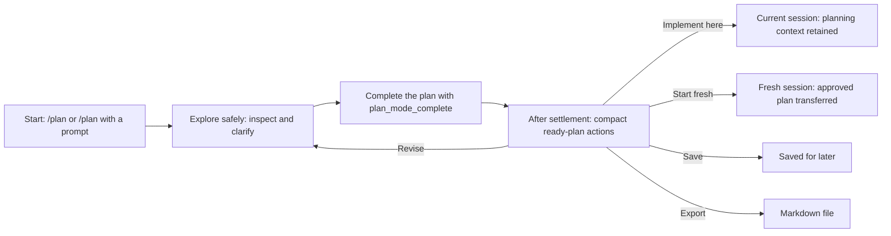
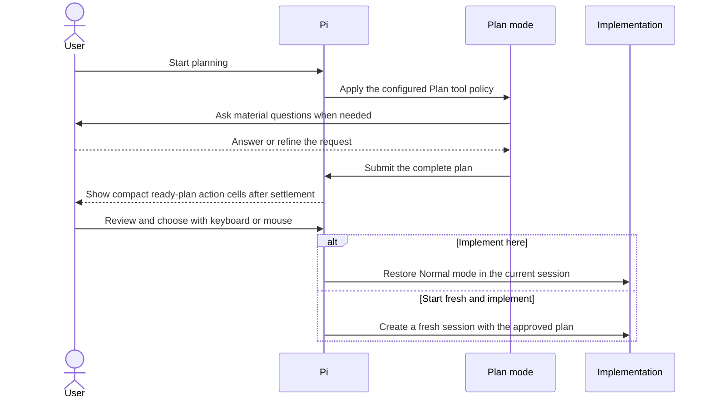

# pi-plan-mode (nredd fork) -- Plan Before Pi Edits Code

[](https://pi.dev) [](./LICENSE)

Maintained fork of [`@narumitw/pi-plan-mode`](https://github.com/narumiruna/pi-extensions/tree/main/packages/pi-plan-mode) (MIT). Imported into [`nredd/pi-harness`](https://github.com/nredd/pi-harness) from [`nredd/pi-plan-mode`](https://github.com/nredd/pi-plan-mode) commit [`4c2bfc3459b07b294efab62e9a8a01849f67a831`](https://github.com/nredd/pi-plan-mode/commit/4c2bfc3459b07b294efab62e9a8a01849f67a831), retaining its history, authorship and MIT license. The source fork rebases the patch queue onto upstream `@narumitw/pi-plan-mode@0.59.3` (release commit `9b8befda`), with the core fork's `v1.3.0-nredd.6` development host. Install the published npm package; `main` is the retired 0.58.0 fork. `dist/` is committed because pi loads it straight from the npm package.

Differences from upstream. The presentational ones come first; the ready-plan flow, decline gate, and bash policy changes follow:

- "Planning" and "implementing" (Plan mode on with no plan ready yet, and actively implementing an approved plan) have no above-editor widget at all -- no `Plan mode — ...` / `Implementing plan — ...` line, no divider. Both are steady states with nothing pending, so the widget only duplicated the footer. The only indicator is the footer status chip, colored with the theme's `accent` role like Codex's `Plan mode` footer badge, instead of upstream's plain unstyled text. The tool policy is still reachable via `/plan` and `/plan settings`.
- States with a concrete pending action (`plan ready`, `plan saved`) keep their existing one-line above-editor widget, since there's a decision to make that the footer chip alone doesn't surface. After a valid plan settles, Pi opens a compact, once-only action chooser with no policy prose: use arrows, Tab, Enter, or click an action cell. The completed plan remains directly above it for review.
- Both Plan tools render for Pi 1.0's one-line collapsed rows (`<renderCall first line> · <renderResult first line>`), so the summary sits on the first line and expanded rendering carries the detail:
  - `plan_mode_question`: call `plan question · Scope, Tests`; collapsed result `Scope → Small · Tests → Full` or `cancelled (reason)`; expanded shows every question with its options (the chosen one marked) and notes. No more raw JSON.
  - `plan_mode_complete`: call is the plan title (first heading); collapsed result `plan proposed`, so the row reads `<title> · plan proposed`; expanded shows the full plan.
  - The `proposed-plan` transcript message (shown when a plan settles, and by `/plan show`) has a registered renderer too, so it sits in the same disclosure gutter as tool rows: collapsed it is `Proposed Plan · <title>` (or `Saved Plan`, `Active Implementation Plan`), click or `Ctrl+O` expands the full plan. The message carries `details: { version: 1, title, plan }`; messages persisted before this fall back to parsing the `**Title**` content. Upstream renders it as an always-expanded purple box.
- Ready-plan approval opens by itself once a valid `plan_mode_complete` settles idle with no queued messages. Upstream leaves it closed until `/plan`. Cancellation, incomplete prose, reload, supersession, exit, and session replacement don't open it.
- Escape in the ready-plan chooser runs `Stay in Plan mode`: the plan is kept and Plan mode stays active. Ctrl+C closes the chooser with no action. The plan is discarded *only* through the explicit `Discard plan and exit` item.
- `Edit plan…` in the ready-plan chooser (or `Ctrl+G` while it is open), the `/plan` ready menu and the saved-plan menu opens the plan in `ctx.ui.editor`, which Pi wires to `externalEditor`/`$VISUAL`/`$EDITOR` through its own `Ctrl+G` (RPC uses its `editor` dialog). Saving replaces the stored plan with the same 50,000-character limit and empty-plan rejection as `plan_mode_complete`, persists it with the Plan state as source `user_edit` so reload, resume and tree moves restore it, and reopens the menu on the edited plan. The model is told once through a hidden `plan-mode-plan-edit` message carrying a unified diff. Implement here, Start fresh, `/plan show`, export and `pi-plan-mode:plan-approved` all use the edited text verbatim. Editing is refused while an agent run is active. A cancelled or unchanged edit changes nothing. An edit refused after the editor closes (run started, rejected, or the plan changed meanwhile) is reported and not applied, and its text prefills the editor the next time you edit the same plan in this session; a tree move or session switch drops it. Editing is not a decline.
- Declined plans (decline gate). Escape / `Stay in Plan mode` on a ready plan, or sending a message while a plan awaits action, counts as a decline (`declinedPlans`, once per proposal, persisted with the Plan state). Editing the plan is not a decline. The counter resets when a new planning workflow starts or Plan mode exits.
  - Hard gate: after a decline `plan_mode_complete` returns an error until `plan_mode_question` runs in explicit `reproposal_confirmation` mode and its canonical `Re-propose now` choice is selected, or you run `/plan finalize`. Ordinary clarification, `Not yet`, cancellation, custom text, and answer-label inference never grant permission. A `<proposed_plan>` block is ignored with a warning while blocked.
  - Contract: with 1 decline the model is told to restate what changed and what is open and re-verify the facts your feedback touched. With 2 or more it must list every thread raised since the last proposal as resolved/open. Before either replacement, confirmation mode uses its fixed review-only question and tool-produced `Re-propose now` / `Not yet` choices, not model-provided labels. On `ui_unavailable` it tells the user to run `/plan finalize`; after cancellation or `Not yet`, it continues material planning or awaits input rather than repeating the confirmation. `declinedPlans` remains historical while persisted `reproposalReview` derives both the guard and injected contract. The text is injected per request (`src/decline-contract.ts`), not into the stable Plan contract. Upstream's "clarification-only, resubmit the unchanged plan" rule is removed.
- Bash policy (`src/tool-policy.ts`), tightened and extended:
  - A `safeSubcommands` prefix approves only its own segment; the rest of a compound command is validated independently. Redirections and pipes into interpreters are rejected. Upstream trusts the whole command.
  - `cd <dir>` and `git -C <dir>` are allowed under the cwd or a `trustedDirectories` entry (new global-only setting); `cd` moves the effective directory for later segments. The policy helpers take `{ workingDirectory, trustedDirectories, homeDir }` after `safeSubcommands`; `homeDir` drives `~/` expansion.
  - `ssh <host> <cmd>` (with a configured prefix) re-validates the remote command; `gh api` is GET only; `curl` has no output/data/upload flags.
- Extension tools that declare `annotations.readOnlyHint: true` classify as `read-only (annotated)` and are admitted by default, on top of `defaultPlanTools` or the safe built-ins. Only user-installed extensions and packages (and explicit `-e` files) count; native MCP tools (`builtin:mcp`), other built-in extensions, and project-scope extensions keep upstream's explicit opt-in, since their hints are third-party or could ship with an untrusted repository. A package that proxies an MCP server is admitted on that package's say-so. Mutating tools must stay unannotated, apart from the `ssh_exec` exception below. The hint means no direct edits by the tool, *not* no side effects: an admitted tool may run repo code (`build.rs`, `conftest.py`, tests), so [`pi-dev-tools`](https://github.com/nredd/pi-dev-tools) `cargo_check`, `cargo_test`, `cargo_doc` and `py_test` run in Plan and may write build or cache outputs (`target/`, `.coverage`, `.pytest_cache`).
- An `ssh_exec` tool call (`{ host, command }`, from [`pi-dev-tools`](https://github.com/nredd/pi-dev-tools)) is the narrow mutating-tool exception: Plan explicitly admits it only from a trusted extension source, then gates it like `ssh <host> <cmd>`. `host` must be a configured `ssh` prefix, `command` must pass the remote reviewed policy, `cwd` must be a plain path, and any other parameter (`stdin` included) is refused. This is risk reduction, not an OS sandbox for extension code. `ssh_pull` and `ssh_push` get no such exception in default admission; an explicit opt-in of either gets no input gate.
- Approving a plan for implementation (Implement here, `/plan implement`, Start fresh) emits `pi-plan-mode:plan-approved` on `pi.events` with `{ version: 1, planId, plan, sessionId }`, the plan verbatim. [`rpiv-todo`](https://github.com/nredd/rpiv-todo) turns it into plan-sourced todos that need evidence to complete. The approval is also recorded as a `plan-mode-approved-plan` session entry; a fresh implementation session restores late setup and announces it before its first model request, including an extension-triggered custom start, and a resume re-announces the same `planId` (listeners treat that as a no-op). Nothing listening is fine.
- If a tree move restores a Plan whose helper tools are unavailable, Plan turns off, restores its prior runtime, clears its status and releases workflow ownership. Restore the helpers before starting Plan again.
- Subagent hosts can keep their children planning too (#437). Plan answers a synchronous `pi-plan-mode:state-query` on `pi.events` (`{ version: 1, reply(state) }`) with `{ version: 1, active, sessionId, evaluate? }`; while Plan is active, `evaluate({ toolName, input, cwd, tool })` is the policy for a child started now, frozen at the answer so the child keeps it after the planner leaves Plan. It refuses `edit`, `write` and `update_plan`, runs safe built-ins and trusted `readOnlyHint` tools as Plan admits them, runs other tools only when the planner's policy selected that same tool (name and source path, so a project copy of a selected user tool stays blocked), and sends `bash`, `powershell` and `ssh_exec` through the same reviewed checks as the planner. [`@nredd/pi-subagents`](../subagents/README.md#plan-mode) asks before every child run. Answering a query is the live state, so `/reload`, `/resume` and tree moves need no extra publish. Nothing asking is fine. The handler fails closed: if building the answer throws, it answers active with a policy that refuses every child tool. The gate is a handshake: Plan asks `pi-plan-mode:gate-query` at session start and before every `Agent`, `SubagentWorkflow` and `steer_subagent` call while active, and blocks the call when no gate replies `{ version: 1 }`, so a subagents build without Plan support cannot start an unrestricted child. Only those three start or resume a child, so only they are gated, by name: reading a result, stopping an agent with `stop_subagent`, or any other tool that starts no child, stays available in Plan. Needs `@nredd/pi-subagents` newer than `0.22.0-nredd.8`; this side is in releases newer than `0.59.3-nredd.3`.
- In print and JSON mode, `/plan` commands that send a model turn (`finalize`, `implement`, `/plan <prompt>`) return only after that turn has run, so a scripted `pi -p "/plan start" "plan it" "/plan finalize"` gets every turn answered. Upstream returns right after sending, and print mode exits with the turn unanswered.
- `Start fresh and implement` starts the fresh session right away. Upstream stages it until the run that produced the plan settles (`fresh-handoff-coordinator.ts`); the fork drops that path because its chooser only opens once the run is already idle.

Upstream 0.59.3 now preserves ready plans on custom-message starts; the fork keeps that guard after late state restoration and approval announcement. The workflow mutex and saved/implementation plan lifecycle otherwise remain upstream-owned. The fork's policy and decline-contract differences are listed above.

Use a Codex-like `/plan` mode to explore a codebase, resolve important questions, and approve an implementation-ready plan before Pi edits files.

## ✨ Features

- Starts and manages Plan mode through `/plan`, `/plan start`, or `/plan <prompt>`.
- Blocks mutations, inactive helpers, and unsafe shell forms while keeping helper schemas stable.
- Uses structured questions for important ambiguity and explicit completion for a decision-ready plan.
- Reviews the complete plan before implementation, export, save, further planning, or discard.
- Implements in the planning session or a fresh linked session with the approved plan.
- Configures persistent or one-shot destination model and thinking choices for fresh implementation.
- Restores Plan state and one saved plan across resume and compaction.
- Configures the Plan tool allowlist, reviewed shell commands, user-trusted subcommands, export path, plan reinjection, shortcut, thinking level, and a router-tier Plan model.
- Publishes statusline state and cooperates anonymously with Workflow Mutex Protocol v1 participants.

## 📦 Install

This release requires Pi 0.80.6 or newer.
Native PowerShell tool support requires Pi 0.84.3 or newer on Windows; earlier Pi versions omit that optional tool and retain the existing Plan policy.

```bash
pi install npm:@nredd/pi-plan-mode@0.59.3-nredd.2
```

Try without installing permanently:

```bash
pi -e npm:@nredd/pi-plan-mode@0.59.3-nredd.2
```

Build and try this package locally from the repository root:

```bash
npm ci --ignore-scripts
npm run build
pi -e .
```

The package declares `dist/index.ts`, so build an unbuilt local checkout before Pi loads the package directory.
Install only from sources you trust because Pi extensions run with Pi's permissions.

## 🚀 Quick start

Run `/plan` to open the state-aware menu, then start Plan mode and ask the agent to inspect and design the change.
Run `/plan <prompt>` when the first planning request is already known. When the plan is ready, Pi opens a compact action chooser after the run settles; review the completed plan above it, then use the keyboard or click an action cell.

## 🗺️ How it works

Plan mode keeps exploration and implementation on opposite sides of an explicit review boundary:



During planning, the agent can inspect the project and ask material questions, but Plan mode blocks editing tools and unsafe shell forms. Implementation starts only after the plan is complete and you choose a handoff:



## 💬 Commands

| Command | Purpose |
| --- | --- |
| `/plan` | Start or manage planning, review a plan, or choose same-session or fresh-session implementation. |
| `/plan start` | Enter Plan mode without sending a model message. |
| `/plan <prompt>` | Start planning with a prompt, or send a follow-up while already active. |
| `/plan tools` | Choose a session-specific tool policy, then start; cancellation changes nothing. |
| `/plan show` | Display the stored plan without starting a model turn. |
| `/plan finalize` | Ask the active planner to finish or ask one remaining material question. Also lifts the decline gate. |
| `/plan implement` | Implement a completed or saved plan in this session, without a selector. |
| `/plan save` | Save a ready plan in this Pi session and leave Plan mode. |
| `/plan settings` | Open the same Plan Settings screen available from the menus. |
| `/plan export [path]` | Write a ready, saved, or active implementation plan to Markdown. |
| `/plan exit` (alias: `off`) | Leave Plan mode and discard its ready plan, or clear a saved/active plan. |

All routes support TUI and RPC.
Print and JSON modes reject the menu, `tools`, and `settings`; stored-plan display and implementation have [additional mode restrictions](#-planning-and-implementation).
Exact subcommand words select routes; other text is a planning prompt, so `/plan start a migration` sends a prompt rather than rejecting trailing text.
There is no startup flag.

State-changing transitions require an idle run; tool selection is locked once planning starts.
`show`, `save`, `export`, and `implement` require an applicable stored plan; `finalize` requires active Plan mode.
Export defaults to the configured destination (`PLAN.md` when unset), never overwrites an existing target, and ends Plan mode only when exporting a ready plan.
See [command workflows](#plan-command-workflows) for tool selection, busy-state recovery, path handling, and export cancellation, and [Security and privacy](#-security-and-privacy) before allowing custom tools.

## 🔒 Security and privacy

While Plan mode is active, the policy blocks built-in editing tools and instructs the agent not to edit files or implement the change.
The boundary is no direct edits by the agent, not a sandbox: admitted tools may run repo code such as `build.rs`, `conftest.py` and tests, which may write build or cache outputs (`target/`, `.coverage`, `.pytest_cache`).
It should explore first and ask structured questions when a preference or tradeoff materially changes the plan.
Configure persistent defaults or a one-workflow tool override before activation; active and ready workflows lock those controls.

Plan mode registers `plan_mode_question` and `plan_mode_complete` during extension load and never changes their active status itself.
Another active-tool policy may hide them, in which case Plan start or restore fails without widening that policy.
By default, the Plan policy allows active safe built-ins such as `read`, limited `bash`, limited `powershell`, `grep`, `find`, and `ls`.
The optional native `powershell` tool must be active when an automatic Plan policy starts, for example through Pi's Windows `defaultTools` setting, unless its name was explicitly retained for first-request resolution.
Tools named `edit`, `write`, or `update_plan` and deselected tools are blocked at execution time even though active schemas remain visible.
A subagent host that asks `pi-plan-mode:state-query` (see the fork notes above), such as `@nredd/pi-subagents`, applies the same policy to every child it starts while Plan is active, so delegating does not widen it. That holds for children that never load Plan mode themselves.
Tools outside the reviewed core policy are denied by default except trusted user-scope/package extension tools declaring `annotations.readOnlyHint: true`, as described above. Native MCP, native orchestration, built-in extensions, and project-scope extensions still require explicit opt-in.
Server annotations such as `readOnlyHint` are unverified hints, not permission or a safety guarantee; the fork trusts the declaration only from the admitted extension sources.
For example, opt into `mcp__docs__read`, `mcp__firecrawl__firecrawl_scrape`, or `lsp_diagnostics` through `/plan tools` or `defaultPlanTools` before the next workflow.

Direct and `model-only` tools must be active in Pi; `model-only` tools cannot be called by another tool.
Registered `codemode` and `deferred` tools are selectable without direct activation and can run through Pi's nested tool pipeline.
MCP `codemode-deferred` follows its public `deferred` exposure.
Select an orchestrator such as `codemode` or `tool_search` separately when needed: allowing it does not authorize its callees, and selecting an MCP tool does not enable its orchestrator.
Pi's `tool_search` may declare tools independently, but declaration does not admit unselected names to the frozen Plan policy.
Every nested call remains individually gated, including editing and limited-shell restrictions.
Hidden tools remain unavailable even when selected or listed as active; unsupported exposure and unavailable policy metadata fail closed.
Registered but inactive direct tools, unregistered tools, blocked core tools, and unselected tools report distinct denial guidance.
A tool admitted before later deactivation can be reactivated and reused in the current workflow without restarting.
After they become visible, the Plan-only helpers remain visible in Normal mode, but their handlers and the `tool_call` policy reject calls unless Plan mode owns the active workflow.

Limited `bash` uses a fail-closed Bash policy, including when an extension overrides the canonical `bash` tool name.
It accepts common inspection commands, read-only Git and npm queries, pipelines and command lists composed entirely of accepted commands, plus selected checks such as `npm test`, `npm run typecheck`, and `cargo test`.
Case-insensitive `-i` is allowed for inspection commands such as `rg`, `grep`, and `git grep`. Commands where `-i` edits in place, including `sed`, stay blocked.
It also accepts `hostname` without arguments and local Windows `tasklist` queries using reviewed display, filter, module, and service flags.
Reviewed Git inspections may place `--no-pager` before the accepted subcommand.
They may also place one or more complete `-C <path>` pairs before the accepted subcommand only when every path stays under the Pi working directory or a `trustedDirectories` entry (no `..`, no flags, no expansion beyond a leading `~`).
Other targets are rejected so `git -C` cannot introduce executable configuration, hooks, filters, signing programs, or lazy-fetch remotes from an untrusted repository.
`cd <dir>` follows the same rule and moves the effective directory for the following segments (`cd ~/code/pi && git status`).
`gh api` (GET only) and `curl` (no output, data, or upload flags, GET only) are accepted with fixed argument checks, and `ssh <host> <cmd>` is accepted for a configured `ssh <host>` prefix with the remote command re-validated.
It rejects output/input redirects, shell expansion, substitutions, subshells, background jobs, piping into interpreters (`sh`, `bash`, `python`, `node`, ...), incomplete `-C` pairs, other Git global options, Git config overrides, mutating flags, dependency changes, editors, and unknown commands.

Limited `powershell` uses a separate fail-closed PowerShell policy, including when an extension overrides the canonical `powershell` tool name.
It accepts canonical inspection cmdlets such as `Get-ChildItem`, `Get-Content`, `Get-Item`, `Get-Location`, `Resolve-Path`, `Select-String`, `Test-Path`, `Measure-Object`, `Sort-Object`, `Format-List`, `Format-Table`, `Out-String`, and `Write-Output`.
It accepts local `Get-Process` and `Get-Service` queries with reviewed static selectors while rejecting remote and object-input parameters.
It also accepts the same reviewed `git` and configured `gh` queries as limited Bash, including pipelines and semicolon-delimited command lists composed entirely of accepted commands.
It rejects redirects, variables, substitutions, script blocks, call operators, type or method expressions, stop-parsing tokens, multiline input, non-ASCII quotation delimiters, aliases, mutating cmdlets, and unknown commands.
Use canonical cmdlet names because PowerShell aliases are intentionally outside the reviewed policy.

A rejected parsed command list or pipeline identifies its first blocked command segment; malformed or unsupported shell syntax reports the complete submitted input instead.
Tests and builds may still write ignored caches or build artifacts and may execute project-defined hooks; enable or invoke them only when the repository is trusted.
Both limited-shell policies reduce risk but do not provide an OS sandbox or confidentiality boundary.
A configured `safeSubcommands` match bypasses the argument checks for *its own segment only*; the other segments of a `&&`/`||`/`;`/`|` list are validated independently, and redirections, substitutions, and pipes into interpreters stay rejected.

## 🧭 Planning and implementation

`plan_mode_question` follows Codex's `request_user_input` pattern: the agent can ask 1-3 concise questions, each with meaningful options and a free-form Other path.
In TUI mode, a single question shows its header as plain muted text, submits as soon as its preset or custom answer is confirmed, and does not show tabs, Review, or question-navigation controls.
Add an optional note with `n` before confirming a single preset answer.
With two or three questions, one question appears at a time with question tabs and a final Review tab.
Use Tab, Shift+Tab, left, or right to visit any question or Review, including unanswered future questions.
Use up and down to choose an option, Enter to record it and advance, or `n` to record the highlighted option and open its optional note editor.
Press `n` again on an answered item to edit or clear its note.
Revisit a question to replace its answer; changing the chosen option clears its prior note.
Review lists every answer and note, blocks incomplete submission, and requires returning to a question to edit its answer or note.
Custom answers and notes retain their raw submitted text in the tool result, while terminal rendering is sanitized.
In TUI mode, a custom editor registered through Pi's `ctx.ui.setEditorComponent()` also handles answer and note editing in a separate instance, without changing the main prompt draft.
While that editor is active, it controls Escape and submission keys; Ctrl+C still cancels the question.
The editor's submitted value is retained, including any whitespace normalization it intentionally applies.
Without a custom editor, existing editing and cancellation behavior is unchanged.
The TUI rejects either field above 4,000 characters instead of truncating it.
RPC keeps the existing sequential `select` and `editor` dialogs because Pi RPC cannot render custom TUI components.
If you cancel, the agent should call `plan_mode_question` again or proceed only with a clearly stated low-risk assumption. The agent must never ask questions in assistant text; plain text is allowed only after `plan_mode_question` actually returned `ui_unavailable`. After a declined plan, only `mode: "reproposal_confirmation"` with canonical `Re-propose now` grants permission to propose again; ordinary questions never do.

Pi identifies tools by tool name.
The pre-start selector stores accepted session policy names and shows each effective tool's source and availability from Pi metadata, including native built-in extension registrations.
A selected name can run in Plan mode only when the effective tool is registered, available through its exposure, and permitted by policy at the workflow's first provider-bound context.
The allowlist freezes at that boundary and restores without admitting new names after reload, resume, or tree navigation.
A tool registered or first made available later waits for the next Plan workflow; an admitted callable tool later declared to the model keeps its existing admission.
If an extension overrides a built-in tool with the same name, Pi exposes the effective tool for that name and the selector shows that source.

A complete Plan mode answer should appear only after the agent has resolved discoverable facts and high-impact user decisions.
The agent must call `plan_mode_complete({ plan })` alone as its final action, passing the complete Markdown plan.
The tool rejects empty or whitespace-only plans and plans longer than 50,000 JavaScript characters; it does not truncate.
Its visible result contains the full plan, and versioned result details let the extension restore it safely from the active session branch.

`plan_mode_complete` uses Pi's `terminate: true` hint.
Termination is best effort: if a model puts it in a parallel tool batch, Pi terminates the batch early only when every finalized sibling tool also terminates.
The prompt therefore requires the completion call to be standalone and last.
The extension deliberately does not infer completion from phrases such as “I will present the plan,” and ordinary research or clarification turns never trigger automatic retries.
`/plan finalize` and its exact canonical finalization prompt are explicit recovery requests.
If one of those requests ends normally without a valid structured question or completed plan, Plan mode waits for `agent_settled` and retries once with stronger tool guidance.
A valid question, accepted completion, user cancellation, explicit exit, workflow supersession, reload, session replacement, or shutdown cancels the retry.
A second prose-only failure leaves Plan mode active, warns in interactive modes, and requires another explicit `/plan finalize` request.

Legacy sessions and models may still submit one non-empty `<proposed_plan>` block with tags on their own lines.
That compatibility path remains accepted, but it is not the primary workflow.
Empty, malformed, unclosed, or multiple legacy blocks keep Plan mode active and produce a warning.

After completion, `/plan` opens the ready actions when interactive UI is available.
The same flat menu shows **Implement here** and **Start fresh and implement**, explains which conversation context each choice uses, and previews the selected **Plan reinjection** policy.
**Implement here**—and the compatibility route `/plan implement`—appends the Normal contract, lifts the Plan runtime policy, captures the reinjection setting, and starts implementation in the current session with its complete planning conversation and tool calls.
**Start fresh and implement** opens a settings page before replacement.
Its searchable model list snapshots the session's scoped models when configured, otherwise Pi's currently available models, and shows each provider, model ID, and friendly name.
Pi 0.80.6–0.82.1 does not expose session model scopes to extensions, so the list uses all currently available models on those releases.
One-shot provider and model identifiers are limited to 512 characters each; longer custom identifiers are rejected before the source session is replaced.
The model and thinking rows start from the persistent **Fresh model** and **Fresh thinking** defaults; when either setting is omitted, they show the planning session's current value with **same as plan** (or **previous model** while a Plan model is applied) and carry it into the fresh session independently.
With a [Plan model](#plan-model) applied, the model row shows the pre-Plan model as **previous model** instead of the tier and starts the fresh session on it, and the source session switches back to it; resuming the source plans on the tier again.
The fixed thinking choices are `off`, `minimal`, `low`, `medium`, `high`, `xhigh`, and `max`.
Back navigation preserves this menu-local draft, while closing and reopening the menu restores both persistent defaults.
If the configured model is outside the current scope or no longer available, the row reports the fallback and uses **same as plan** (or **previous model**) without deleting the stored preference.
The saved-plan menu keeps its direct fresh-session action without optional rows and applies the same persistent defaults and fallback.

Starting from that settings page waits for the source session to become idle, re-resolves and authenticates an explicit model, creates a new session linked to the persisted source as its parent, and transfers the exact approved plan without copying planning messages, tool results, or compaction/branch summaries.
The destination consumes the one-shot choices before its first provider request, applies an explicit model first, and then applies explicit thinking.
Concurrent prompts that arrive while those choices are being applied are queued as follow-ups behind the kickoff prompt.
If durable consumption blocks the kickoff, the handoff reports a partial start and restores a conversation-history prompt to the editor instead of reporting success.
Changing only the model keeps the planning thinking level; changing only the thinking level keeps the planning model.
If Pi clamps an unsupported thinking level, the extension reports the effective level.
If the chosen model disappears or loses authentication after source preflight, the destination reports the race, consumes the intent without retrying it later, and continues with its default model.
The destination still loads its normal `AGENTS.md`, skills, project resources, and extensions.
Choosing **Export plan…** asks for a destination, writes the plan, appends the Normal contract, restores inherited thinking, and leaves Plan mode without starting a model turn or changing active tools.
Choosing **Save for later**—or running `/plan save`—instead stores one plan in the current Pi session before leaving Plan mode.

When a resumed active Plan workflow completes before `/plan` has run in that resumed session, the automatic menu cannot obtain Pi's command-only session replacement capability; choosing fresh asks you to reopen `/plan`, where the same action is available.
A successful fresh handoff does not delete or consume the source planning session.
Resume it later to inspect or hand off the ready/saved plan again; this deliberate duplication is the recovery path if the destination work is abandoned.
In-memory sessions create an unlinked fresh session because no parent file exists.
Escape, Ctrl+C, menu disposal, source replacement/shutdown, model/auth failure, or cancellation by another extension before replacement leaves the source plan unchanged.
Under **Off — conversation history only**, the destination receives the complete plan in its initial user prompt and does not persist active-plan state.
When a one-shot runtime choice exists, only that temporary non-model state is persisted and it is removed before the first request.
If that removal cannot be persisted, the request is not sent and can be retried after session persistence is available.
If that kickoff fails, the complete request remains in the destination editor and the source remains resumable.
Under either guaranteed-plan policy, the destination persists active-plan state before kickoff.
If guaranteed-plan persistence fails, the complete request is placed in the destination editor and the source remains resumable.
If a guaranteed-plan kickoff fails, the destination retains the active plan; send a message to continue, use `/plan exit` to clear it, or resume the parent planning session.

A saved plan appears as `plan saved` and remains available after reload, resume, branch-local fork, and compaction in that session.
It does not expire automatically, cross into a new session, or participate in ordinary model context.
Open `/plan` to Show, Edit, Implement here, Start fresh and implement, Export, open Settings, or Clear it; `/plan show`, `/plan implement`, `/plan export [path]`, and `/plan exit`/`off` retain their direct routes in TUI and RPC.
Fresh implementation checks idle state, the selected model, and authentication before session replacement; Implement here keeps its established preflight behavior.
Starting another workflow with `/plan start`, `/plan <prompt>`, or `/plan tools` is blocked until the saved plan is implemented or cleared, so the single saved slot is never silently overwritten.
Resuming that session keeps the plan saved; open `/plan` to review, implement, export, or clear it.
Cancellation or failed implementation preflight leaves it unchanged.

Text print and JSON modes cannot display the bare `/plan` menu and reject that route before changing state; use `/plan start` for direct no-prompt activation or `/plan <prompt>` to start planning with a prompt.
`/plan tools` also rejects before changing state because its staged selector requires TUI or RPC.
These modes can export any stored plan with `/plan export [path]`, save a ready plan with `/plan save`, and clear it with `/plan exit` or `/plan off`.
Successful export is observable through the created file; exporting a ready plan also leaves Plan mode, while saved and active implementation state remains unchanged.
An existing target or missing plan fails the command without changing state.
These modes reject saved-plan display and implementation before changing state because Pi provides neither printable custom-message output nor acknowledged extension-triggered turns; resume the session in TUI or RPC to show or implement it.

Both implementation paths apply the current **Plan reinjection** policy in their destination.
The default **Off — conversation history only** policy does not create active-plan state or inject a hidden plan context.
Implement here sends `Implement the plan.` and leaves the accepted plan in ordinary planning history.
After `Edit plan…`, history holds the earlier proposal, so Implement here sends the complete edited plan in its prompt, like a saved plan.
Start fresh and implement, or implementing a saved plan here, puts the complete plan in one ordinary initial user prompt because no reliable planning conversation is present.
Later model calls then rely on Pi's normal conversation history and compaction behavior.
**Through first implementation run** guarantees the exact plan throughout that run, including retries, compaction retries, and queued continuation, then clears active-plan state at `agent_settled`.
**Until manually cleared** guarantees the exact plan across later turns, resume, and manual or automatic compaction until `/plan exit` or supersession.
The guaranteed policies avoid a duplicate context block while the original implementation handoff remains available and inject one hidden canonical copy after that handoff is compacted away.
Reinjection can consume up to the existing 50,000-character plan limit in model context.
Cleanup is bound to the matching implementation, so an older run settling cannot clear a newer handoff.

While a guaranteed plan is active, `/plan show` displays the accepted plan.
Interactive `/plan` offers Show, Export plan…, Settings, Start a new plan, and Clear; `/plan exit` and `/plan off` are the direct clear routes.
Settings changes never alter the policy already captured by an active guaranteed-plan implementation.
Automatic first-run cleanup removes the active status and future injected context after the triggering implementation run has received the complete plan.
Starting a new Plan-mode workflow or implementing a replacement plan supersedes an active guaranteed plan.
The extension deliberately does not infer completion from assistant prose or agent settlement under **Until manually cleared**, so clear the active plan when it no longer applies.
Under **Off — conversation history only**, implementation messages remain ordinary conversation history and there is no active plan for `/plan exit` to remove.
Choosing Stay before implementation keeps the plan ready.
Revision feedback starts another Plan-mode turn and clears the previous implementable plan until an updated completion arrives.
Any reply to a ready plan counts as a decline (see Declined plans); the agent can clarify normally, but a replacement requires explicit `reproposal_confirmation` permission instead of label-text inference.
Before saving or implementation, exit/off discards the ready plan and removes its completion result from later non-Plan model context.

While Plan mode is enabled, the extension also publishes a compact status for Pi statuslines.
With `@narumitw/pi-statusline`, this appears in the extension status area:

- `plan active`: Plan mode is enabled and still gathering context or drafting a plan.
- `plan ready`: A completed plan is stored until you implement it, export it, save it, continue planning, or exit Plan mode.
- `plan saved`: One completed plan is stored outside model context in the current session until you implement or clear it.
- `plan implementing`: The exact accepted plan is guaranteed under **Through first implementation run** or **Until manually cleared**.

You can also exit directly.
Before implementation, direct exit discards the latest proposed plan; while a plan is saved, it clears that saved plan.
During a guaranteed-plan implementation, it removes both the original implementation handoff and the extension's canonical active-plan block from later model calls; an earlier Pi-generated compaction summary may still describe prior work:

```text
/plan exit
```

## 🧱 Cache-stable mode transitions

Plan and Normal requests share one append-only conversation.
The extension appends one hidden, model-visible, versioned Plan contract before the first Plan prompt and one Normal contract before the first post-Plan Normal or implementation prompt.
Ordinary linear turns do not rewrite or duplicate these contracts.
The Plan contract explains native-tool opt-in and per-call nested enforcement; this wording changes future Plan transitions without rewriting existing transition messages.
**Implement here** retains the Plan dialogue, structured questions, tool calls, completion evidence, and `Implement the plan.` kickoff in order.
**Start fresh and implement** is the isolation path and transfers only the approved plan plus the Normal contract to a linked session.

The `context` hook filters repeated legacy `plan-mode-context` artifacts but preserves current transition messages.
If compaction removes the effective transition, the hook inserts one canonical fallback at a deterministic retained-history boundary.
Repeated transforms leave that fallback in place instead of moving it to the newest turn.
An inactive legacy state entry does not inject a Normal contract, so sessions that never entered Plan mode keep their ordinary context after resume or reload.
Manual `/tree` navigation restores branch-owned Plan state and chooses the matching contract without navigating or adding a branch summary.
Pi lists hidden transition messages in `/tree`; Plan mode rejects those internal targets, so select an adjacent conversation entry.

Plan mode registers `plan_mode_enter`, `plan_mode_question` and `plan_mode_complete` once and keeps their names and definitions stable across Normal, Plan, ready, implementation, and restored workflows. The entry tool is model-only, so nested orchestrators cannot request this user interaction. Set `modelPlanEntry: false` in `pi-plan-mode.json` to remove only the entry tool from the active set at the next session start or reload. File-watch updates do not change its active status mid-session; restrictive active-tool policies are never widened.
Visible helpers do not mean `/plan` is active, and their descriptions exclude ordinary planning, the `writing-plans` skill, roadmaps, checklists, and plan-file work.
Only the latest active Plan contract authorizes the helpers; inactive or stale calls fail without accepting a plan or opening question UI.
Plan mode does not widen a restrictive active-tool policy; start or restore fails when a required helper is unavailable.
Stable schemas preserve a cache-eligible prefix but cannot guarantee a hit because provider serialization, cache lifetime, minimum prefix size, implementation details, and session affinity remain external.

The default `thinkingLevel: "inherit"` avoids a Plan-specific reasoning-parameter change.
A fixed Plan thinking level remains supported, but changing reasoning parameters can prevent provider-side state reuse even when prompts and tool schemas stay stable.

The default `planModel` is unset, so Plan inherits the current model.
A configured [Plan model](#plan-model) switches models, which costs the provider cache twice: on the first Plan request and again on the first post-Plan request.

## 🤝 Workflow coexistence

Plan mode is independently installable and keeps its standalone behavior when no other protocol participant is present.
On the characterized Pi `0.84.2` runtime, it participates in the anonymous `workflow:mutex:v1` `agent-workflow` group.
It holds the group while Planning is active, while a completed plan awaits review, and while revision is underway.
Saved plans and ordinary implementation after Plan handoff do not hold the group.

Every inactive start performs one final synchronous admission after asynchronous preflight and before changing Plan state, persistence, prompts, tools, thinking level, queues, or status.
If another participant is active, TUI and RPC show an anonymous warning that another workflow is active.
Print and JSON direct routes throw the same anonymous error before mutation.

Launch-menu, selected-tool, shortcut, active-implementation **Start a new plan**, and restored activation use the same admission boundary.
A rejected selected-tool launch does not save its draft choices.

Restored active Plan state acquires before restoring restrictive tools, thinking, status, or model hooks.
If restoration is busy, Plan mode stays non-running, leaves persisted history and active tools untouched, and requires a later reload or explicit new start after the other workflow ends.
Planning-session cancellation during a fresh implementation preflight keeps the source Plan and its ownership.
Successful session replacement relies on source-session shutdown to clean up and release; the destination's ordinary active implementation does not acquire the Plan mutex. A prompt dispatched late to a replaced session is displayed as recovered input, without starting a turn in the destination.

The coexistence guarantee is cooperative and applies only when every contender implements v1 on the characterized Pi runtime and shares its event bus and session-manager identity.
A pre-v1, mixed-version, non-participating, forked, or otherwise uncharacterized counterpart remains unsupported for mutual exclusion.
Plan mode does not identify, inspect, configure, start, stop, or depend on another extension.
Guaranteed coexistence with Goal requires `@narumitw/pi-goal` `0.53.0` or newer and this package at `0.52.0` or newer on the characterized Pi `0.84.2` runtime.

| Installation | Support |
| --- | --- |
| Plan mode without another workflow participant | Supported standalone behavior |
| Plan mode `>=0.52.0` with Goal `>=0.53.0` on Pi `0.84.2` | Workflow Mutex v1 coexistence guarantee |
| Either package below its floor, or another Pi runtime | Standalone behavior only; mutual exclusion unsupported |

## 🛠️ Tools

- `plan_mode_enter({ reason })` requests Plan mode for multi-file work, unclear requirements, or an explicit planning request. It is not needed for single-file fixes or questions. TUI and RPC require explicit confirmation within 10 seconds; Escape, cancellation, timeout, or refusal leaves Normal mode unchanged and lets the model continue. Print and JSON refuse before mutation. Accepted entry returns `terminate: true` and runs only at `agent_settled`, through the existing `/plan start` admission, helper availability, mutex and frozen policy. It appends the canonical Plan contract once and resends the original user request. Parallel siblings and any continuation before settlement still run under Normal policy. Consent belongs to the originating request: new user input or an admitted user message cancels pending entry, even when steering/follow-up queues drain before settlement without another `before_agent_start`. Reload, branch changes, supersession, run cancellation/error and shutdown also invalidate pending entry. An aborted settlement cancels entry even when the final assistant message was not aborted. Active/ready/saved plans, active implementation state and another pending entry cannot be superseded. Another workflow's mutex refusal remains anonymous, including if it starts while confirmation is open. Confirmation is consent to *planning*, never to implementation or broader permissions.
- `plan_mode_question` asks up to three structured questions, supports optional answer notes, submits one answer directly, and reviews multiple answers before TUI submission.
- `plan_mode_complete` records the complete approved Markdown plan and terminates the planning turn when called alone.

## ⚙️ Settings

Run `/plan settings`, open **Settings** from an inactive `/plan` menu, or edit `<getAgentDir()>/pi-plan-mode.json` (normally `~/.pi/agent/pi-plan-mode.json`).
The optional file is read at session start and watched for changes; only an explicit save creates it.
SDK hosts isolate settings with the `settingsPath` dependency, not `homeDir`: an explicit path is the only file read or written and the legacy file is skipped, so the `getAgentDir()` defaults (which honor `PI_CODING_AGENT_DIR`) are only reached by the CLI. `homeDir` covers `~` in the Bash and PowerShell policy alone.

```json
{
  "thinkingLevel": "inherit",
  "planModel": "@deep",
  "implementationPlanRetention": "clear-on-start",
  "defaultImplementationModel": {
    "provider": "anthropic",
    "modelId": "claude-sonnet-4-5"
  },
  "defaultImplementationThinkingLevel": "high",
  "defaultPlanExportPath": "PLAN.md"
}
```

By default, Plan mode inherits the model and thinking, allows active safe built-ins, uses the planning model and thinking level for fresh implementation, exports to `PLAN.md`, and relies on ordinary conversation history after implementation starts.
The shortcut is disabled unless configured; enabling, changing, or removing it takes effect after `/reload` or restarting Pi.
Until then, the current shortcut binding stays unchanged.
Settings saves apply to later workflows; an active implementation keeps its captured reinjection policy.
The export destination affects the next export immediately.
Inactive built-in `grep`, `find`, and `ls` must be [enabled in Pi settings](#enable-inactive-built-in-search-tools-in-pi); Plan policy only grants execution permission.

> [!WARNING]
> `safeSubcommands` is a JSON-only trust override for the matched command segment, not a read-only allowlist.
> A matching prefix skips the argument checks for that one segment (e.g. `gh pr view 1 --web`); other segments, redirects, substitutions, and pipes into interpreters are still checked.
> `trustedDirectories` (JSON-only, global settings only) widens where `cd` and `git -C` may point. See the [settings reference](#pi-plan-mode-settings-reference).
> Configure both only for commands and directories you fully trust.

Saves are ordered within one Pi process, preserve unknown fields, and publish atomically; separate Pi processes can still race.
Invalid settings remain untouched and make Settings read-only; session-start failures use safe defaults.

Read the [settings reference](#pi-plan-mode-settings-reference) for all accepted values, tool-policy resolution, reinjection choices, shortcut configuration, shell-override examples, and legacy-file migration.

## 🧠 Codex-like behavior

This extension maps Codex's `ModeKind::Plan` behavior onto Pi's extension API:

- Plan mode is conversational collaboration, not TODO or progress tracking.
- `/plan <prompt>` enters Plan mode before submitting the prompt.
- The agent uses `plan_mode_question` for material preferences and completes with a standalone `plan_mode_complete` call instead of prose detection.
- `update_plan` is blocked until the explicit implementation boundary restores Normal mode.
- The default `clear-on-start` policy uses conversation history; `clear-after-first-run` and `keep` add exact-plan guarantees.
- Append-only Plan and Normal contracts keep helper schemas stable, but Pi's tool policy is risk reduction rather than Codex sandbox enforcement.

## 🗂️ Package layout

```text
pi-plan-mode/
├── src/                               # Policy, questions, settings, and handoff modules
│   ├── index.ts                       # Thin Pi entrypoint
│   ├── child-policy.ts                # State query and the Plan policy for subagent children
│   └── plan-mode.ts                   # Planning policy and implementation handoff
├── dist/                              # Generated Jiti runtime
├── scripts/build-runtime.mjs          # Runtime builder
├── docs/                              # Published reference documentation
└── test/                              # Behavior and lifecycle coverage
```

The generated runtime is built from `src/index.ts` and does not import back into `src`.

`test/{confirmation,decline,policy,transcript}-session.test.ts` ports the seven retired process scenarios through the real core session and interactive harnesses. File-backed restore, canonical RPC select choices, all seven allowed/eleven blocked shell rows, and raw terminal clicks/Escape run without Pi binaries, owner configuration, polling, or sleeps. Only the Bash executor is inert; the production factory and admission hook run unchanged. `npm run check` includes these scenarios on Bun (verified with 1.3.14); `npm test` runs the full Vitest suite. The release-tarball development host provides `/testing` and `/testing/interactive`; `@xterm/headless@5.5.0` supplies its terminal emulator. Peer dependencies and the shipped runtime are unchanged.

Fork maintenance follows the split/diff-replay queue, never unreleased upstream main. Exclude `dist/` from replay and regenerate the standalone lockfile for the release's development pins. Run `npm run check && npm test` locally; the typecheck covers source and test files. Test fixtures resolve relative to the package's source location rather than the runner's working directory, so both gate layouts exercise the same files. Also apply the queue in a full upstream monorepo clone at the release tag, run `npm ci --ignore-scripts`, build `packages/pi-tui-kit`, run the Plan package's `npm run check`, then run root `PI_EXTENSIONS_TEST_BASE='@narumitw/pi-plan-mode@0.59.3' npm test`. Rebuild the Plan package there after the final source change, copy its `dist/` back here, and commit those artifacts last. The vendored harness tracks that release, including the mock UI's `onTerminalInput` method.

## 🔎 Keywords

Pi extension, Pi coding agent, plan mode, Codex-like plan mode, AI coding workflow, read-only planning, implementation plan.

Lockfile: there is no nested `package-lock.json`; the root workspace lock governs
(`npm ci --ignore-scripts` at the repository root).

## Pi Plan Mode settings reference

Back to README

- [Plan model](#plan-model)
- [Default Plan policy tools](#default-plan-policy-tools)
- [Enable inactive built-in search tools in Pi](#enable-inactive-built-in-search-tools-in-pi)
- [Plan reinjection](#plan-reinjection)
- [Fresh implementation runtime](#fresh-implementation-runtime)
- [Export destination](#export-destination)
- [Toggle shortcut](#toggle-shortcut)
- [Safe shell subcommands](#safe-shell-subcommands)
- [Thinking level and persistence](#thinking-level)

### ⚙️ Settings

Run `/plan settings` or open **Settings** from an inactive `/plan` menu to edit **Plan thinking**, **Plan policy tools**, **Plan reinjection**, **Fresh model**, **Fresh thinking**, **Export destination**, **Plan mode shortcut**, and **Plan model**.
You can also edit `$PI_CODING_AGENT_DIR/pi-plan-mode.json` (normally `~/.pi/agent/pi-plan-mode.json`) manually.
`safeSubcommands` and `trustedDirectories` are JSON-only, and are read from this global file only (there are no project-level plan-mode settings, so a repository cannot widen its own shell policy).
The optional file is read at session start, watched for changes, and created only by an explicit Settings save or manual edit.
The shortcut is disabled when `toggleShortcut` is omitted.
```json
{
  "thinkingLevel": "inherit",
  "planModel": "@deep",
  "defaultPlanTools": ["read", "bash", "grep", "find", "ls"],
  "implementationPlanRetention": "clear-on-start",
  "defaultImplementationModel": {
    "provider": "anthropic",
    "modelId": "claude-sonnet-4-5"
  },
  "defaultImplementationThinkingLevel": "high",
  "defaultPlanExportPath": "PLAN.md",
  "safeSubcommands": {
    "git": ["rev-parse", "blame"],
    "gh": ["pr view", "issue list"],
    "kubectl": ["get", "apply"],
    "npm": ["run inspect-custom"]
  },
  "trustedDirectories": ["~/code", "~/.local/share/chezmoi"],
  "toggleShortcut": "<your_key>"
}
```

#### Plan helper tools

Plan helper schemas are stable from extension registration onward. Plan mode never changes the active status of `plan_mode_question` or `plan_mode_complete`. The separate model-only `plan_mode_enter({ reason })` tool is active by default, but `modelPlanEntry: false` removes it at session start or reload without widening any active-tool policy. The setting accepts only a boolean and is JSON-only; watched edits do not change entry-tool visibility mid-session. Entry requires explicit TUI/RPC confirmation within 10 seconds and is refused in print/JSON. Consent requests planning only; normal Plan admission and implementation approval remain mandatory.
Tool visibility alone is not Plan activation.
Only the latest effective active Plan contract authorizes `plan_mode_question` or `plan_mode_complete`; ordinary planning and the `writing-plans` skill use their own workflow instead.
The retired `toolVisibility` key is ignored and preserved as unknown data when another setting is saved or a legacy settings file is migrated.

#### Plan model

`planModel` runs Plan turns on a subscription-router tier, like Claude Code's `opusplan`: plan on `@deep`, implement on whatever you were using.
Omit it, or choose **Inherit**, to plan on the current model; that is the default.
The value is a tier reference, `@` plus a router profile key matching `^[a-z0-9][a-z0-9._-]*$` (at most 512 characters), and selects the router's `router/<tier>` virtual model.
A concrete `provider/modelId` is rejected and invalidates the settings file with `planModel must be a router tier like "@deep", not a concrete model id`: profile differences live in the router's tier mapping, not here.
Settings lists the `router/*` models in the current scoped or available catalogue.

When a Plan workflow starts, Plan mode remembers the current model and switches to the tier before the first Plan request.
Pi's per-model thinking default does not replace the current or configured Plan thinking level during the switch.
**Implement here**, **Export plan…**, **Save for later**, and `/plan exit` switch back to the remembered model and thinking before the next request.
A `/model` change during Plan wins and stays after exit, as does a manual thinking change.
The switch is persisted with Plan state, so `/reload` and resume keep planning on the tier and still restore the previous model on exit.
**Start fresh and implement** uses **Fresh model** when set; otherwise its model row shows and uses the remembered pre-Plan model as **previous model**, not the tier.
Either way, once Pi replaces the source session, the source switches back to the remembered model and thinking; its plan stays resumable, and resuming it, including after a partial start, plans on the tier again.

An unregistered or unauthenticated tier warns once (`... is no longer available; using the current model.`) and Plan starts on the current model; the stored preference is kept.
Quota exhaustion is the router's business: its exhaustion policy waits or fails, and Plan mode never substitutes another tier or model.
A workflow-mutex refusal changes nothing.
Saving applies to the next Plan workflow.
See [cache-stable mode transitions](#-cache-stable-mode-transitions) for the cache cost of switching.

#### Default Plan policy tools

`defaultPlanTools` defines the initial runtime allowlist when a session has no stored pre-start selection.
Omit it—or choose **Use automatic safe built-ins**—to allow already-active safe built-ins by default.
Extension tools that declare `annotations.readOnlyHint: true` are admitted in addition to either list; see [annotated read-only tools](#annotated-read-only-tools).
An explicit empty array appears as **No optional tools** and denies every ordinary tool while the required helpers remain callable in Plan mode.
Neither setting changes model-visible tool schemas.

Tool names must be non-empty strings; duplicates are removed in first-seen order.
Explicit configured or session-selected names remain policy intent when their tool is unknown or inactive, but Plan mode never registers or activates them.
The inactive menu takes a fresh registered and active tool snapshot each time it opens, while an already open picker does not update in place.
At the workflow's first provider-bound context, after every `before_agent_start` handler has settled, Plan mode resolves retained names against Pi's live registry, exposure, and active declarations and freezes the executable allowlist.
Automatic defaults recheck the effective source metadata at that boundary, so a custom override of a safe built-in name still requires explicit opt-in.
The resolved allowlist persists with the active workflow and restores without reopening the resolution boundary after reload, resume, or tree navigation.
Names unavailable at resolution wait for the next Plan workflow rather than a new session.
An admitted tool may be reactivated or declared later without widening that frozen policy, but current hidden exposure still blocks it.
Settings shows unresolved names as pending registration; resetting to automatic removes the entire override.

Direct and `model-only` tools must be active; registered `codemode` or `deferred` tools can be selected without direct activation.
MCP `codemode-deferred` is represented as public exposure `deferred`.
`model-only` tools cannot run as nested calls; hidden and unsupported exposure remain unavailable regardless of active declarations or saved names.
Missing exposure on older Pi versions retains the direct-tool behavior.
Native MCP tools and orchestration tools require explicit opt-in just like other tools outside the reviewed core policy; server annotations never grant permission.
For example, `"defaultPlanTools": ["read", "codemode", "mcp__docs__read"]` permits that MCP tool through an already-active `codemode` orchestrator.
Selecting either tool does not enable the other, and every nested call needs its own Plan-policy admission.
Pi's `tool_search` can declare a tool without restarting an admitted workflow, but cannot add an unselected name to its frozen Plan policy.

Allowing a custom tool trusts its effective implementation; Plan mode does not infer its side effects from arguments or annotations.
Pi resolves tools by name, so if an extension overrides a built-in name, the effective extension tool is selected instead.
Names `edit`, `write`, and `update_plan` stay blocked, and `bash` or `powershell` stays subject to its limited-shell policy, including nested calls and regardless of source metadata.

A selection accepted through **Choose tools, then start…** or `/plan tools` is stored in that Pi session and takes precedence over `defaultPlanTools` when the session resumes.
The global setting remains the policy baseline for fresh sessions and sessions without an explicit selection.
Settings saves immediately, but saved policy names and thinking apply only when a later Plan workflow starts; they never mutate active schemas or a workflow already in progress.

#### Enable inactive built-in search tools in Pi

Pi's default selection leaves the registered built-ins `grep`, `find`, and `ls` inactive.
Settings and `/plan tools` label these rows **inactive in Pi**, not **blocked by Plan policy**.
Pi controls tool activation; `defaultPlanTools` only grants Plan-mode execution permission and never activates tools.
Built-in `edit` and `write` remain policy-blocked even when active in Pi.

Change the Pi settings used by the current session, **not** `pi-plan-mode.json`.
For the CLI, the user file is normally `~/.pi/agent/settings.json`, or `$PI_CODING_AGENT_DIR/settings.json` when configured.
SDK hosts can use a different `agentDir` or a custom or in-memory `SettingsManager`; ask the host which settings source and restart procedure apply rather than assuming the CLI path.
The picker cannot determine that source and does not display a concrete Pi settings path.

**Full selection (including Pi releases before 0.99 with `defaultTools`):** plain names replace the defaults.
If you use Pi's normal defaults, this full list preserves them and adds the search tools:

```json
{
  "defaultTools": ["read", "bash", "edit", "write", "grep", "find", "ls"]
}
```

If you already have a plain-name `defaultTools` list, add `"grep"`, `"find"`, and `"ls"` to it instead of replacing your custom selection with this example.

**Additive selection (Pi 0.99 or newer only):** `+name` and `-name` modifiers change the inherited selection.
With no existing `defaultTools`, use:

```json
{
  "defaultTools": ["+grep", "+find", "+ls"]
}
```

On Pi 0.99+, append these modifiers to an existing non-empty `defaultTools` array to preserve custom inclusions and exclusions.
If your existing list is `[]`, use plain names `["grep", "find", "ls"]` to enable only the search tools; a modifier-only list would restore the inherited defaults too.
Do not use modifiers on older releases: they treat them as exact names and can disable the normal built-in tools.
Preserve unrelated settings in either setup.
Releases without `defaultTools` need an upgrade for this setup; the extension's older-Pi compatibility is unchanged.
Restart Pi, then reopen `/plan settings` → **Plan policy tools** or `/plan tools` and select the tools if your Plan policy does not already allow them.
CLI tool allowlists/exclusions can override this setting, and trusted project settings can affect the effective selection.
If the rows remain inactive, check those overrides before changing Plan policy.
Custom tools and overrides of built-in names still require explicit Plan-policy opt-in; this setup does not bypass blocked policy, hidden exposure, or missing registration.

#### Plan reinjection

The stable JSON field `implementationPlanRetention` controls whether and how long the `context` hook restores the exact approved plan when ordinary model context no longer contains it.
Omit it or use `clear-on-start` for **Off — conversation history only**, the default Codex-like behavior with no active-plan state or hidden context injection.
In the planning session, this policy sends `Implement the plan.` and relies on the accepted plan already present in ordinary conversation history.
A fresh session or saved-plan implementation instead places the complete plan in one ordinary kickoff prompt because its planning history is unavailable or intentionally excluded.
Use `clear-after-first-run` for **Through first implementation run** to guarantee the exact plan until that implementation's first fully settled run ends.
Use `keep` for **Until manually cleared** to guarantee and reinject the exact plan until `/plan exit` or supersession.
A resumed guaranteed-plan cleanup policy re-arms against the first context in the replacement session.
Failed handoff delivery restores the ready or saved plan and does not run automatic cleanup.

Changing this setting applies to the next Implement action only.
Each guaranteed-plan implementation stores its effective policy, so a later Settings save cannot shorten or extend an implementation already in progress.
Conversation-history-only implementation has no active Plan-mode state to show, export, or clear after kickoff.

#### Fresh implementation runtime

Omit `defaultImplementationModel` and `defaultImplementationThinkingLevel` to use **same as plan**, the default.
While a [Plan model](#plan-model) is applied, the model row shows **previous model** instead and uses the pre-Plan model, not the tier.
A configured model is an object with non-empty `provider` and `modelId` strings of at most 512 characters each.
`defaultImplementationThinkingLevel` accepts `off`, `minimal`, `low`, `medium`, `high`, `xhigh`, or `max`; use omission rather than `inherit` for **same as plan**.
Choosing **Same as plan** in Settings removes the corresponding field.

The model picker snapshots the current session's scoped models when a non-empty scope exists, otherwise Pi's currently available models.
A configured model outside that catalogue remains stored but is ineffective for that handoff: Settings and the ready-plan fresh screen report that it is unavailable and fall back to the planning session model (or **previous model** while a Plan model is applied).
The preference becomes effective again if the model returns to the applicable catalogue.
This fallback also protects a persistent default that disappears while the ready-plan fresh screen is open.
Authentication and one-shot model races still use the normal fresh-handoff preflight and recovery behavior.

These persistent values seed each ready-plan **Start fresh and implement** screen, where either choice can be overridden once without changing Settings.
The saved-plan direct fresh action applies the persistent values without an extra picker and warns when its configured model falls back.
Changes save immediately and apply to later fresh implementation actions; an already open fresh-action screen keeps its own menu-local draft.
They never switch the planning session's current model or thinking level.

#### Export destination

`defaultPlanExportPath` controls only exports that omit a path.
Omit it—or submit an empty value in Settings—to use `PLAN.md`.
The value must be a non-empty string of at most 4,096 characters without terminal control characters or NUL.
Relative values are resolved against the current working directory at export time; the Settings detail and every export input preview the concrete resolved destination.
An explicit `/plan export <path>` is a one-off override and does not edit Settings.
Saving a new destination affects the next export immediately, including export of a currently active implementation.

The existing no-overwrite, cancellation, and atomic Plan-state behavior is unchanged.
A failed save rolls the row back to its previous value; a failed or cancelled export preserves the plan and target.
Long previews wrap or truncate to the available terminal width without changing the raw path used by the action.

#### Toggle shortcut

`toggleShortcut` configures the Plan-mode toggle in TUI mode; it is disabled by default.
Set it to a Pi key identifier, or omit it to disable the shortcut on the next load.
Enabling, changing, or removing the shortcut requires `/reload` or restarting Pi, whether saved through Settings or edited in JSON.
The current binding stays unchanged until then; Settings shows the configured value separately from the value loaded at startup.
Pi snapshots shortcut registrations when binding the editor, so Plan mode registers once per extension runtime rather than attempting live rebinding.
Other settings retain their existing watched reload behavior, and `/plan` commands are unchanged.

Avoid conflicts with Pi or other extension shortcuts; the startup value is a registration preference, not a guarantee that Pi accepts it or the terminal sends that key combination.
Tree navigation and compaction do not apply pending shortcut changes.

#### Safe shell subcommands

`safeSubcommands` maps any command prefix to subcommand prefixes that the user chooses to trust in limited `bash` and `powershell`.
For example, `"kubectl": ["get", "apply"]` trusts a command segment beginning with `kubectl get` or `kubectl apply`, while `"npm": ["run inspect-custom"]` trusts a segment beginning with `npm run inspect-custom`.
Command keys and subcommand entries are trimmed and must be non-empty strings.
Matches are literal and case-sensitive after leading whitespace in the segment is ignored.
A match requires the complete `<command> <subcommand>` prefix followed by whitespace or the end of the segment, or a prefix that itself ends in a non-alphanumeric character (`"gh": ["api repos/"]` matches `gh api repos/x`), so `"kubectl": ["apply"]` does not match `kubectl applies`.
Duplicate values and command keys that become equal after trimming are merged in first-seen order.
Omitted `safeSubcommands`, an empty object, and empty arrays preserve the default policy.

A matching prefix approves *only its own segment*: Plan mode splits the submitted command on `&&`, `||`, `;` and `|`, and every other segment is validated independently.
For example, `"kubectl": ["apply"]` permits `kubectl apply -f deployment.yaml && git status` but not `kubectl apply -f deployment.yaml && rm -rf build`.
The matched segment skips the command-specific argument checks, so `gh pr view 218 --web` is still permitted by `"gh": ["pr view"]`; choose entries that are as specific as your workflow permits.
Shell syntax is still enforced for the whole command, prefix or not: redirections, `$(...)` or backtick substitution, multiline input, and background `&` are rejected, and piping into an interpreter (`sh`, `bash`, `zsh`, `python`, `node`, `perl`, `ruby`, `awk`, `env`, `xargs`, `eval`, `pwsh`, ...) is rejected even when that interpreter is itself configured.
A trusted command can still read or modify anything available to Pi's process, so it is not a sandbox or a read-only guarantee.

Three commands keep built-in argument checks even when a prefix names them:

- `ssh <host> <command>` needs a configured `ssh <host>` prefix (e.g. `"ssh": ["home"]`). The remote command must be non-empty, must not start with an ssh option, and is re-validated recursively with the same policy; `cd` and `git -C` are rejected on the remote side.
- `gh api` is allowed without configuration but is GET only: `-X`/`--method` other than `GET`, `-f`, `-F`, `--field`, `--raw-field`, `--input`, and the `graphql` endpoint are rejected.
- `curl` is allowed without configuration but rejects output (`-o`, `-O`, `--output`, `--remote-name*`), data (`-d`, `--data*`, `-F`, `--form*`, `--json`), upload (`-T`, `--upload-file`), config and file-writing flags (`-K`, `-D`, `-c`), and any non-GET `-X`/`--request`. Quote URLs containing `?`, `*`, `[` or `{`.

#### Annotated read-only tools

A tool registered by an installed extension or package with `annotations: { readOnlyHint: true }` classifies as `read-only (annotated)` and is admitted to the default Plan policy alongside `defaultPlanTools` (or the safe built-ins when that is unset).
A session-selected list from **Choose tools, then start…** or `/plan tools` still takes precedence, and the usual activation and exposure rules apply.
The hint is author-asserted and unverified, so it only covers user-scope extensions and packages and explicit `-e` files; native MCP tools (`builtin:mcp`), other built-in extensions, and project-scope extensions keep needing explicit opt-in even when they declare the hint. A user-installed package that proxies an MCP server is trusted as that package.
A tool with a mutating mode must not declare the hint.
The hint means the tool makes no direct edits, not that it has no side effects. Plan is not a sandbox: an admitted tool may run repo code such as `build.rs`, `conftest.py` and tests, which may write build or cache outputs (`target/`, `.coverage`, `.pytest_cache`). `pi-dev-tools` `cargo_check`, `cargo_test`, `cargo_doc` and `py_test` are admitted on that basis.

`ssh_exec` is mutating outside Plan mode, so it carries no `readOnlyHint`; Plan admits a trusted-source tool named `ssh_exec` by name (same source rules as above) and gates every call as follows. `ssh_pull` and `ssh_push` get no such exception in default admission; an explicit opt-in of either gets no input gate. This is risk reduction, not an OS sandbox.

`ssh_exec` calls (`{ host, command }`) are validated like `ssh <host> <command>`: `host` must be a configured `ssh` prefix in `safeSubcommands` and `command` must pass the remote reviewed policy, so `cd`, `git -C`, redirects and mutations are rejected; `cwd` must be a plain path and parameters other than `host`, `command`, `cwd` and `timeout` (notably `stdin`) are refused.

#### Trusted directories

`trustedDirectories` lists extra directories, beyond Pi's working directory, that `cd` and `git -C` may target in limited `bash` and `powershell` (`cd` is `bash` only).
Entries must be absolute paths or start with `~`/`~/`, which is expanded to the home directory; anything else invalidates the settings file.
A target is accepted only when it resolves under the working directory or a trusted directory, has no `..` component or flag, and uses no shell expansion other than a leading `~`.
Resolution is lexical: symlinks are not followed.
`cd <dir>` takes exactly one such argument and moves the effective directory for the following segments, so `cd ~/code/pi && git -C sub log` resolves `sub` under `~/code/pi`; a `cd` followed by `|` is rejected.
`git -C <dir>` additionally keeps rejecting `-c`, `--git-dir`, `--work-tree`, and `--exec-path`.
Omitted or empty `trustedDirectories` limits both to the working directory.

**Migration from whole-command trust:** a configured prefix no longer exempts trailing commands or unsupported syntax.
Simple configured commands continue to work; for supported chains, each additional segment must be reviewed independently or explicitly trusted through its own narrow entry.
Run workflows requiring redirects, multiline input, or other unsupported syntax outside Plan mode after review rather than relying on the old bypass.
The JSON schema and settings file do not need migration.

Segments that do not match still use the built-in fail-closed reviewed policy.
That default policy includes Git `status`, `log`, `diff`, `show`, `branch`, `remote`, `ls-files`, and `grep`, with command-specific argument checks.
It rejects output and input redirects, shell expansion and substitution, explicit pager or browser requests, explicit external diff, textconv, filter, or signature helpers, mutating flags, malformed command layouts, and any parsed chain containing an unsafe segment.
Read-dominant Git validators accept ordinary inspection flags without requiring `--no-textconv` or `--no-ext-diff`; Git may therefore invoke a helper configured by the user or trusted repository even when the command does not request one explicitly.
Use the negative flags when you want to suppress those configured helpers.
Mixed read/write surfaces remain narrower: use `git remote show -n` to avoid invoking a transport helper, while mutating `branch` and `remote` forms remain blocked unless explicitly trusted through `safeSubcommands`.

Read-only does not mean private: Git inspection can expose repository history and tracked secrets, while configured commands can expose or modify any data available to Pi's process.
A built-in-policy `git -C <path>` inspection is accepted only when the path stays under Pi's working directory or a trusted directory.
The default policy reduces accidental mutation and cross-repository executable configuration; the segment a configured `safeSubcommands` prefix approves bypasses that protection.
A non-object `safeSubcommands`, empty command or subcommand string, non-array value, or non-string entry invalidates the entire settings file and triggers the normal warning/default fallback on session start.
Likewise a `trustedDirectories` value that is not an array of absolute or `~`-prefixed path strings invalidates the file.

#### Thinking level

Plan mode inherits Pi's current thinking level by default.
Set `thinkingLevel` to request a fixed level only while Plan mode is active.
Supported values are `inherit`, `off`, `minimal`, `low`, `medium`, `high`, `xhigh`, and `max`.
The extension snapshots the prior level and restores it on exit only if the level still matches the value it applied; a manual change made during Plan mode is preserved.
A Settings save does not change Pi's current or default thinking level and takes effect only when the next Plan workflow starts.

Settings saves are serialized in invocation order inside one Pi process.
Each save re-reads the latest valid document, preserves unknown top-level fields and unedited `safeSubcommands`, then publishes through a same-directory temporary file and rename.
A missing file stays absent until an explicit save.
Invalid JSON, invalid values, oversized content, non-regular files, and read failures make Settings read-only; the existing bytes and previous effective settings remain.
This in-process queue is not a cross-process lock, so concurrent separate Pi processes can still race.

Invalid settings produce a warning and fall back to inherited Plan thinking, available safe-built-in tool defaults, `clear-on-start`, same-as-plan fresh runtime choices, and `PLAN.md`.
Compatibility: a valid legacy `plan-mode.json` remains readable with a warning and is never modified automatically.
If Settings is explicitly saved while only that legacy file exists, the extension creates canonical `pi-plan-mode.json` from the complete legacy document, applies the selected change, preserves unknown fields, and leaves the legacy file untouched.
If both files exist, the canonical filename takes precedence.

## Plan command workflows

[Back to README](#-commands)

### Start and choose tools

`/plan start` activates Plan mode without sending a model message.
`/plan <prompt>` starts with an initial planning message, or sends an ordinary follow-up when already active.
Only the exact argument `start` selects direct activation; `/plan start a migration` is a planning prompt.
There is no startup flag; run `/plan start` after Pi launches.

Before starting, `/plan tools` or **Choose tools, then start…** stages a session-specific tool policy.
**Done — start with this policy** stores the selection and starts Plan mode.
Back, Escape, Ctrl+C, disposal, session replacement, or shutdown discards the unconfirmed draft without changing Plan state, active tools, thinking, or stored selection.
Persistent defaults belong in [Settings](#pi-plan-mode-settings-reference).

The TUI selector supports fuzzy search and paging; RPC shows the unfiltered list.
The selector distinguishes callable tools, inactive direct tools, hidden tools, blocked policies, and pending registration.
**Inactive in Pi** means Pi must enable the tool separately; **blocked by Plan policy** cannot be enabled by selecting the row.
For inactive built-in `grep`, `find`, and `ls`, follow the [Pi settings setup](#enable-inactive-built-in-search-tools-in-pi) before reopening the selector.
Native MCP tools are explicit opt-ins; registered `codemode` and `deferred` exposure is selectable without direct activation.
Select the needed orchestrator separately, and select every nested callee; neither choice grants the other permission.
Selected names awaiting metadata stay selected for first-request resolution.
Reopen the selector to refresh newly registered tools.
Active and ready workflows lock tools and settings; exit and start a new workflow to change the allowlist.
See [Planning and implementation](#-planning-and-implementation) for the first-request policy boundary, completion, and same-session versus fresh-session handoff.

### Ready-plan approval

After a valid standalone `plan_mode_complete` call, or an accepted legacy completion, the ready-plan chooser opens once when the run is idle and has no queued messages. It does not open for incomplete prose, cancellation, session replacement, reload, supersession, or exit.

The fullscreen chooser has no policy or reinjection copy. It packs `Show latest proposed plan`, `Implement here`, `Start fresh and implement`, `Export plan…`, `Edit plan…`, `Save for later`, `Stay in Plan mode`, and `Discard plan and exit` into responsive action cells. Use arrows or Tab to select, Enter to confirm, or click a cell. Escape runs `Stay in Plan mode` (the plan is kept); Ctrl+C closes the chooser with no action; Ctrl+G runs `Edit plan…`. Only `Discard plan and exit` discards the plan. Narrow terminals wrap cells safely. RPC retains the same description-free selector fallback.

The stored plan and ready state remain intact until the selected action completes. `/plan` still opens the state-aware management menu when needed.

### Edit a plan

`Edit plan…` in the ready-plan chooser, the `/plan` ready menu, and the saved-plan menu opens the plan in Pi's editor (`ctx.ui.editor`, so `externalEditor`/`$VISUAL`/`$EDITOR`; RPC uses its `editor` dialog). Saving applies the `plan_mode_complete` limits (trimmed, non-empty, at most 50,000 characters), replaces the ready or saved plan with source `user_edit`, persists it with the Plan state, and reopens the same menu. The next model request carries one hidden `plan-mode-plan-edit` message with a unified diff from the earlier version. Implement here, Start fresh, export, `/plan show`, and `pi-plan-mode:plan-approved` use the edited text; under **Off — conversation history only**, Implement here sends the edited plan in its prompt instead of `Implement the plan.`, and Start fresh transfers only the edited plan.

Editing is refused with a warning while an agent run is active, both before the editor opens and when it closes, because a deferred edit message could land after a newer plan. Cancelling the editor or saving unchanged text changes nothing. An edit refused after the editor closes (a run started, the text is empty or over the limit, the plan changed meanwhile, or the edit could not be recorded) is reported and not applied; its text is kept in memory and prefills the editor the next time you edit the same plan in this session, until it is saved or that plan changes; a tree move or session switch drops it. Cancelling that restored text keeps it; saving text identical to the plan drops it. Editing is not a decline. Print and JSON modes have no editor and reach none of these menus.

### Busy transitions and recovery

Wait for Pi's run to settle before starting, exiting, saving, exporting a ready plan, implementing, or using another state-changing menu action or configured shortcut.
Busy transitions leave state unchanged and report a warning in TUI/RPC or an error in print/JSON mode.
An ordinary follow-up or `/plan finalize` can still run while Plan mode is active because neither changes its mode contract.

`show`, `save`, `export`, and `implement` require an applicable stored plan; `finalize` requires active Plan mode.
Cancellation and failed implementation preflight leave the stored plan intact.
For finalization retries, fresh-session recovery, and non-interactive limitations, see [Planning and implementation](#-planning-and-implementation).

### Export Markdown

`/plan export [path]` writes a ready, saved, or active implementation plan.
Without a path, it uses the configured **Export destination**, defaulting to `PLAN.md`; an explicit path always overrides the setting for that export.
Relative paths resolve from Pi's current working directory at export time, absolute paths stay absolute, a leading `@` is accepted, and missing parent directories are created.
Existing files, directories, and symbolic links are never overwritten: choose another path or remove the target first.
The output preserves accepted Markdown exactly apart from one trailing newline.

In TUI or RPC, **Export plan…** asks for a destination and shows the configured value and its resolved path.
Submit an empty value to use the configured destination.
A failed export retains the TUI draft for correction or reopens the RPC input; Escape returns without writing.

A successful ready-plan export ends Plan mode, restores thinking, and clears the ready state without starting a model turn or changing active tools.
Saved and active implementation exports preserve their existing state.
Failed or cancelled exports leave Plan state unchanged.
Export is an explicit user-requested file mutation, and the resulting file can be read with normal tools; model-initiated Plan-mode writes remain blocked.

### Declined plans

Every explicit confirmation request supersedes earlier permission, including a voluntary confirmation before the first proposal. Until an affirmative answer or `/plan finalize`, completion stays blocked; this does not invent a declined proposal in the history.

Escape or `Stay in Plan mode` on a ready plan, or a message sent while a plan awaits action, is a decline; `Edit plan…` is not. `declinedPlans` remains historical, while the persisted `reproposalReview` lifecycle controls both the completion guard and model instruction. After a decline, `plan_mode_complete` errors until `plan_mode_question` is called with `mode: "reproposal_confirmation"` and its canonical **Re-propose now** choice is selected, or `/plan finalize` runs. The tool fixes the confirmation wording to permission to submit the revised plan for review, not implementation. Ordinary clarification, **Not yet**, cancellation, custom text, and label-like text never grant permission. On `ui_unavailable`, the model tells the user to run `/plan finalize`; after cancellation or **Not yet**, it continues material planning or waits for input instead of immediately repeating confirmation. One decline asks the model to restate and re-verify; two or more require a resolved/open thread list. The counter resets when Plan mode exits or a new workflow starts.

## 📄 License

MIT.
See [`LICENSE`](./LICENSE).
