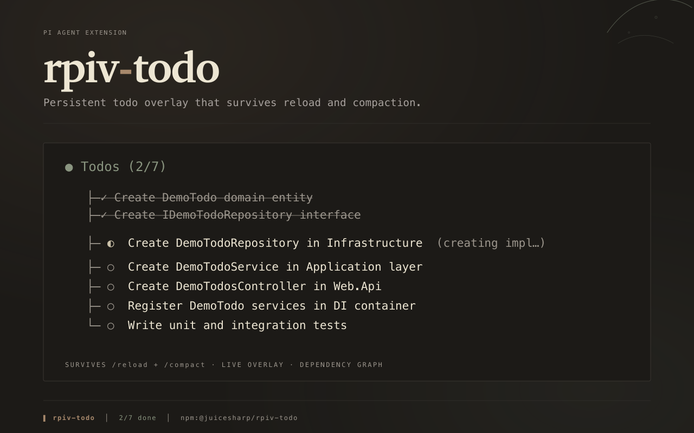
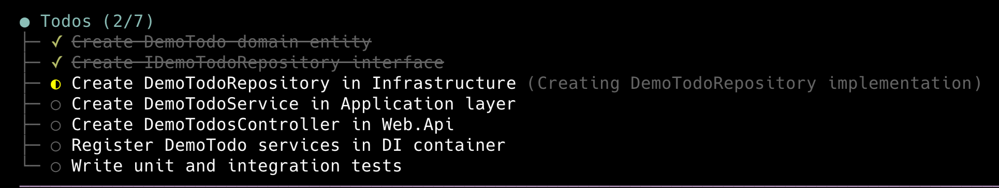

# @nredd/pi-todo

[](https://www.npmjs.com/package/@nredd/pi-todo)
[](https://opensource.org/licenses/MIT)

<div align="center">
  <a href="https://github.com/nredd/pi-harness/tree/main/packages/todo">
    
  </a>
</div>

Give the model a task list you can see. `pi-todo` adds a `todo` tool, a
`/todos` command, and a live panel above the editor to
[Pi Agent](https://github.com/badlogic/pi-mono), so you always know what the
agent is doing now, what it finished, and what is queued. The list is rebuilt
from the conversation itself, so it survives `/reload` and compaction — useful
on long research → design → implement sessions.

## Fork changes

Imported from [`juicesharp/rpiv-mono`](https://github.com/juicesharp/rpiv-mono/tree/main/packages/rpiv-todo)
`packages/rpiv-todo` at fork commit `9a4e2e8` (`nredd/rpiv-todo`). Source, tests and docs are
based on that snapshot, with the workspace's injected-home seams and standalone test
support described below. Retained packaging deltas:

- Renamed to `@nredd/pi-todo`; `repository`, `homepage`, `bugs` and the doc/license links point at
  `nredd/pi-harness/packages/todo`. Links that credit upstream stay on `juicesharp/rpiv-mono`
- `author` dropped from `package.json`; the retained upstream MIT `LICENSE` carries attribution
- `@juicesharp/rpiv-i18n` is a hard `dependency` (`^2.13.9`), not an optional peer, and
  `peerDependenciesMeta` is removed. The English-only fallback in `state/i18n-bridge.ts` is kept
  but unreachable in a normal install; only its comments changed to say so
- `pi.image` points at `docs/cover.png` in this repository. The file is not packed
  (`!docs/*.png`); the URL resolves once the package is on `main`
- The persisted config path stays `~/.config/rpiv-todo/` and the i18n namespace stays
  `@juicesharp/rpiv-todo`, for compatibility with existing configs and sessions
- There is no nested `package-lock.json`: the root workspace lock governs (`npm ci --ignore-scripts`).
  The packed contract `npm install`s the tarball into an empty consumer, resolving from the registry,
  and audits that fresh install

## In-process home injection

The default extension entry accepts `registerTodo(pi, importOverlay?, options?: { homeDir?: string })`.
An embedder can call `registerTodo(pi, undefined, { homeDir: "/temporary/home" })` to bind config,
guidance, shortcut, resume and overlay reads to that home without changing `HOME`.
Omitting `homeDir` keeps the call-time `os.homedir()` default. An absolute `XDG_CONFIG_HOME`
still overrides the config directory; if its file is missing, the legacy fallback uses
`<homeDir>/.config/rpiv-todo/config.json`. This is an in-process dependency, not a new
user setting, and it does not write or migrate config files. `importOverlay` retains its
existing optional lazy-loader seam.

## Verification

The workspace gate (from the repository root, or standalone in this directory):

```sh
npm ci --ignore-scripts
# Put Bun 1.4.4 (see .bun-version) on PATH.
npm run check
```

`check` runs Biome, strict TypeScript, and all 408 Vitest tests (including every
upstream test) on both Node and Bun. The two real interactive settled-row regressions
run inside that same suite on both engines. The test host
pins core `v1.3.0-nredd.8` release tarballs. Unpublished upstream mock helpers
are vendored under `.test-support/`; provenance and test counts are documented
[here](.test-support/README.md). Tests inject temporary homes and use faux providers, never
a pi process or credentials. The measured line/function coverage and mutation receipts
are documented [here](docs/coverage-closure.md); coverage policy remains separate.

Settled update/delete rows with a valid result snapshot retain that historical
subject. Legacy/error rows without one still read the live store and now call
`context.invalidate()` on foreground state changes, including replay and eviction.
Weak subscriptions avoid retaining discarded rows; render probes have no effects.

## Install

```sh
pi install npm:@nredd/pi-todo
```

Restart your Pi session.

## Quick start

Run `/todos` after the restart to confirm the extension is loaded. On a fresh
session it prints:

```
No todos yet. Ask the agent to add some!
```

Then ask for something with several steps — "add a repository layer with tests,
and track it as todos". The model calls `todo` and the panel appears above your
input box, updating as work moves:



Click the heading's `▾`/`▸` marker to collapse or expand the panel. The
`ctrl+shift+t` shortcut does the same thing. Resuming a session starts the panel collapsed (`collapseOnResume`). Run `/todos` at any time to print
the full list grouped by status.

## What you get

- **The plan stays on screen.** A panel above the editor shows every task with a
  status glyph, the label of whatever is in progress, and a `Todos (done/total)`
  heading — you never have to ask the agent where it is.
- **Tasks survive `/reload` and compaction.** Every change records the full
  post-mutation snapshot on the session branch, including changes made from a
  codemode script, and the list is replayed from there. No disk writes, nothing
  to lose.
- **Finished work gets out of the way.** Completed rows stay visible for the rest
  of the turn, then drop at the start of the next one; the panel disappears
  entirely when the list empties.
- **The overlay never eats your terminal.** Past the row budget it becomes a
  window over the whole list: scroll it with the mouse wheel, and `↑ N above` /
  `↓ N below` hints say what is out of view. Nothing is ever hidden.
- **Task status reflects actual work.** Mark every started task `in_progress`,
  including parallel work; assign `owner` to identify each worker. The owner shows
  on the row as `@auth-audit`; when it names a top-level subagent of this session
  (from [`pi-subagents`](https://github.com/nredd/pi-harness/tree/main/packages/subagents#events)
  lifecycle events, per the [owner match rule](./docs/overlay.md#owner-match-rule))
  the row also shows that agent's live state, `queued`, `running`, `done`, `failed` or
  `stopped`. An
  `in_progress` todo whose agent failed or stopped is marked `✗ failed` or `✗ stopped`; the todo
  stays `in_progress` until the parent completes it with evidence. Complete each
  verified task immediately. Atomic batches may record independently verified
  results together, but must not delay individual completions. There is no
  global single-active-task limit. Plan text, completion evidence, and deferral
  reasons remain protected.
- **Requested changes cannot silently disappear.** Action-inapplicable fields
  reject the call, including an entire `ops` batch. `create` always starts
  `pending`; use an explicit `update` with its id to change status. Dependency
  updates use `addBlockedBy` / `removeBlockedBy`, never `blockedBy`.
- **The agent can sequence work, not just list it.** `blockedBy` dependencies are
  validated before anything is written — dangling ids, deleted dependencies,
  self-blocks, and cycles are all rejected.
- **An approved plan becomes the list, verbatim (nredd fork).** With
  [`pi-plan-mode`](https://github.com/nredd/pi-plan-mode), approving a plan seeds
  one todo per actionable bullet, copied word for word and tagged `[plan]`;
  context sections (`Summary`, `Not adopted`, `Assumptions`, ...) are skipped.
  Approved text cannot be edited and plan items cannot be deleted; activity
  labels, ownership, dependencies, and metadata remain editable. A revised
  approved plan replaces them. Status and evidence carry forward only for an
  unambiguous unchanged item, identified by its full heading path and work text.
  Legacy items without that identity restart pending on their next reapproval.
  See [reconciliation and migration](./docs/plan-reconciliation.md).
  The heading shows `N/M plan items open`.
- **Done needs proof (nredd fork).** `completed` requires an `evidence` string
  (command + result, commit, test name); `deferred` requires a `reason`, and
  the user is notified when a plan item is deferred. Batches notify only final
  deferrals, while each operation reports its own outcome and reason. See
  [batch outcomes](./docs/batch-outcomes.md). If a run tries to finish with plan
  items open, the model gets one reminder listing them before it can wrap up.
  Outside Plan mode, a run that settles with `in_progress` todos also reports them
  (`agent_settled` in `plan-hooks.ts`), grouped by why each is still open: `owner agent failed
  or stopped` (all named), `owner agent not found after resume`, `agent running for another session`, `held by the parent`, `agent running without a completion notice`, `blocked` and `agent running`, three per group
  then a count. `agent running` includes an owner agent still `queued`. `blocked` means a live
  `blockedBy` dependency: one `in_progress` whose owner agent has not failed or stopped, or one
  `pending` whose owner agent is running or queued with a verified completion notice. A todo is `held by the
  parent` when it has no owner, a free-text owner, an agent that finished without the todo being
  completed, or open blockers that are all dead (`deferred`, unowned `pending`, or abandoned), shown
  as e.g. `(by #3 deferred)`. Each displayed todo names its owner even when no agent state is known,
  alongside any blocker details, e.g. `(@release-team; by #3 deferred)`. An `Agent`-tool background spawn or resume is heard at `subagents:created`, so
  it counts as running while still queued; spawns that skip `created` (cross-extension RPC, the
  scheduler, `@handle`) are first heard at `subagents:started` and read `held` until then (or at `subagents:failed`, as `stopped`, if stopped while still queued). Its armed clause, `armed:
  no todo-owned wake (monitor and agent notices list session wakes)`, says only that todos arm
  nothing themselves; the `subagents` and `session-kit` monitor notices say what does wake the
  parent. Only a lifecycle event explicitly confirming an agent completion notice makes that owner a verified wake; foreground, silent RPC and older unknown agents warn on every settle. Abandoned, lost or silent work, and parent-held work while nothing is armed (below), is a warning repeated on every settle, so a stop with
  owned work pending and nothing to wake the parent is never silent. When every todo waits on a running agent or a live dependency
  it is info, shown once: a settle that changes no todo's group, owner, owner agent state, wake eligibility or blocker identity, status, owner or owner agent state
  repeats nothing until the next prompt from a person. Todo status never changes on its own, e.g.
  `Run ended with 2 in_progress todos, armed: no todo-owned wake (monitor and agent notices list session wakes); owner agent failed or stopped: #3 Audit auth (@auth-audit failed); held by the parent: #6 Deploy`.
  After a process restart (`session_start` reason `startup`), an `in_progress` todo whose `owner` was already set when the session started and
  that no `subagents` event has named since is `owner agent not found after resume` (warning, every
  settle, all named): children die with the process, so it is not parent-held. `/new`, `/resume`,
  `/fork` and `/reload` are not that boundary: pi-subagents detaches still-running background agents.
  On every `session_start`, and on `subagents:announce_survivors` (which this extension sends once the session is bound and again
  at every settle), pi-subagents announces ALL running detached survivors in the process. Those registered under this session's
  file (after `/reload`, or a `/resume` back into the session that spawned them) arrive as `subagents:started` and are `running` and
  armed, with `subagents:completed` / `:failed` replayed when their results are delivered. Every other one arrives as `subagents:other_session_survivor` with the `sessionFile` it wakes: its result
  spools there, not here. Only one registered under a file this session was forked from (its header's `parentSession`, then that
  file's own, so a `/fork`, a fork of a fork, or a `/reload` in either) makes a todo it owns read
  `agent running for another session, which it wakes instead of this one` (info, once); it is never armed here and never triggers the
  held-work reminder. Handles are per manager, so a same-named survivor of an unrelated session (`/new`, `/resume` of another session)
  proves nothing about this owner: that todo is `held` (or lost) and reminds as usual. A repeated `started` for an agent already
  running with the same identity changes nothing, so re-announcing a survivor never outranks a newer same-named agent. The set is rebuilt from each announcement, so a `/reload` loses nothing and a survivor that finished
  (even while this session was inactive) drops out at the next settle. An owner nobody names is `held`, never lost. A free-text owner (a person or team) is indistinguishable from a dead
  agent handle, so it lands there too until it is reassigned. Parent-held work warns only when nothing
  is armed: a running monitor (`session-kit:monitor:started` / `:stopped` on `pi.events`, payload
  `{ sessionId, id, name }`) or a background agent with a verified completion notice makes it an info
  report, shown once like the other waiting groups. Abandoned, lost and silent work always warn.
  When todos are held or lost and nothing is armed, nothing can wake the parent, so `agent_before_settle`
  appends one hidden `rpiv-todo-held-reminder` and requests one more request, once per prompt from a
  person (a plan reminder is independent). The `context` hook swaps the live list for the marker on that
  request only, like the plan reminder; it fires only if the todos are still held and unarmed then.
  Reminders pause while Plan mode is active; old approved todos remain until a
  replacement is approved. Exiting planning without approval resumes the old
  obligations. Details in the
  [tool reference](./docs/tool-schema.md#plan-items).
- **Parallel sessions stay separate.** Task state is keyed by session, so a
  detached or child session can neither read nor overwrite the foreground list.
  Stale shutdowns use captured session identity and never assume ownership of
  the foreground. Replay skips malformed snapshots rather than replacing valid
  tasks, while accepting valid historical tasks without newer evidence fields.
  Owner agent state is display-only: a subagent never reads or writes the
  parent's list, and only the parent completes its todo. Without `pi-subagents`
  owners render without a state. An evicted agent keeps its last known state for
  the rest of the session, until 256 more recently updated agents push it out;
  agents are tracked per session, so after `/new` or
  `/resume` a todo never shows another session's agent.
- **Historical rows keep their own subjects.** Settled calls render from their
  validated result snapshots, not the current task list, including after reload
  and resize. Live owner agent state appears only on the overlay and `/todos`,
  never in a tool result or a settled row. Partial results and renderer probes do not change cached history.
- **Localized UI, no setup required.** Nine locales ship with the package and are
  served by [`@juicesharp/rpiv-i18n`](https://www.npmjs.com/package/@juicesharp/rpiv-i18n),
  a regular dependency.

## Configuration

Optional. Create `~/.config/rpiv-todo/config.json` (or
`$XDG_CONFIG_HOME/rpiv-todo/config.json` if you set that variable):

```json
{
  "maxWidgetLines": 8,
  "collapseKey": "alt+t"
}
```

| Setting | What it does | Default |
| --- | --- | --- |
| `maxWidgetLines` | Content rows the overlay may use, heading included. Minimum `3`. Applies on the next repaint. Pi's tool-output expansion mode shows all tasks. | `12` |
| `collapseKey` | Key that collapses and expands the panel, in Pi keybinding form (`alt+o`, `ctrl+shift+t`). Set `"off"` to register no shortcut. Needs `/reload` to rebind. | `"ctrl+shift+t"` |
| `collapseOnResume` | Start the panel collapsed when a session is resumed. Set `false` to keep it expanded. Read at each session start. | `true` |
| `guidance` | Replaces the built-in instructions the extension gives the model about when and how to use the todo list. Needs `/reload`. | _(built-ins)_ |

A missing or malformed file falls back to these defaults. `pi-todo` only reads
this file — it never writes one. Full semantics:
[Configuration](https://github.com/nredd/pi-harness/blob/main/packages/todo/docs/configuration.md).

## Reference

- [`todo` tool reference](https://github.com/nredd/pi-harness/blob/main/packages/todo/docs/tool-schema.md)
  — every `todo` parameter, the status machine, the response envelope, and the
  exact error strings.
- [Configuration](https://github.com/nredd/pi-harness/blob/main/packages/todo/docs/configuration.md)
  — config file resolution, option validation rules, and the accepted keybinding
  grammar.
- [Overlay and `/todos`](https://github.com/nredd/pi-harness/blob/main/packages/todo/docs/overlay.md)
  — overlay lifecycle, glyphs, overflow behavior, `/todos` output, and
  localization.

## Requirements

- A Pi Agent host. No API key, no model selection, no native dependencies.
- An interactive session for the panel and `/todos`. Headless runs still get the
  `todo` tool; nothing is rendered.
- [`@juicesharp/rpiv-i18n`](https://www.npmjs.com/package/@juicesharp/rpiv-i18n)
  and `@juicesharp/rpiv-config` install automatically as dependencies.

## Related

- [`@juicesharp/rpiv-i18n`](https://www.npmjs.com/package/@juicesharp/rpiv-i18n)
  ([source](https://github.com/juicesharp/rpiv-mono/tree/main/packages/rpiv-i18n))
  — localizes this extension's UI chrome and adds a `/languages` picker.
- [`@juicesharp/rpiv-pi`](https://www.npmjs.com/package/@juicesharp/rpiv-pi)
  ([source](https://github.com/juicesharp/rpiv-mono/tree/main/packages/rpiv-pi))
  — the umbrella package that installs this extension alongside its siblings.

## License

MIT, retained from upstream -- see [LICENSE](https://github.com/nredd/pi-harness/blob/main/packages/todo/LICENSE).
